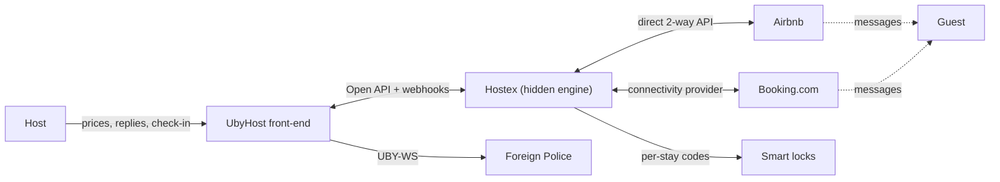

# UbyHost × Hostex — Integration & Launch Plan

*Execution playbook for the Hostex partnership: sync integration, the Kompletně product, the white-label front-end, runbooks and ready-to-send artifacts. Companion to the "UbyHost — Pricing Strategy" canvas (pricing rules, tiers and unit economics live there). All Hostex facts verified October 2026 against api-doc.hostex.io and the Hostex support thread (Alex + Airi Assistant).*

## 1. Status at a glance

| Item | Status |
|---|---|
| Hostex contact thread (Alex, Airi) | active — technical questions answered |
| Manual on-behalf setup (before OAuth) | ✅ authorized by Hostex (Alex) |
| OAuth partner credentials | ⬜ not yet requested — draft email ready in §10 |
| Partnership application form | ⬜ not yet submitted — asks defined in §8 |
| Dev/test Hostex account | ⬜ create trial account, generate simple Access Token — needs no approval |
| Integration code | ⬜ not started — Phase A spec in §6 |
| Pricing for Kompletně (~390 Kč indicative) | pending wholesale rate — ask in §8 |

## 2. The two product lines

| | **UbyHost (core)** | **UbyHost Kompletně** |
|---|---|---|
| Price | 129 Kč/unit/mo (annual −20 % ≈ 99; volume 5–9 → 99, 10+ → 79) | ~390 Kč/unit/mo indicative (annual −20 %), pending wholesale Hostex rate |
| Customer sees | UbyHost compliance app | UbyHost only — Hostex is invisible plumbing |
| Hostex | host owns their own account, connects via OAuth ("Connect Hostex", ~6 clicks) | per-customer hidden Hostex account; UbyHost holds credentials |
| Channels | iCal standalone, or their own Hostex sync | Airbnb + Booking.com two-way, operated by UbyHost |
| Smart locks | native TTLock add-on +49 Kč standalone; **lock-code passthrough free if Hostex-connected** | included via Hostex's TTLock integration — zero UbyHost TTLock calls |
| Money flow | customer pays UbyHost; host pays Hostex directly | **customer pays UbyHost; UbyHost pays Hostex** (reseller; margin depends on wholesale rate) |
| Who it's for | price-sensitive, self-serve | hands-off hosts; PMs; upsell from core |

Rule: Kompletně is a second SKU, not a tier — the 129 Kč core stays untouched and clean.

## 3. Verified Hostex facts (Oct 2026)

### Authentication
- **Simple Access Token**: Host Portal → OpenAPI Settings → "+ Add new" → copy → paste into UbyHost. No approval. Use for development and the interim manual phase.
- **OAuth 2.0 required for software partners** (SaaS acting on behalf of users). Request by email to **contact@hostex.io**: product name, description, OAuth redirect URL, square PNG logo → Client ID + Secret after approval.
- One host = one account = one authorization. **No shared key for many customers; no partner console** (Group Company multi-account access exists but is explicitly not a partner console).
- Disconnect: host can revoke from hostex.io/app/api/authorized-apps → Hostex deletes our app-owned webhooks and fires a final `authorization_revoked` event.

### Rate limits (per account — non-binding for us)
1,200 req/min · 6,000/10 min · 20,000/hour · 100,000/day · endpoint-specific limits exist · max 5 webhook endpoints per account (we need 1). Since each customer authorizes separately, every host gets this allowance individually.

### Reservation payload (GET /reservations)
`guest_email`, `guest_phone`, `guest_name` (all nullable, channel-dependent), **per-guest country code (ISO 3166-1 alpha-2 — flag foreign-guest obligations before check-in opens)**, `number_of_guests`, dates, `channel_type`, `status`, arrival/departure times, `lock_code`, `lock_code_visible_after`, deposit details. No nationality field (collected at guest check-in, as designed). Nullable guest e-mail → keep the claim flow as fallback.

### Webhooks (harsh contract)
- Events: `reservation_created`, `reservation_updated`, `property_availability_updated`, `listing_calendar_updated`, `message_created`, `review_created`, `review_updated` (+ lifecycle `authorization_revoked`).
- 3 s connect / 5 s total timeout · **max 3 immediate retries · no replay — dropped events are gone forever** · **any HTTP response counts as delivered, incl. 4xx/5xx** · duplicates possible · failing endpoints get paused.
- Webhook payloads are intentionally minimal — after each event, fetch the full reservation via API.
- Secret per webhook record, shown **once**; verify `Hostex-Webhook-Secret-Token` header; don't IP-allowlist (retries come from different IPs).

### What the API cannot do
- Cannot create/authorize OTA channel connections (Airbnb/Booking auth happens in the channel's own flow).
- **No lock endpoints at all** — TTLock account connection and lock-property linking are manual, in the Hostex Host Portal (WorkPlace → smart lock account → link locks in Check-in Guide settings). One-time step per customer.
- The API *can write* `lock_code` onto a stay via Update Check-in Details (display-only, no TTLock operation) → reverse passthrough (see §5).

### Channel connection gotchas (onboarding SOP)
- **Airbnb**: main host account only (co-host accounts rejected); API connections use **Host Only Fee** model; **Instant Book enabled by default**; dates closed before connecting must be re-closed manually in Hostex.
- **Booking.com**: needs account e-mail/username + Hotel IDs; Hostex must be set as **connectivity provider in the extranet** by an authorized person; **connection clears previous pricing setup — re-set prices in Hostex immediately**.

### Smart locks
Hostex supports all TTLock-compatible locks; paired locks **auto-generate a code per reservation 3 days before check-in**; code surfaces as `lock_code` in the API. A POA is not part of the flow and does not replace channel authorization.

## 4. Architecture decisions

1. **Per-customer hidden Hostex accounts — never one central account.** GDPR isolation; clean exit (contract: account handover on cancellation — sellable, not scary); OAuth later = internal one-click per account. Central account rejected: forced re-authorization of every customer, no isolation, Hostex billing dragged onto us.
2. **The only un-hideable step:** one-time channel authorization — customer types credentials into Airbnb's / Booking.com's own screen (never sees Hostex), 10 minutes on a setup call. After that they never log into anything.
3. **Adapter pattern.** Build the front-end and sync against internal domain models (`Listing`, `PriceUpdate`, `Conversation`) with a thin Hostex adapter. Hostex is a vendor-concentration risk; the adapter keeps the backend swappable. The compliance core already survives without Hostex — the front-end must too.
4. **Storage: existing SQLite on Lightsail, app-level encrypted (AES-256-GCM, key from env). No Supabase / no new datastore** — second vendor + failure domain for zero gain, and it contradicts the privacy-first "everything on our server" brand.
   - App layer (`hostex_connections` table): `account_id` (from `GET /accounts/me`), access/refresh token (encrypted), token_expires_at, webhook_id, webhook_secret (encrypted), status, last_sync_at, last_error. Apartments carry `hostex_property_id` (1:1 mapping). On `authorization_revoked`: null tokens, keep the row for audit.
   - Ops layer: Kompletně hidden-account *login* passwords → password manager only, never the app (a DB breach exposes expirable tokens, not reusable logins).
   - Backup rule: DB snapshot and encryption key must be recoverable independently (key also in the password manager). A snapshot without its key = re-authorize every customer by hand.
5. **Poll-first.** v1 sync uses 15–30-min polling; with 1,200 req/min per account it's effectively free and the 3-working-day legal deadline needs minutes, not real-time. Webhooks are a refinement, not a requirement.
6. **One-channel rules (per apartment, both directions):** guest receives the lock code through exactly one surface (UbyHost page XOR Hostex automated messages); guest is messaged by one system per topic (Kompletně: Hostex owns the channel inbox, UbyHost owns check-in/compliance e-mail). Never double-send.

## 5. Smart locks via Hostex

- **Passthrough (Kompletně + Hostex-connected core):** connect customer's TTLock account to Hostex during setup (~2 min) → Hostex generates every per-stay code → UbyHost reads `lock_code` from the reservation and shows it in its own check-in flow (code + police registration + rules on one page — better UX than Hostex's own guide). Zero UbyHost TTLock API calls, zero lock support surface.
- **Timing:** `lock_code` is null until 3 days before check-in — fetch on demand / next poll; hide the code block until it exists; **honor `lock_code_visible_after`**.
- **Lock mode per apartment:** `hostex` (passthrough) vs `native` (own TTLock integration, for standalone hosts). Auto-switch to `hostex` when the apartment syncs from Hostex. **Never let both systems generate PINs for the same lock.**
- **Migration drain rule (native → hostex, e.g. Kompletně upgrade):** nothing transfers physically — same locks, same TTLock account; only the PIN generator changes. At cutover set mode `native` → `hostex` with the boundary drawn at **reservations, not dates**: stays created before cutover keep their UbyHost PIN (no deletion, no re-send; expires after checkout as usual); reservations created after get Hostex codes. UbyHost stops generating at the mode switch — that alone prevents double PINs. Edge: stays < 3 days from check-in at cutover stay native (or manual code in Hostex); verify with Hostex whether in-window reservations get backfilled. Guest page is source-agnostic — guests never notice. Same drain logic works in reverse on Kompletně exit.
- **Reverse passthrough:** for `native`-mode stays under a Hostex host, push the generated PIN into the Hostex stay via Update Check-in Details so the host's Hostex inbox/automated messages show the correct code; also usable for fixed digital-lock codes.

## 6. Build phases & effort

| Phase | Scope | Effort | Gate / dependency |
|---|---|---|---|
| **A. Sync MVP (polling only)** | Token vault · property import + mapping UI (1 Hostex property = 1 UbyHost apartment/IDUB) · 15–30-min reservations poller in the existing worker queue (TTLock-job pattern) · guest routing (`guest_email` → check-in link; null → claim flow; country code → foreign-guest flag) · lock-code passthrough + mode switch · sync-status page per apartment | ~2–3 weeks part-time | none — start now with a simple token from own trial account |
| **B. Webhooks** | Receiver: verify secret, ack 2xx < 5 s, enqueue, process async, idempotent on `event_id` · fetch full reservation after each minimal event · auto-register webhook on connect · poller demoted to 6-h reconciliation | ~1 week | after Phase A proves sync logic |
| **C. OAuth self-serve** | "Connect Hostex" button (auth-code flow, refresh rotation, `GET /accounts/me`) · `authorization_revoked` handling · token vault for many accounts | 1–2 weeks + Hostex approval latency | OAuth request email (§10) — send early, it's their clock |
| **FE-1. Front-end read-only** | Calendar view, reservations, unified inbox (list + threads) — Kompletně exclusive | ~2–3 weeks | Phase A/B data |
| **FE-2. Front-end write surfaces** | Price/availability/restriction editing (`Update Listing Prices/Inventories/Restrictions` — async: success = task started, optimistic UI confirmed via `listing_calendar_updated`) · inbox reply (`Send Message` — **not idempotent, no message ID: never auto-retry**) | ~2–3 weeks | **partnership form must confirm white-label wrapper is permitted (§8) before this investment** |
| **Leon in the reply box** | "Leon navrhne odpověď" — compliance-aware draft (registration status, missing-data nudges, lock code, arrival logistics), human approves | ~1 week | after FE-2; distinct from Hostex's HostGPT — if differentiation proves thin, skip |
| **Kompletně ops** | Zero new code (rides Phase A token mechanism; you paste the hidden account's token) · credential vault + SOP call script (§7) | ops, not code | sellable the day Phase A ships |

Edge cases to handle in Phase A: `property_id = 0` (unallocated — skip + alert), multi-stay reservations (`stay_code` suffix), cancellations mid-flow, nullable `guest_email`.

**Guardrails (never build):** no channel-manager build (Airbnb Preferred Partner / Booking connectivity-provider BD tolls are Hostex's, building one = 2–4 person-years + competing with our partner), no guest-inbox build (transactional SES messaging stays ours; channel replies ride Hostex's conversations API). The front-end above is a re-skin over Hostex's API, not a build.

## 7. Runbooks

### Kompletně setup call (~15 min, screen-share, customer watches)
1. Create the customer's Hostex account together (you drive; you hold the credentials).
2. Connected Accounts → Connect an account → channel: **customer** completes the channel's own authorization (Airbnb: log in, tick listings, approve; Booking.com: you enter username + Hotel IDs, they set Hostex as connectivity provider in the extranet). They see the channel's screen, never Hostex.
3. "Link my listings" — match each OTA listing to the Hostex property/room type; save.
4. Gotchas: review Instant Book (on by default), Host Only Fee pricing shift, re-close previously closed dates; re-set Booking.com prices immediately after connection.
5. Smart locks (~2 min): WorkPlace → add TTLock account → link each lock to its property in Check-in Guide settings. If migrating from native UbyHost TTLock: apply the drain rule (§5).
6. Customer generates the Access Token in OpenAPI settings → paste into UbyHost (or you do, as account operator).
7. Verify: one upcoming reservation syncs; `lock_code` flow understood; guest check-in link fires for a reservation with an e-mail.
8. Set the apartment lock mode + code-delivery surface + messaging surface (one-channel rules, §4.6). Send confirmation: "Kanály připojeny."

*Pitch line: "Jedna appka pro ceny, kalendář, zprávy i hlášení cizinců — a jediné, co jste kdy museli udělat, bylo jednorázové přihlášení k Airbnb."*

### Core (self-serve, after OAuth ships)
Host clicks "Connect Hostex" in UbyHost → logs into Hostex → approves → mapping UI → done. Docs page: "Using TTLock with Hostex? Connect it under WorkPlace → Smart Locks and UbyHost picks up the code automatically." Free lock passthrough for Hostex-connected; +49 Kč add-on only for standalone hosts.

### Exit (Kompletně cancellation)
Contract clause: account handover — the customer keeps their Hostex account, channels, history. Flip lock mode `hostex` → `native` (drain rule). Position it as engineered, not punished.

## 8. Partnership asks & open questions

**Partnership form — three asks, in priority order:**
1. **White-label front-end permission** (gates FE-2): "UbyHost's customer interface is our own front-end consuming the Open API; Hostex remains the operating backend. We drive full-stack subscriptions to Hostex."
2. **Wholesale/reseller pricing** (gates Kompletně margin): "We pay you for every unit we sell, at scale, every month" — anchor 25–30 % off list; at Hostex retail (~$7/property ≈ 160 Kč/unit COGS) Kompletně at 390 carries ~45–55 % gross margin; wholesale adds ~10 pts. Also ask: multi-account agency billing / per-account minimums.
3. **Integrations Directory listing** — sit alongside PriceLabs, Rategenie, TurnOver, STRLY, VRTrust as the Czech-compliance integration.
   Distribution argument for all three: every new UbyHost customer without a PMS is a new Hostex subscription; we are effectively your channel for Czech STR — a market where Hostex has little local presence.

**Open technical questions:**
- Do lock codes backfill for reservations already inside the 3-day window at connection time?
- Webhook availability on trial accounts during development?
- Password format rules per lock (configured in Hostex settings — document in SOP so setup calls stay 15 min).

## 9. Risks & mitigations

| Risk | Mitigation |
|---|---|
| Vendor concentration (whole PMS layer = Hostex) | adapter pattern; compliance core independent; front-end built against internal models |
| Partnership rejected / terms unfavorable | core survives on iCal — nothing load-bearing on Hostex; Kompletně paused, not broken |
| Double-booking / price errors are ours in Kompletně | contract scope clause (channel management per documented settings, host approves pricing rules); gotchas = internal SOPs |
| `Send Message` non-idempotent (timeout = unknown outcome) | never auto-retry; optimistic UI without blind resend |
| Dropped webhooks (no replay) | 6-h reconciliation poller is permanent, not optional — legal-deadline product |
| HostGPT overlap weakens Leon-in-inbox | Leon = compliance-aware; if thin, keep Leon on own surfaces only |
| Hostex API schema drift | they warn payloads change — parse and ignore unknown fields; adapter absorbs |
| Channel-auth friction at setup | it's the customer's own Airbnb/Booking screen; never take passwords; POA doesn't replace it |

## 10. Ready-to-send artifacts

### OAuth application email → contact@hostex.io
> **Subject: OAuth application — UbyHost (Czech compliance integration)**
>
> Hi Alex,
>
> Following up on our thread — we're ready to formalize the integration. Requesting OAuth access per your docs:
>
> - **Product name:** UbyHost
> - **Description:** Czech compliance automation for short-term-rental hosts — automatic reporting of foreign guests to the Czech Foreign Police via UbyPort (direct web service, official receipt archived as proof), digital house book, duplicate-submission protection, and local stay-fee reports. We integrate Hostex as the PMS layer: sync properties and reservations via your Open API, subscribe to reservation webhooks, and route guests into online check-in using the contact details in the reservation payload.
> - **OAuth redirect URL:** `https://ubyhost.com/api/hostex/callback` *(confirm actual endpoint)*
> - **Logo:** attached, square PNG
>
> Two remaining questions: API rate limits (per connected account or per app?), and whether webhooks are available on trial accounts during development.
>
> Best regards,
> Josef Pechar, UbyHost

*(Rate limits now answered — keep the trial-webhook question. Send early: approval latency is Hostex's clock, and it gates Phase C.)*

### Partnership form content (structure)
1. Who we are: compliance platform, direct UbyPort integration, doručenka + XML proof archive, duplicate protection, house book, stay fees. Fines to 50,000 Kč → mandatory purchase for every Czech host.
2. What we ask: white-label front-end permission (§8.1); wholesale/reseller pricing (§8.2); directory listing (§8.3).
3. The distribution argument: every UbyHost customer without a PMS is a new Hostex subscription; compound growth; Czech market access.
4. Complement-not-compete: Hostex stays PMS + channel manager; UbyHost is the government-reporting engine on top.
5. Technical scope: OAuth app, reservation/calendar sync, webhooks, conversations API (Leon drafts), lock-code passthrough.

### Already sent / in flight
- Hostex thread with Alex + Airi: connection mechanics, account model, channel requirements, lock behavior — all answered (facts in §3).
- Airi offered to draft the client-facing onboarding checklist — reply specifies the per-customer model, customer's two personal steps, and the four gotchas to include. Turn her version into a Czech client-facing onboarding e-mail once received.

## 11. References

- Hostex Open API docs: api-doc.hostex.io/reference/overview (index: api-doc.hostex.io/llms.txt — append .md to any page for markdown; MCP server + llms.txt built in — Hostex is AI-forward)
- Webhooks guide: api-doc.hostex.io/reference/webhook-useage-guide
- Locks: hostex.io/help/door-lock-code · hostex.io/help/integrate-smart-lock-systems · hostex.io/smart-locks-integration
- OAuth: api-doc.hostex.io/reference/how-to-request-oauth-access
- General setup: hostex.io/help/openapi · hostex.io/help/webhooks
- Police credential process: reguby@pcr.cz or databox ybndqw9 (UBY-WS account per IDUB)
- Pricing rules, tiers, unit economics: see the "UbyHost — Pricing Strategy" canvas

---

*Prepared for Josef Pechar · UbyHost (ubyhost.com) · verified October 2026.*