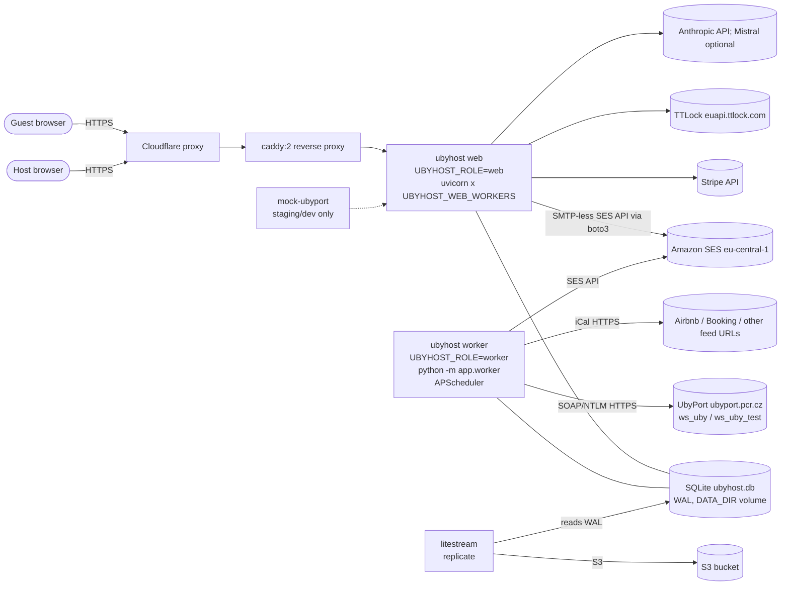

# Architecture

Verified against the repository at the current revision. Every claim cites a
file; `⚠️ UNKNOWN` marks what the repo cannot establish.

## Topology (production, `deploy/lightsail/docker-compose.yml`)

Sources: services and roles — `deploy/lightsail/docker-compose.yml` (`ubyhost`
line ~14–24 `UBYHOST_ROLE: web`; `worker` line ~60–70 `UBYHOST_ROLE: worker`,
`command: python -m app.worker`; `litestream` ~line 108; `caddy` ~line 168);
UbyPort URLs — `App/app/config.py:135-136`; SES region — `App/app/config.py:315`;
TTLock — `App/app/config.py:169`; Stripe — `App/app/stripe_connect.py` (imports
`stripe`); AI — `App/app/ai.py:129-131`, `App/app/config.py:352-355`.

**Not in the topology:** no Redis, no message broker, no Postgres, no
object-storage upload path in application code (`boto3` is used only in
`App/app/mail.py`), no Celery/RQ/Dramatiq/arq/Huey/River (checked in
`App/requirements.lock`, compose, and `App/app`).

> ⚠️ UNKNOWN — needs human input: the Lightsail instance size is documented as 8 GB / 2 vCPU in `Dockerfile` comments and `docs/LIGHTSAIL.md` (section "Recommended Lightsail plan"); confirm the live instance and region in the AWS console.

## Roles and processes

| Process | Image/command | Role env | Starts scheduler? | Source |
|---|---|---|---|---|
| web | `uvicorn app.main:app --workers $UBYHOST_WEB_WORKERS --no-access-log` | `UBYHOST_ROLE=web` | No | `Dockerfile` CMD; `App/app/main.py:158-159` |
| worker | `python -m app.worker` | `UBYHOST_ROLE=worker` | Yes (takes `DATA_DIR/scheduler.lock`) | `App/app/worker.py:1-30`, `:77` |
| all (local dev) | `App/run.sh` | `UBYHOST_ROLE=all` | Yes, in the web process | `App/run.sh:31-40`, `App/app/main.py:156-157` |
| litestream | `replicate -config /etc/litestream.yml` | — | n/a | `deploy/lightsail/docker-compose.yml` |

`UBYHOST_WEB_WORKERS` defaults to 2 (`Dockerfile`); the Dockerfile comment
says 4 on the 8 GB server (`Dockerfile` header comment). `docker-entrypoint.sh`
rejects values outside 1–16.

> Drift: `docs/OPERATIONS.md` ("Scheduled jobs") says the scheduler runs "in the web process". That is true only for `UBYHOST_ROLE=all`. Production uses the separate worker (`App/app/main.py:159` logs this explicitly). See [gap report](gap-report.md#inconsistencies).

## Components (one line each)

- `App/app/main.py` — FastAPI app, role gate, lifespan (starts/stops scheduler, closes DB connections), routers.
- `App/app/routes/` — HTTP routers (guest, admin, billing, exports, passkeys, …).
- `App/app/worker.py` — worker process, liveness file `worker.alive` every 30 s, exits 1 if scheduler dies.
- `App/app/scheduler.py` — 14 APScheduler jobs (see [Background jobs](#background-jobs)).
- `App/app/db.py` — all SQLite access, schema, migration runner, Fernet helpers.
- `App/app/reporting.py` — UbyPort submission sweep, batches, submit state.
- `App/app/ubyport/` — UbyPort SOAP/NTLM client, error table.
- `App/app/icalsync.py`, `App/app/feed_fetch.py` — iCal feed polling and fetch with size/redirect limits.
- `App/app/deadlines.py` — Czech public holidays and the 3-working-day deadline.
- `App/app/filing_watchdog.py` — read-only at-risk detection and host/operator alerts.
- `App/app/mail.py` — e-mail outbox (`email_outbox` table) and SES sending.
- `App/app/invoice_pdf.py`, `App/app/stay_fee_remittance_pdf.py` — reportlab PDFs.
- `App/app/doc_ocr.py` — Tesseract OCR via subprocess.
- `App/app/ai.py` — the single gateway to model APIs (per the file's own docstring).
- `App/app/retention.py`, `App/app/dsr.py` — retention schedule and data-subject requests.
- `App/mock_ubyport/server.py` — mock UbyPort SOAP service (state in `mock_state.json`).

## Background jobs

APScheduler 3.11.3 `BackgroundScheduler` in `Europe/Prague`, in-memory job store
(no jobstore configured), all jobs `max_instances=1, coalesce=True`
(`App/app/scheduler.py:495-569`; timezone `App/app/config.py:268`).

| Job id | Trigger | Function | Retry / idempotency |
|---|---|---|---|
| `ical` | every `UBYHOST_ICAL_POLL_MINUTES` (60) | `icalsync.sync_all` | `⚠️ UNKNOWN` internal retry (not read in full) |
| `submit` | every `UBYHOST_SUBMIT_SWEEP_MINUTES` (10) | `reporting.sweep` (`reporting.py:1993`) | lease `submission_claim` (`reporting.py:1330`); auto-retry cap `SUBMISSION_MAX_AUTO_ATTEMPTS=1` (`reporting.py:97`) |
| `deadlines` | every 30 min | `check_deadlines`, DSR alerts, `filing_watchdog.run` | read-only watchdog |
| `mail` | every 5 min | expire holds, `mail.drain`, reminders, purge | conditional `queued→sending` update (`mail.py:655-661`); backoff `min(6h, 60·2^n)`, FAILED at 8 attempts (`mail.py:684-693`) |
| `photo_sweep` | every 12 h | passport/guide photo purge, signup purge | — |
| `meta_capi` | every 10 min | `meta_capi.send_pending` | 8 attempts (`meta_capi.py:41`) |
| `retention` | cron 03:30 | `retention.run` | dry-run unless `UBYHOST_RETENTION_AUTOPURGE=1` |
| `stay_fee_mail` | cron 07:00 | `stay_fee_auto.run` | — |
| `stripe_sweep` | cron 04:15 | payment-request expiry, webhook dedupe | — |
| `billing` | cron 06:00 | `billing_jobs.run` | — |
| `billing_snapshot` | cron 06:15 | `billing_analytics.write_month_snapshot` | — |
| `door_codes` | every 1 min | door codes, cleaning codes | cleaning codes: 5 attempts (`cleaning_codes.py:156`) |
| `posthog` | every 15 min | `posthog_sync.sync` | — |
| `push` | every 1 min | `push.drain` | `⚠️ UNKNOWN` semantics not read |
| `guide_import` | every 1 min | guide import queue, merge | `⚠️ UNKNOWN` semantics not read |

Failure handling: each job body catches `Exception`, logs, and raises a
`job_failed` alert (severity critical for `submit` and `deadlines`, warning
otherwise; `App/app/scheduler.py:43-71`). A successful run resolves the alert
and writes `job_last_ok:<id>` (`scheduler.py:101-108`). Each run logs one
`job run job=<id> ok=<0|1> ms=<n>` line on logger `ubyhost.scheduler`
(`scheduler.py:111-128`).

Dead-man switches (healthchecks-style pings): `UBYHOST_HEARTBEAT_URL`,
`UBYHOST_HEARTBEAT_ICAL_URL`, `UBYHOST_HEARTBEAT_MAIL_URL`,
`UBYHOST_HEARTBEAT_FILING_URL` (`App/app/config.py:155-165`). Failed pings are
only logged (`scheduler.py:167-174`).

Queues are SQLite tables, not a broker: `email_outbox`, `ad_click` send state,
`cleaning_code`, guide import, push, webhook dedupe. Claims use
`db.update_if` conditional updates (`App/app/mail.py:660`). No
`SELECT … FOR UPDATE` or `SKIP LOCKED` exists in `App/app` (grep). Leases:
`submission_claim` (`App/app/db.py:355`), `reservation_claim` (`db.py:363`).
Request-scoped `BackgroundTasks` are used in `routes/exports.py`,
`routes/passkeys.py`, `routes/admin_accounts.py`; they are not a queue.

Job lifecycle detail and the admin Operations page: `docs/OPERATIONS.md`.

## Request flows

| Flow | Trigger | Sync or async | Where |
|---|---|---|---|
| Guest registration / claim | guest opens link; claim holds expire after 30 min | Sync (HTTP) for form and claim; e-mail reminders async | `App/app/claim.py:14-20` (claim holds — **not** UbyPort) |
| iCal sync | `ical` job, hourly by default; also a scoped sync from the host UI | Async | `App/app/icalsync.py`, `App/app/feed_fetch.py` (5 MB limit, 3 redirects: `feed_fetch.py:27-30`) |
| PDF generation | Invoice or remittance requested by host/admin | Sync in request (reportlab) | `App/app/invoice_pdf.py`, `App/app/stay_fee_remittance_pdf.py` |
| Police submission | `submit` sweep every 10 min, or a host/admin action | Async (sweep); `⚠️ UNKNOWN` whether any manual submit route bypasses the sweep | `App/app/reporting.py`, `App/app/ubyport/client.py` |

## Data model and tenancy

- Storage: one SQLite database, `DATA_DIR/ubyhost.db` (or `UBYHOST_DB`), WAL mode (`App/app/config.py:20-22`, `App/app/db.py:667-686`).
- Schema: base schema `db.SCHEMA` (migration `0001`, frozen) plus `App/app/migrations/0002_…` to `0033_admin_queue_index.sql` (32 files, `App/app/migrations/`).
- **Tenancy: shared schema, filtered by owner id in application code.** Access helpers take the logged-in owner and scope queries (`App/app/access.py:59` `owner_id(request)`; per-entity checks such as `access.py:67, 74, 103, 113, 122`). **No row-level security**: no `CREATE POLICY` or `ROW LEVEL` in migrations or `db.py` (grep). Isolation therefore depends on every query passing through the owner-scoped helpers.
  - Scoping uses `owner_user_id IS ?` (`App/app/db.py:1416`). With `owner=None` this also matches NULL-owner rows; legacy NULL owners are backfilled to the first user (`App/app/auth.py:779-782`). Whether NULL-owner rows survive in production is `⚠️ UNKNOWN`.
  - Route check (grep): 64 raw `WHERE id = ?` lookups in `App/app/routes/*.py`; only 10 have an `owner_user_id` clause within two lines. Example of an upstream check: `routes/admin.py:4265` (`access.guest`) guards the DELETE at `:4275`. The others were not each traced.
  - ⚠️ UNKNOWN — needs human input: a complete audit that every route query is owner-scoped. Do this before the migration.
- Encryption at rest for selected columns: Fernet via `cryptography` (`App/app/db.py:21`, `:1592-1700`); encrypted columns include `ENCRYPTED_GUEST_COLUMNS` and `submission.request_xml_enc` (`App/app/db.py:1734-1740`); blobs via `encrypt_blob`/`decrypt_blob` (`App/app/db.py:1745-1750`). Keys: `UBYHOST_DATA_KEYS` (first key encrypts); legacy key derived from the session secret unless `UBYHOST_DATA_KEY_LEGACY=0` (`App/app/db.py:1592-1607`).
- Retention: `App/app/retention.py` (per-field lines, the rule in `AGENTS.md` requires one line per new personal-data field), `UBYHOST_AUDIT_RETENTION_DAYS` 1095, `UBYHOST_ALERT_RETENTION_DAYS` 365 (`App/app/config.py:232-233`). Detail: [compliance](compliance.md).

## Migrations

- Tool: custom runner, **not Alembic** (`App/app/db.py:1124-1260`). Files: `App/app/migrations/NNNN_*.sql`, applied in order, recorded in table `schema_migrations` (`db.py:1136`). A failing file leaves nothing behind (`db.py:1205`).
- Start-up: serialized by an flock on a file in `DATA_DIR` (`App/app/db.py:1088-1116`, `startup_lock`). Both web and worker run this (`App/app/worker.py:1-12`).
- Rules: a schema change is a new file in that directory (`AGENTS.md`, "Database, migrations").
- Runbook for running them: [runbook](runbook.md#running-migrations).

## Auth and authorization

- Session: signed cookie `ubyhost_session` via `itsdangerous.URLSafeTimedSerializer` (`App/app/auth.py:24-33`). Lifetime 12 h, or 400 days for "remember me" (`auth.py:30-33`, `:256-259`). Impersonation has its own max age (`auth.py:38-49`).
- Login methods: e-mail magic link (`App/app/login_link.py`), WebAuthn passkeys (`App/app/passkeys.py`), TOTP two-factor via `pyotp` (`App/app/auth.py`, `App/requirements.txt`), password (admin/staging: `UBYHOST_STAGING_LOGIN_PASSWORD`, `App/app/config.py:253`).
- Bot protection: Cloudflare Turnstile (`App/app/turnstile.py`, `UBYHOST_TURNSTILE_*`, `TURNSTILE_SECRET`).
- Roles: admin, host (owner), guest access by token; the admin console is `routes/admin*.py`. Full role matrix: `⚠️ UNKNOWN` (sub-audit pending; see [SECURITY](SECURITY.md)).
- Secrets and key handling: [SECURITY](SECURITY.md), [OPERATIONS § If the secret key is lost](OPERATIONS.md#if-the-secret-key-is-lost-or-rotated).

## Deployment topology

- Production: AWS Lightsail, Docker Compose, Caddy TLS (`deploy/lightsail/caddy`), Cloudflare proxy with origin certificates (`docs/context/architecture.md`). Full steps: [LIGHTSAIL.md](LIGHTSAIL.md).
- Staging: Render web service `ubyhost-staging`, region `frankfurt`, free plan, `rootDir: App`, mock UbyPort, `autoDeploy: false` (`render.yaml`).
- Replicas: one `ubyhost` web container (2–4 uvicorn workers inside it), one `worker`. There is no horizontal scale-out: SQLite on a local volume (see [performance](performance.md)).
- TLS termination: Caddy on the Lightsail host (`deploy/lightsail/docker-compose.yml`, service `caddy`); Render terminates TLS for staging.
- DNS: `ubyhost.com` (production); `⚠️ UNKNOWN` DNS provider and records beyond Cloudflare (see [SECURITY](SECURITY.md) / [CLOUDFLARE.md](CLOUDFLARE.md)).

## Postgres connection strategy

Not applicable today: there is no Postgres driver in `App/requirements.lock`
(`psycopg`, `asyncpg`, `sqlalchemy` absent), and the connection pool is SQLite
(`sqlite3.connect`, `timeout=30`, `App/app/db.py:667-669`). There is no
PgBouncer. A Postgres move is planned and deferred (commit `84763c6b`); see
[migration-to-go](migration-to-go.md).

## Tests

`App/tests/` — about 515 files (`git ls-files`). Key guards named in the repo:
`test_privacy_first.py` (no tracking cookies), `test_no_tracking.py` (CSP),
`test_auth_forms_no_js.py`, `test_guest_browser_e2e.py`,
`test_host_geometry.py` (`docs/context/architecture.md`). Deadline tests:
`App/tests/test_deadlines.py`, `test_deadline_after_reporting.py`,
`test_filing_watchdog.py`. Test-to-change map: `docs/context/test-map.md`.
