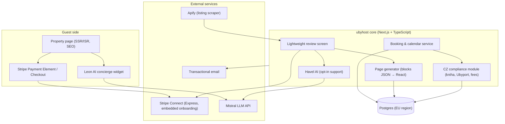
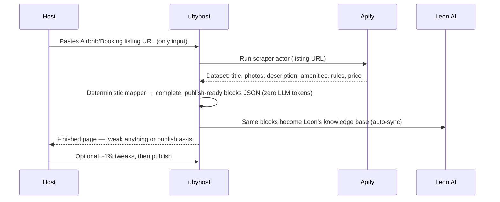
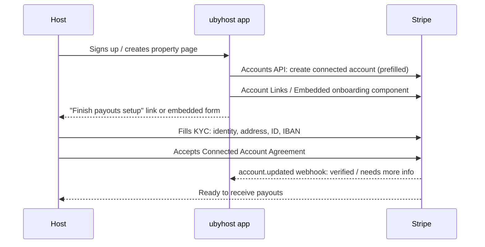
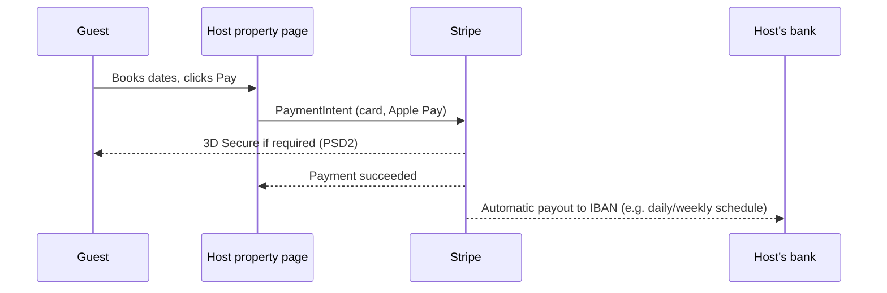
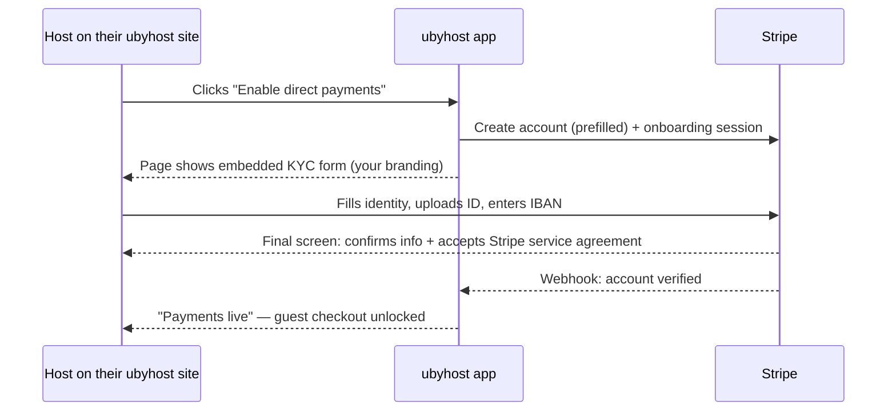

# ubyhost — Complete Project Documentation (Unified)

**Date of compilation:** 27 October 2026
**Product:** ubyhost — a SaaS platform (Czechia-first) where short-term rental hosts paste their Airbnb/Booking.com listing URL and get a complete, bookable property page. Guests pay the host directly (0% ubyhost commission); revenue is a SaaS subscription (free beta at launch — pricing deliberately undecided and mentioned nowhere).

**Structure:** this file unites the seven working documents of the project, in logical reading order:

| # | Part | What it contains |
|---|------|------------------|
| 1 | Platform Architecture & Page Generator Build Plan | The whole product: scrape → map → publish pipeline, booking flow, AI tools (Havel/guest AI), sync, security model, milestones, coverage audit |
| 2 | Direct Host Payments — Deep Scope | The core feature: Stripe Connect architecture, all 29 provider answers (R1–R29), published research (CZK pricing, DPA, residency, restricted businesses), charge pattern, payout timing, chargeback defense, terms-template system, remaining open items |
| 3 | Host Terms of Service (Skeleton) | 17 sections + Appendices A–F, drafted with senior-counsel working positions; 16-item lawyer checklist. **Working positions for verification by a human Czech lawyer — not legal advice yet** |
| 4 | Launch Readiness | Revenue model (beta-free decision), booking holds, signup acknowledgment gate, analytics, GDPR, exception paths, go-live checklist & pilot plan |
| 5 | Unified Payment Provider Outreach Message | The A1–J3 message + R1–R29 question set sent to providers, and the full Stripe correspondence (historical record) |
| 6 | Page Generator — Reference Implementation | TypeScript reference code for the deterministic URL → page mapper |
| 7 | Listing Creation & Payments Workflow (Interactive Map) | The HTML workflow map covering the end-to-end host and guest journeys |

**Status summary for the reviewer (as of compilation):**

**⚠️ Reconciliation review vs. the shipped product (owner-requested, 27 Oct — read first):** these documents were drafted as a green-field design and must be reconciled with the *actual* codebase before build:

1. **Stack conflict — the plan's Part 1/Part 6 stack does not exist in the repo.** The product is **Python/FastAPI** (`App/app/main.py`, 120+ modules: stays, invoices, stay fees, Havel/Leon AI, guest guides, iCal, mail, auth), with **zero Stripe and zero Apify code today** (no `stripe` in `requirements.lock`, no `apify` anywhere). Part 1 prescribes "Next.js 15 + TypeScript end-to-end" and Part 6 is a TypeScript reference implementation — **that stack was never started.** The page-generator/booking flow must be re-specced against the existing FastAPI app (Jinja2 templates + reportlab PDFs is the established pattern), or the plan's Part 6 becomes dead weight. Do not start M1 with Part 6 as the blueprint.
2. **What already exists and must NOT be rebuilt:** invoice engine (stay-linked, one-per-stay, VAT, PDF, email — `invoices.py`, `invoice_pdf.py`), stay-fee calculation + remittance + UbyPort reporting, e-kniha/guest registration, Havel/Leon, iCal, mail outbox, admin/funnel tooling. The plan's M5 "CZ compliance" milestone is essentially **already built**; M1's "block schema/renderer" partially overlaps existing property/page structures. Re-scope the build sequence against the real code before any sprint is planned.
3. **The deterministic URL→page generator and the two-rail checkout are the genuinely new builds** — plus Stripe Connect integration (nothing exists) and Apify scraping. Those are the correct M-next targets.
4. **Effort realism (from the review):** M3's stated 3–4 weeks is optimistic by ~1.5× for a senior dev; total plan ~13–17 stated weeks ⇒ realistically 5–7 months single-dev, and only after the re-spec above. This is a scope conversation, not a detail.
5. **Primary money path is ad-hoc links (owner, 27 Oct)** — build order in Part 1's §6 should be read with the payment-request flow first, page-booking second.


- The Stripe conversation is **fully closed** — all questions answered in writing (email/published docs only, no sales call). What remains externally: (a) the human Czech lawyer's verification of the drafted positions in Part 3 (including review of Stripe's *published* SSA + Connect Terms at stripe.com/legal), (b) Mangopay's reply → a provider comparison matrix, (c) sandbox validations + a live-mode dry run, (d) the operator's go-live inputs.
- All product/payment decisions in these documents are **locked** unless explicitly marked otherwise in the text.
- Some sections are **historical records** (round-1/round-2 provider correspondence inside Part 2 §12 and Part 5) and are superseded by later answers; the documents annotate where this happens.

**A note on links:** `https://` links work normally. `search-result://` links are internal research citations from the working session in which these documents were produced; they will not resolve outside that context — **the Appendix at the end of this file ("Complete Source Register") decodes every one of them to its canonical public URL**, verified 27 Oct 2026, plus a map for reconfirming the provider's written answers against published pages.

---


# Part 1 — Platform Architecture & Page Generator Build Plan

---


# ubyhost · Platform Architecture & Page Generator — Build Plan

**Mission:** hosts paste their Airbnb/Booking listing URL and get a beautiful, complete, bookable property page *on ubyhost* in minutes — generated deterministically from the scrape (zero AI tokens), reviewed on an ultra-light screen, with Stripe-hosted onboarding so guests pay the host directly at 0% ubyhost commission. Leon AI supports guests on the published page, fed from the same data as the page itself. Czechia-first, EU-ready.

**Strategic wedge vs. Superhostem:** Superhostem is a back-office tool — guest self-service lookup, unified calendars, digital ubytovací kniha with automatic Ubyport reporting, e-consent registration forms, municipality fee calculation ([Superhostem.cz](search-result://q9uSVsKZ)). None of that gives a host their own **guest-facing page with direct payments**. ubyhost's wedge: own the front door (the page + the payment rail), then absorb the back-office functions (registration, kniha, Ubyport) as CZ-native moat features. Hosts get one system instead of two.

---

## 1. Payments provider decision for Czechia

The question: is there an alternative to Stripe for *this exact implementation* (embedded KYC + connected accounts + automated host setup) in Czechia?

**Short answer: no true equivalent — Stripe stays the core rail, with one real conversion gap to plan around.**

| Provider | Model | Auto-KYC per host (embedded) | Czech bank buttons | Verdict for ubyhost |
|---|---|---|---|---|
| **Stripe Connect (Express + embedded)** | Connected accounts, host accepts Stripe's Connected Account Agreement in-app | ✅ The whole point of it | ❌ Not supported | **Core rail.** Only provider combining CZ platform support, embedded onboarding, and per-host accounts with zero individual contracts |
| Mangopay | Wallet-based marketplace, escrow-style fund flows, strong in EU/rentals | ✅ Managed by Mangopay | Partial | **Fallback** if escrow-style release-on-check-in flows become core ([Fynex: Stripe Connect alternatives](search-result://VA5AMQHH), [twosided](search-result://9CA7gxFc)) |
| Adyen for Platforms | Enterprise marketplace processing | ✅ | ✅ (local methods) | **Overkill now** — enterprise contracts, heavy implementation ([Ryft: alternatives](search-result://aw5QRdHG), [ConnectPay](search-result://YyjbVeIV)) |
| Mollie Connect | EU split payments, lighter feature set | ✅ | Partial | Simpler, but weaker escrow/disbursement features than Stripe for this use case ([twosided](search-result://9CA7gxFc)) |
| PayPal Commerce Platform | Buyer-trust rail + Hyperwallet payouts | ✅ | ❌ | Add as *guest payment option* later, not as platform rail |
| **Comgate / GoPay / PayU / ČSOB / KB SmartPay** | Single-merchant gateways | ❌ Each host signs their own contract — exactly what you want to avoid | ✅ Best-in-class | **Not suitable as platform rail**, but interesting as a future add-on (below) |

Two facts to design around:

1. **Stripe doesn't support Czech bank payment buttons** (the tlačítka banky — pay-from-your-bank quick buttons that Comgate and GoPay cover across all Czech banks) — a real conversion consideration for domestic guests ([KosmoWeb: Czech gateways compared 2026](search-result://dQZ7z7XQ)).
2. **Payout speed:** Stripe's Czech default is T+7 vs. T+1 for Comgate/GoPay — hosts will notice ([KosmoWeb](search-result://dQZ7z7XQ)). Stripe payout schedules can be improved after a track record; set expectations early.

**Recommended posture:** launch with Stripe (cards + Apple Pay + Google Pay) — for a direct-booking page, card + wallet coverage is strong enough to prove the model; a "pay by Czech bank button" gap mostly affects impulse domestic traffic. Revisit a **hybrid** in v2: keep Stripe as the connected-account rail, and add a Czech gateway under a *platform-billed* flow (platform is the payee, then separate-charges-and-transfers to the connected account) to capture bank buttons — accepting the fee-model change documented in the payments scope doc. Local gateways also can't be ignored entirely on cost: Comgate's Start plan offers 0% for the first six months on cards up to 50,000 CZK/month under the state-backed "Czechia Pays by Card" program ([NowPayments: CZ gateways](search-result://q7gw56en), [Comgate](search-result://lktq3qHd)) — but per-host contract signing disqualifies it for the automated model.

---

## 2. System architecture



**Stack recommendation (mine, since you delegated):** Next.js 15 (App Router) + TypeScript end-to-end, Postgres (Neon/Supabase, EU region), Vercel or Fly.io EU deployment, Stripe SDK, Apify API client, Mistral API for Havel/Leon. One deployable product, typed from database to page — smallest sane team surface.

### Core concepts

- **Property page = blocks JSON**, not free-form HTML. The generator produces a typed array of blocks; the renderer maps each block to a React component. This is what makes the editor "extremely easy": every edit is a form on a block, not layout surgery.
- **One host = one Stripe connected account**, verified once, charging across all their pages. Embedded onboarding component inside the host dashboard (as scoped in the payments scope doc — Stripe handles KYC + agreement acceptance, and auto-absorbs compliance changes ([Stripe docs: Embedded onboarding](search-result://uhRYwldO))).
- **Havel AI** = optional host assistant *in the dashboard* — an opt-in "polish with Havel" button on the review screen plus support chat (payments status, questions). Deliberately absent from the creation path: pages are built deterministically from the scrape, so the default token cost ≈ 0.
- **Leon AI** = guest concierge *on the published page*: answers house-rules/amenity/location/booking questions from the same blocks JSON as ground truth — one source of truth, zero drift between page and chat.

---

## 3. The page generator — one path: paste a URL, get a complete page

### The 2-minute start — scrape once, page done



**The 99% rule:** the deterministic mapper (pure functions, no AI) fills *every* block — hero, gallery, about, amenities, location, pricing, booking defaults (request-to-book, flexible cancellation), starter guest info. **Havel is not in the creation path**; the default flow spends zero AI tokens. The host's remaining ~1%: reorder photos, adjust price, change booking defaults if they want. The raw dataset is kept in `listing_imports` for re-mapping, never published directly.

**Leon is fed at the same moment:** the same blocks JSON that renders the page is Leon's ground truth — amenities, house rules, pricing, neighborhood. Every publish re-syncs both together, so the page and the guest AI complement each other and can never contradict. Leon only spends tokens when a guest actually asks a question.

### The review screen: deliberately minimal (hosts use it least)

The page arrives ~99% done, so this is a **review screen, not an editor** — a single-column checklist of the page's sections where everything is already filled in, the host skims and tweaks if needed, then hits Publish.

1. **Single-column checklist UI**: one scrollable page (Basics → Photos → Amenities → House rules → Pricing → Payments → Legal), each section already populated with a couple of inline fields — no navigation tree, no multi-step wizard, no drag-and-drop. Works perfectly on a phone.
2. **On-demand preview**: a simple "Preview" link opens the published-render in a new tab — no live-rendered preview pane inside the app, so the review screen stays featherweight.
3. **Autosave + publish gate**: edits save on blur into the same blocks JSON; publishing runs a completeness checklist (payments connected or explicitly deferred — everything else is already filled by the mapper).
4. **No AI in the default flow**: one opt-in "✨ Polish with Havel" button per long-text field (description, house rules), clearly metered and off by default. No tokens are spent unless the host explicitly taps it.
5. **Tiny by construction**: a page is ~10–20 KB of JSONB; the published page is ISR-cached static HTML with a lightweight dozen components. No live editors, no preview infrastructure, no per-host compute — review-and-publish costs almost nothing to serve.

### Page block model (v1)

| Block | What it renders | Edited as |
|---|---|---|
| `hero` | Heading, subheading, CTA "Book direct" | 2 text inputs + CTA label |
| `gallery` | Ordered photos, captions | Photo manager (upload/Apify import, reorder, cover) |
| `about` | Description sections | Rich-text-lite (paragraphs + headings) |
| `amenities` | Icon grid, grouped (Wi-Fi, kitchen, outdoor…) | Checkbox groups |
| `location` | Neighborhood description + map (no exact address pre-booking) | Text + pin-on-map with privacy radius |
| `pricing` | Nightly rates, weekend/seasonal, cleaning fee, deposit | Table editor synced with booking service |
| `booking` | Availability calendar + payment CTA | Config (deposit %, min nights, instant/pending) |
| `terms` | Cancellation policy from a template (Balanced default: 100% back ≥14 days, 50% ≥7 days, none inside 7 days) | Template picker (Balanced/Flexible/Strict) + free-text override; acceptance recorded at checkout |
| `faq` | Q&A list | List editor + "Leon answer suggestions" |
| `czechGuestInfo` | Arrival details, self check-in instructions | Text (shown after booking) |

**Guest-side rendering:** Next.js SSR/ISR at `{handle}.ubyhost.cz` (custom domain later), `schema.org/LodgingBusiness` structured data, OG images, `hreflang` multi-language (CS/EN/DE first), sub-500ms TTFB, Lighthouse ≥ 95 — direct-booking pages live and die on Google.

### Booking & payment on the page

Availability comes from the booking service (own calendar first; **iCal sync both directions in v1** — export a tokenized feed per page so ubyhost bookings block Airbnb/Booking dates, import the host's OTA iCal URLs so OTA bookings block the direct page, on a 2-hour poll with manual "Sync now" — real-time channel-manager sync is v2; the launch-readiness canvas §3 has the full design incl. collision handling). Guest picks dates → sees itemized total (nights + cleaning + municipality fee if applicable) → sees the **booking-contract panel** ("You are booking directly with [host] — by confirming you enter a binding accommodation contract with the host, exactly as via Airbnb or Booking.com; payment is processed by Stripe on the host's behalf") → ticks acceptance of the contract wording + cancellation terms (both stored with the booking — the chargeback-evidence centerpiece) → Stripe Checkout Session (card, Apple Pay, Google Pay — hosted surface; also the surface Adaptive Pricing requires, R4) → money flows per the payments scope: direct charges on the host's Express account, fee collector = account, `application_fee_amount = 0`, with payouts triggered by our booking service ~7 days before check-in (smart payout timing, payments scope §13). **Charge pattern (R1, adopted):** *instant book* = payment-mode Checkout Session, charged immediately. *Request-to-book* = **setup-mode Checkout Session saving the guest's card at request** (3DS-authenticated on-session, with the guest's mandate to be charged on approval), then an **off-session charge when the host approves within the 24h hold** — the guest is never charged for a declined request, and the same mandate powers later deposits/extra-guest fees/damage contributions (R2). Off-session charges can still be declined for `requires_action` (banks may re-challenge) → guest gets a notification + re-authentication link, the hold stays; **on expiry the hold releases with both parties notified — host approval voided, guest re-request link, dates freed (exception table, launch readiness §7; owner decision 27 Oct: no silent releases).** Post-payment: Leon sends the guest their stay details + e-consent guest registration form (CZ requirement), and the booking lands in the host's kniha with automatic Ubyport reporting — the Superhostem back-office loop, absorbed.

### Multi-rail checkout: card rail + Czech QR bank rail (v1)

Every ubyhost page offers **two payment rails**, so guests pay the way Czechs actually pay:

**Rail 1 — Card/wallet rail (Stripe).** The default checkout described above: credit cards, Apple Pay, and Google Pay, on the host's connected account, 0% ubyhost commission. (SEPA Direct Debit and Pay by Bank deliberately excluded.)

**Rail 2 — Czech QR bank payment (SPAYD).** The Czech Banking Association's open QR standard — the QR encodes the recipient's IBAN, amount, and variable symbol, is scannable inside every Czech banking app, and is open-source under Apache 2.0 with no licensing fees ([Wikipedia: Short Payment Descriptor](search-result://mtHJixKy), [Webito: Czech QR Platba](search-result://QPbVQqxD)). Design:
- ubyhost generates the QR **per payment request**, with a unique variable symbol (VS) for matching.
- The guest scans → pays from their own bank → money lands **directly in the host's own bank account**, bypassing the PSP entirely. Zero processing fees — the cheapest rail that exists.
- The page/booking shows "awaiting payment" until confirmation: **v1 = one-tap host confirm in the dashboard** (the VS is displayed next to the request, plus an auto email nudge when a matching amount can't be auto-matched); **v2 = automatic reconciliation** via open-banking/transaction-API import.
- Host enters their payout IBAN once for QR generation (Stripe's payout IBAN is not accessible to the platform — deliberately).
- Guardrails: no buyer protection or PSP dispute path on this rail, no automatic receipts — so cap it to moderate amounts by default, keep the card rail as primary for full bookings, and position QR as the "quick, free, local" option. QR requests double as printed/onsite payment slips (fridge magnet, guest folder).
- **Positioning (owner decision, 27 Oct): ubyhost is a technology provider on this rail, nothing more.** The QR is an information payload (IBAN + amount + VS) that the *host* asks the *guest* to pay; the payment itself is a direct guest→host bank transfer with no PSP, no ubyhost account, and no ubyhost involvement in the funds. The guest must understand the limits before paying: the payment is irrevocable from their side, has **no buyer protection, no dispute path, and no receipt** from ubyhost — this is shown next to the QR ("Platba jde přímo hostiteli z vaší banky — bez ochrany kupujícího. Ubyhost je jen poskytovatel technologie." / "The payment goes directly to the host from your bank — no buyer protection. ubyhost is only the technology provider."). Conflicting guidance to the guest that a payment "didn't arrive" is resolved between guest and host; ubyhost's only role is showing the VS and the host's confirmation. **For legal (checklist item 11b): ubyhost has no payment-service relationship with the guest on Rail 2 in any capacity — no receiving, processing, holding, reconciling-as-a-service, or remitting of funds; the host-confirm UI is a display of the host's own statement, not a settlement confirmation by ubyhost. Verify this technology-provider characterization under ZPlČS alongside item 5.**

### Host payment links — the ad-hoc "request money from a guest" tool

Hosts get a **"Request payment"** button in the dashboard (this is the feature that kills the Booking.com detour for mid-stay money — quick repair contributions, extra-guest fees, late checkout, cleaning, damage deposit, custom):

| Field | Example |
|---|---|
| Reason | "Broken window contribution" / "Extra guest (2 nights)" |
| Amount + currency | 1,500 CZK |
| Optional photo/doc | Photo of the damage |
| Expiry | 7 days |
| Message | Short note from the host |

ubyhost creates a **payment link on the host's connected account** — Stripe supports payment links for connected accounts across all charge types, with the platform able to take an application fee (we set ours to 0) ([Stripe docs: Payment links with Connect](search-result://1hNuq9YL))). The host gets a shareable link **plus a QR code of that same link** → sends it via WhatsApp/SMS/email or lets Leon hand it over in chat. Funds land on the host's connected account, itemized in the dashboard, receipts automatic, disputes handled like any card payment. For Czech guests, the same request can alternatively go out as the **SPAYD QR rail** (zero fees, host-confirmed) — the host picks per request: "fast & free (QR)" vs "tracked & protected (card link)".

Czech tax/compliance note: ad-hoc requests are taxable income for the host like any other; damage contributions are typically not accommodation fees, so they don't trigger municipality accommodation fees — ubyhost tags each request type so the host's bookkeeping export stays clean.

**Invoicing & receipts on the two rails (owner decision, 27 Oct):**

- **Card rail (Stripe) — receipts are automatic, invoices are not.** Every Checkout Session and payment link issues a **Stripe receipt** automatically (email to the guest, hosted PDF) on the host's connected account — zero config, zero code. ⚠️️ Pushback (owner asked to review): **a Stripe receipt is not a Czech VAT invoice (faktura).** Stripe can auto-generate *invoices* too, but its Invoicing product is built for the platform's own billing, and per-connected-account invoice automation on direct charges means either the host's Stripe invoicing settings or our orchestration. If the host needs a proper faktura for a card-rail payment, the clean path is our own invoice engine (below) fed by the booking data — not Stripe Invoicing. Working position: **card rail = Stripe receipt (automatic) + ubyhost faktura available on demand**; do not build Stripe-invoice orchestration.
- **QR rail — ubyhost's invoice engine, automatically.** We already have a complete, stay-linked invoice engine in the product (one invoice per stay, accommodation line + capped extras, Czech VAT handling, PDF, send-by-email — owner-approved 2026-10-08, `stay-only-invoices.md`). When a QR payment is confirmed, the booking's invoice draft is auto-created from the stay data so the host never types anything; the host reviews and issues it in one tap (respecting the one-active-invoice-per-stay rule). This is not difficult — the engine exists; the only new work is the confirm→draft trigger.
- **Where most bookings actually happen (owner's read, 27 Oct): hosts will mostly send payment links rather than have guests book through the page** — hosts steer guests to direct links to save commission, so the ad-hoc request flow is the primary money path, and the full booking-checkout flow is secondary. Consequence for build order: the payment-request + link/QR flow gets first-class UX (it is the product's front door), and the page booking flow follows. Card-rail payment links still get automatic Stripe receipts; QR requests get the auto-created invoice draft; both stay in the host's dashboard, not Stripe's.

**Stay-fee scope (owner decision, 27 Oct — confirmed):** ubyhost calculates **only the statutory stay fee (místní poplatek za ubytování)**, derived from the guest registration form (guests, nights, fee-exempt flags) and the property's configured per-person/per-night rate — the same posture as Booking.com and Airbnb's local-tax handling: **charged to every guest uniformly, no exemptions invented by us, adults treated as adults.** The fee is a pass-through line in the checkout total, collected by the host, and remitted by the host to their municipality; ubyhost's role ends at calculation, reporting (the stay-fee document/Ubyport flow), and display. Anything beyond the statutory fee — VAT on the accommodation service, income tax, bookkeeping — is the host's own affair, exactly as it is on the OTAs.

---

## 4. Havel AI (hosts) & Leon AI (guests) — integration design

Shared design: both are thin, product-shaped wrappers around a Mistral API endpoint — *neither is a raw chatbot*.

**Havel (host assistant, authenticated — opt-in only, token-frugal):**
- Lives in: the single opt-in "✨ Polish with Havel" button on the review screen, and a support chat in the dashboard. Nowhere in the default creation path.
- Capabilities: `improveSection(blockId, instruction)` (the polish button); `explainStripeStatus(accountState)` — the one that matters most: Havel translates `requirements.past_due` webhookese into "we need one more document, here's the button"; dashboard Q&A ("why is my payout delayed?", "what does the guest owe for the extra night?").
- Guardrails: **no token is spent without an explicit host action** (a button tap or a chat message); output must validate against block schemas (invalid = regenerate, never render); never sees raw Stripe PII (only status enums); all generation passes through ubyhost's Mistral account with per-host rate limits.
- **Stripe/finances hard isolation (non-negotiable, permanent):** Havel has zero capability to touch anything financial — no Stripe API scopes, no keys, no create/modify/cancel/initiate on charges, refunds, payouts, payment links, capabilities, or account settings, now or ever. `explainStripeStatus` *reads* a non-sensitive status mirror in our DB and explains it in plain Czech; every financial action lives in host-only UI behind owner auth. Enforced at the architecture level (separate scopes/permissions per AI tool), not by prompt instructions alone. Havel explains, never touches.

**Leon (guest concierge, public widget on published pages):**
- Ground truth = the published blocks JSON + booking policies + FAQ block. RAG over *the page's own data*, not the open web.
- Auto-synced at creation and on every publish — fed from the same scrape that builds the page, so page and Leon complement each other by construction.
- Capabilities: availability-aware answers ("is X free next weekend?" → booking service check), amenities/location/house-rules Q&A, booking help, pre-arrival tips. Answering in CS/EN/DE by guest preference.
- Guardrails: never quotes prices not in `pricing` block; never reveals exact address pre-booking; declines off-topic; every booking answer links to the real checkout, no Leon-only promises.

---

## 5. Data model (core tables)

| Table | Key fields |
|---|---|
| `hosts` | id, auth, name, locale, legal_entity_type (individual/company), stripe-eligible prefills: legal name, DOB, address, phone |
| `operators` | host_id, name, email, role (owner/editor/finance), status — invited humans with permissions; **never Stripe identities** |
| `stripe_accounts` | host_id, stripe_account_id, onboarding_state, capabilities, requirements_snapshot, charges_enabled, payouts_enabled — one per host, holder = the owner (merchant of record) |
| `properties` | host_id, handle, title, status |
| `pages` | property_id, blocks JSONB, version, published_blocks JSONB |
| `listing_imports` | property_id, source (airbnb/booking), apify_run_id, raw_dataset JSONB |
| `bookings` | property_id, dates, guests, totals, status |
| `calendar_feeds` | property_id, direction (export token / import URL + source), last_synced_at, last_result, status |
| `payments` | booking_id, stripe_payment_intent_id, fee_model, amount_host_net |
| `payment_requests` | host_id, property_id, booking_id?, reason, amount, currency, stripe_payment_link_id, variable_symbol, rail (card_link / qr), status, expires_at |
| `guests` | booking_id, name, email, e_consent JSONB, registration_form JSONB |
| `compliance_records` | booking_id, kniha_entry, ubyport_report_id, municipality_fee_calc |

Stripe secrets live only in Stripe; ID documents never touch our servers (Stripe-hosted onboarding with prefills — see payments scope §6A). GDPR: EU region everything, right-to-erasure flows defined per table from day one.

**The operator model — who's in Stripe, who's not:**

- **One Stripe connected account per host** — and the host is the **owner/merchant of record**: the legal person or company whose money it is. Payouts, KYC, disputes, and tax all belong to this one identity. A company host names one Stripe *representative* in Stripe's own form (Stripe always requires exactly one verified representative, and collects beneficial owners itself for companies — verified against national registries, never through us) ([Stripe support: representatives](search-result://SJJS4NOp), [Stripe support: beneficial ownership](search-result://0DzzZip9)).
- **Operators are ubyhost users, never Stripe identities.** Hosts can invite as many operators as they want (partner, cleaner with calendar access, accountant with finance view) — the `operators` table is pure role-based permissions inside ubyhost: edit pages, manage bookings, request payments, view payouts. No per-operator KYC, no Stripe accounts, nothing for Stripe to know about.
- **The rule that keeps this clean: money follows the merchant of record.** If someone *legally* operates a property they don't own (a property manager running a client's apartment), that property belongs to *their* ubyhost account with *their* Stripe account — the manager creates a separate host account. Operators inside one host account are collaborators on the same money, not separate payees.
- **Onboarding flow with prefill:** signup already collects the owner's basics → "Set up payouts" creates the Stripe account **prefilled** (name, DOB, address, business type, their ubyhost page URL) → Stripe's form skips everything prefilled and asks only for confirmation, ID document upload, IBAN, and terms acceptance. One screen of gaps, zero re-typing.

---

## 6. Build sequence

| Milestone | Contents | Rough effort |
|---|---|---|
| **M1 — Page generator core** | Block schemas, renderer, lightweight review screen, publish flow | 3–4 wks |
| **M2 — Apify import → complete page** | Scraper orchestration, deterministic complete-page mapper (zero-token), Leon auto-sync (Havel polish optional) | 2 wks |
| **M3 — Payments** | Express connected accounts, Stripe-hosted onboarding (Account Links; embedded component as fast-follow — same compliance posture, confirmed by R25), per-account **Apple Pay + Google Pay** domain registration in the provisioning pipeline (R3 + R19) + Apple Pay merchant tokens (MPAN) for off-session wallet charges, Checkout Session checkout (cards + Apple Pay + Google Pay; setup mode for request-to-book, payment mode for instant book — R1 pattern, off-session approval charge + re-auth path per R2), terms-template acceptance + self-service cancellation refunds, platform-triggered payouts (min(check-in − 7d, payment + 80d) — R22's 90-day ceiling), dispute evidence pack (compile → host review → one-shot submit, R20), webhooks | 3–4 wks (patterns in scope doc §12–§13, legal map §5–5A) |
| **M4 — Booking + Leon** | Calendar service, itemized totals, Leon widget with page-RAG | 2–3 wks |
| **M5 — CZ compliance** | e-consent registration form, ubytovací kniha, Ubyport reporting, municipality fees | 2–3 wks |
| **M6 — Pilot** | 10–20 friendly hosts, SEO pass, analytics, feedback loop | ongoing |

Suggested pilot order flips M3/M5 if trusted hosts need kniha/Ubyport before payments.

---

## 7. Open decisions (for you)

1. Subdomain vs. custom domain at launch (custom domain = DNS+TLS automation work).
2. Instant book vs. request-to-book default (chargebacks vs. conversion tradeoff from the scope doc).
3. Whether guests' Czech bank buttons (Comgate add-on) is a v1 blocker or v2 feature — my recommendation stands: v2.
4. Hosts *without* an existing Airbnb/Booking listing to scrape — offer a blank manual start fallback, or require an OTA listing for v1? (Havel stays opt-in polish/support either way — my recommendation is a minimal manual fallback so nobody is locked out.)
5. ~~Pricing of ubyhost itself~~ **Decided (structure):** single "Host" plan, 14-day trial without card, Stripe Billing + Stripe Tax Basic — the price itself is the open ⚖️ decision (recommended range: 299–499 CZK/mo, launch-readiness canvas §1). The payments architecture keeps the optional-% door closed for now.

Companion artifact: **ubyhost Page Generator — reference implementation** (code canvas) with the block schema, Apify import mapper, Havel prompt contracts, and Stripe embedded-onboarding routes.

### Coverage audit (updated 27 Oct)

**Scoped — see the launch-readiness canvas (all gaps filled in):**
1. ✅ SaaS pricing & plans — **pricing NOT decided: beta is free, no price mentioned; manual invoicing when billing ever starts** — §1 there
2. ✅ Booking hold mechanics (15-min checkout hold, 24h request hold, DB-level range exclusion) — §2
3. ✅ Calendar sync: iCal both directions, OTA polling cadence, collision rule (ubyhost refunds the later booker in full) — §3
4. ✅ Security & host auth (magic link + Google OAuth, operator roles, Leon prompt-injection defense, **Havel ↔ Stripe hard isolation: explains, never touches**) — §4
5. ✅ Host analytics (cookieless, no consent banner needed; "OTA commission saved" retention hook) + guest GDPR position — §5–6
6. ✅ Exception paths (scrape fail, onboarding reject, payment fail, payout fail, Leon down, stale iCal, OTA collision) — §7
7. ✅ Go-live checklist & first-10-hosts pilot with success criteria — §8

**Waiting on the outside world:**
- **Stripe: fully closed — no sales call ever needed.** All 29 round-2 answers recorded (payments scope §12), and the final email round (R15 QR rail, R24 permanence, R26 contracts, R11 Partner Program, sandbox confirmation) is answered too. The pricing sheet, Express Czech, DPA execution and residency were all found published. The pause/churn lever is now **two layers**: our checkout gate (primary, unilateral) + capability unrequest (secondary; the one named-permanent capability, `legacy_payments`, is deprecated and never requested).
- **Mangopay's reply** → then the A/R-code comparison matrix gets built.
- **Lawyer review** of the Host ToS — 16-item checklist with **senior-counsel working positions drafted on 16**; the two formerly "blocked" items (SSA/Connect Terms indemnity + QR-rail exclusivity, DPA/DTA review) are unblocked — the contracts are published at stripe.com/legal, so counsel reviews the actual texts.
- Sandbox validations: onboarding sims + verification triggers (`tok_visa_triggerVerification`/`triggerChargeBlock`/`triggerTransferBlock`), simulated disputes for the evidence pack, **test clocks for the payout formula**, Apple Pay + Google Pay per-account domain registration, request-to-book off-session charge pattern + re-auth path (R1/R2), Adaptive-Pricing-under-off-session validation (R4), Express Dashboard Czech, the two-layer pause test — folded into the go-live checklist (launch-readiness §8), **plus a live-mode dry run of capability gating** (sandbox may not enforce it).

# Part 2 — Direct Host Payments (Deep Scope)

---


# ubyhost · "Host Property Pages with Direct Payments" — Deep Scope

*Last updated 27 Oct 2026 — Rail 1 = cards + Apple Pay + Google Pay; all six open questions decided (§11); terms-template system + chargeback defense added (§13, with the 90-day payout ceiling from R22 and the R1 charge pattern applied); ALL Stripe answers in — R1–R29 plus the final email (§12), and the pricing sheet, Express Czech, DPA/residency, revenue-share and restricted-business evidence found published. **The Stripe conversation is fully closed — no sales call ever needed.** What remains: the lawyer (on published contracts), the sandbox, and Mangopay's reply.*

**Feature in one sentence:** every host gets their own ubyhost property page where guests pay the host directly, ubyhost takes **zero commission**, and host setup is automated — hosts fill in their details once and Stripe handles the rest.

**The Shopify analogy is exactly right.** Shopify Payments is built this way: each Shopify store owner is onboarded programmatically into a Stripe-connected account, fills in their details once (identity + bank account), and payments flow to their own Stripe account. Shopify charges a SaaS subscription, not a cut of payments. ubyhost can copy this playbook.

---

## 1. TL;DR — Your three questions answered

| Question | Answer |
|---|---|
| Can I set it up automatically for hosts? | **Yes.** Create each host's Stripe-connected account via API, prefill what you know (name, email, country), and send them a single onboarding link or embed Stripe's onboarding component in your own host dashboard. |
| Do hosts just fill in IBAN + payment details? | **IBAN alone is not enough.** Anti-money-laundering law (KYC) requires identity verification: legal name, date of birth, address, ID document, tax ID, plus the payout bank account. Stripe's onboarding form collects and validates all of this for you — the host experience still feels like "just filling in a form." |
| Do we need individual contracts with each host? | **No — not for the payments part.** During onboarding, each host clicks accept on Stripe's **Connected Account Agreement**, which is a direct legal agreement between that host and Stripe. You sign *one* agreement as a platform (the Stripe Connect Platform Agreement). You still need your own Host Terms of Service for the platform services (listing, page builder, support), but you do not need to contract with each host for payment processing. |

---

## 2. How it actually works (architecture)

There are three parties:

- **Guest** — pays on the host's property page.
- **ubyhost (you)** — the *Connect platform*. You own the Stripe platform account, control the page builder, and orchestrate everything.
- **Host** — gets a *connected account* (their own sub-account under your platform).

### The two flows

**Flow A — Host onboarding (once per host):**



**Flow B — Guest booking payment (every booking):**



Key points:

- Stripe's embedded onboarding components let hosts complete setup **without ever leaving your app** — Stripe renders the identity/bank form inside your page, localized and validated ([Stripe docs: Account onboarding](search-result://szr3UU5X)).
- You can prefill known data through the API so Stripe asks the host only for what's missing ([Stripe docs: Express accounts](search-result://23fU0o9G)).
- Onboarding requirements adapt automatically to the host's country, business type (individual vs. company), and the capabilities you request ([Stripe docs: API onboarding](search-result://xKlDheqh)).
- Once verified, Stripe pays out to the host's bank/IBAN on an automatic schedule; hosts get an Express Dashboard (a lighter Stripe dashboard) to see their payouts and, if you enable it, manage refunds and disputes ([Stripe docs: Connected account types](search-result://cIBJAXf3)).

---

## 3. Which account type to use

| | Express (recommended for MVP) | Custom | Standard |
|---|---|---|---|
| Onboarding & KYC | Stripe handles it | Stripe-hosted or you build it | Stripe handles it |
| Host dashboard | Stripe Express Dashboard | You build/embed everything | Full Stripe Dashboard (host can also use Stripe independently) |
| White-label feel | Co-branded | Fully white-label | Stripe-branded |
| Integration effort | Low–medium | High | Low |
| Liability for negative balances | Stripe's default responsibility | **You assume liability** if hosts can't repay negative balances | Stripe handles |
| Best for | Launching fast, Shopify-style setup | Complete control at scale | Hands-off hosts with existing Stripe accounts |

Recommendation: **Express** with embedded onboarding. Stripe explicitly positions Express for platforms that want to "leverage Stripe's payments pricing — Stripe sets and collects processing fees from your users, so you don't have to," and Custom accounts for platforms ready to carry more integration effort and risk ([Stripe docs: Connected account types](search-result://cIBJAXf3), [Stripe Connect pricing](search-result://tYWVTwqy)). Revisit Custom later if you want the fully-white-label experience.

---

## 4. "Without any fees" — unpacking the money flow

There are three different "fees" in play, and it matters which one you mean:

1. **ubyhost commission** — you control this. Set the application fee to **zero** and the host receives the full booking amount minus Stripe's processing cost. You can flip this per host or per booking later (your future monetization lever).
2. **Stripe's card processing fee** — always exists (~1.5% + €0.25 style pricing for European cards; varies by country and method). The question is only *who is billed for it*.
3. **Connect platform fees** — extra fees apply *only in some configurations*.

Your two realistic configurations:

**Option 1 — "Stripe-billed" (recommended for the zero-commission model):**
Direct charges on the host's connected account with the fee collector set to the account. Stripe collects its processing fee **directly from each host** — ubyhost pays nothing: no per-account fees, no payout fees, no processing costs ([Stripe docs: Fee behavior on connected accounts](search-result://OurgIzdn), [Stripe Connect pricing](search-result://tYWVTwqy)). Each host effectively has their own Stripe pricing. This is the closest thing to "guests pay, host receives, ubyhost pays €0."

**Option 2 — "Platform-billed" (marketplace style):**
Destination charges, which Stripe says work best for marketplaces like Airbnb ([Stripe docs: Destination charges](search-result://bO01gzEw)). Funds land in your platform account and are auto-transferred to the host minus an application fee (set it to 0 for the free model — but then **you** pay Stripe's processing fee on every booking, plus per-account and per-payout Connect fees when you manage pricing, e.g. ~$2/month per active account and ~0.25% + 25¢ per payout ([Fiska: Stripe Connect pricing](search-result://4x7KyQPP))). This gives you the most control (uniform pricing, one contract, easier cross-border handling) but it turns "free for hosts" into a real per-booking cost for you.

> ⚠️ **Chargebacks:** Stripe's terms don't allow Connect platforms to pass dispute fees to connected accounts ([Stripe pricing page](search-result://ehVtP9F8)). In Option 1 the host bears their own disputes like any independent Stripe merchant; in Option 2 you'd fund them.

**Decision (locked):** Rail 1 = **credit cards + Apple Pay + Google Pay** — nothing else. SEPA Direct Debit was considered and dropped: its 8-week no-questions-asked dispute window (up to 13 months, no appeal) is a poor fit for hosts managing bookings solo ([Stripe SEPA Direct Debit docs](search-result://XnNAulGX)). Pay-by-bank products are also out — coverage and value don't justify the complexity. Guests who want a bank payment use Rail 2 (the Czech QR platba).

---

## 5. The legal/contract map (who signs what)

| Relationship | Agreement | Who acts |
|---|---|---|
| ubyhost ↔ Stripe | Stripe Connect **Platform Agreement** (you accept once when registering the platform) | You |
| Host ↔ Stripe | **Connected Account Agreement** — accepted by the host inside the onboarding flow ([Stripe Connected Account Agreement](search-result://rh1IrjWl)) | Each host, one click |
| Guest ↔ Stripe | Standard payment terms (mandates, 3DS) | Automatic |
| Host ↔ ubyhost | **Your own Host ToS** for the platform services: page builder, listing, support, cancellation policy, refunds | You draft this |

So the answer to "do they need individual contracts with each host?" is: **you never need a payments contract with each host.** Stripe itself states the Connected Account Agreement forms a legal agreement between the connected user and Stripe ([Stripe Connected Account Agreement](search-result://rh1IrjWl)), and if you use Stripe-hosted or embedded onboarding, **Stripe handles the agreement acceptance for you**; only fully custom API-built onboarding requires you to attest that the host saw and accepted it ([Stripe docs: Service agreement types](search-result://u7Q3djX1)). The platform agreement does require you to give hosts the opportunity to review the terms and to keep acceptance records auditable ([Stripe Connect Platform Agreement](search-result://LsFkE84E)) — one more reason to use Stripe's hosted/embedded onboarding rather than building the form yourself.

Practical addition: put a line in your Host ToS like Stripe's own suggested disclosure — "Payment processing services for hosts on ubyhost are provided by Stripe and are subject to the Stripe Connected Account Agreement" ([Stripe docs: Update service agreements](search-result://3KL8svRI)).

### 5A. The liability map — what can still hit ubyhost, and the shields against it

**What the architecture already shields (the four big ones):**

| Risk | Who bears it | Why / shield |
|---|---|---|
| Chargeback / dispute losses | Stripe, then the host | Direct charges + Stripe as **losses collector** (Managed Risk) — confirmed in Stripe's round-1 answer; never switch charge types |
| Host's negative balance after a refund | Stripe recovers from the host | Same config; we're not the creditor |
| KYC/AML failures, sanctions screening | Stripe | Stripe performs screening per connected account; we never touch ID documents (hosted/embedded onboarding) |
| Payment method licensing, 3DS/PSD2, PCI | Stripe | SAQ-A level; card data never touches our servers |
| **"My payment didn't arrive / you lost my money" — a host blaming ubyhost** | **The host** | Direct charges = host ↔ Stripe; ToS §2/§5 carve-outs + the **signup acknowledgment gate** (Host ToS Appendix E: every point ticked individually, each tick logged) — the host explicitly confirmed, tick-by-tick, that payments are a third-party service and their responsibility (R27 facts) |

**What we cannot contract away — ubyhost's real liabilities (small, but know them):**

1. **Indemnity to Stripe under the Platform Agreement.** We warrant our platform operates within Stripe's terms (no prohibited businesses, no circumvention). If *our software* misbehaves — charging wrong amounts, mishandling refunds — that's on us. Scope of this indemnity: question **R26**.
2. **Restricted-business policing.** Stripe screens each host, but we shouldn't knowingly onboard someone Stripe bars. Our own cheap checks: listing type sanity + Stripe's onboarding rejections respected immediately. What exactly we must police: question **R28**.
3. **GDPR as controller** for host data (not guest payment data — that's Stripe's processing under their DPA). We store account *status*, not documents.
4. **Our own SaaS duties to hosts** — uptime, subscription billing, the page builder working. Ordinary software liability, insurable, capped in our Host ToS.
5. **Consumer-law wording of our own marketing.** "ubyhost takes 0% commission" (true) — never "free payments" (hosts still pay Stripe's fees).
6. **The booking contract is guest ↔ host, not ours.** The Host ToS and guest-facing page must state this everywhere: we provide the SaaS + tooling; the host is the seller, the merchant of record, the taxpayer, and the party responsible for guest registration under CZ law (evidence of accommodation) and their listing's accuracy. Our templates (cancellation terms) are *the host's terms once they adopt them* — the ToS says the host publishes and owns them.

**The shield artifact this implies: the Host ToS is not optional paperwork — it's the legal architecture.** It needs: Stripe disclosure line (above), booking-contract disclaimer, **mandatory signup acknowledgment gate — tick-to-proceed, no blanket "I accept," every point logged (Appendix E: third-party payments, merchant of record, payment outcomes are the host's, departure-closure rights)**, content/IP responsibility, tax & registration responsibility, template-terms adoption clause, subscription terms + refund policy, liability cap toward hosts, and Stripe-data handling notice. **Skeleton drafted — companion artifact: "ubyhost — Host Terms of Service (Skeleton)"** (17 sections + appendices A–F + 16-item lawyer checklist with senior-counsel working positions drafted on all 16; the formerly blocked contract reviews now use the published SSA + Connect Terms at stripe.com/legal).

**One deliberate misimpression to avoid:** never present ourselves as the payee anywhere guest-facing — statement descriptors, receipts, and checkout must all show the host as merchant (checked with Stripe: **R21**, **R27**).

---

## 6. What the host experiences (UX scope)

1. Host signs up on ubyhost, builds their property page (photos, calendar, prices).
2. A banner: "Turn on direct payments — guests pay you, we take 0%." One click.
3. A Stripe-hosted/embedded form opens (branded with ubyhost's name, color, logo — you configure this in Connect settings ([Stripe docs: Express accounts](search-result://23fU0o9G))). Host enters identity details, ID document, and IBAN.
4. Verification is usually near-instant; some hosts get "pending" and can receive payouts once cleared (status arrives via the `account.updated` webhook).
5. Host sees their payouts in an Express Dashboard (Stripe-hosted) and a "Payments" tab in your host panel (you build this from Stripe's data).
6. Guests can now pay on the host's page. Money lands in the host's bank on the payout schedule.

Scope note: if a host is in a Stripe-supported country, this all just works; country coverage and business-type requirements vary automatically ([Stripe docs: API onboarding](search-result://xKlDheqh)).

---

## 6A. Deep dive: can KYC/AML live *inside* ubyhost?

Short answer: **yes — the data *collection* can happen entirely inside ubyhost (even on the host's own property page), but the actual AML *screening* always runs on Stripe's side.** You never build your own sanctions-list/identity-verification engine for the payments leg. "Implementing KYC in ubyhost" really means: implement the collection UX in your app and let Stripe run the checks against that data.

### The two layers, separated

| Layer | What it is | Who can do it |
|---|---|---|
| **Collection UX** | The form: name, DOB, address, ID upload, IBAN, ToS checkbox | ubyhost (any of 3 modes below) or Stripe |
| **Verification & AML screening** | Identity checks, document review, sanctions/PEP screening, fraud signals, reverification | **Stripe, always** — triggered automatically when you submit data |

### Three implementation modes (from safest to most custom)

| | Mode A: Stripe-hosted | **Mode B: Embedded components (recommended)** | Mode C: Full API onboarding |
|---|---|---|---|
| Where it happens | Redirect to a Stripe-hosted page | Stripe's form rendered **inside your host's page** — they never leave ubyhost | 100% your own form in ubyhost; "Stripe can be completely invisible to the account holder" |
| Look & feel | Co-branded redirect | Themeable, limited Stripe branding, localized for all supported countries | Fully yours |
| ToS/KYC acceptance | Stripe handles it | Stripe handles it (final screen shows Stripe service agreement; footer links can point to your policies incorporating Stripe's) | **You** must attest the host saw & accepted Stripe's agreement, record it audibly, and pass `tos_acceptance[date]` + `tos_acceptance[ip]` |
| Compliance upkeep | Stripe updates it | Stripe updates it automatically as requirements change ("you don't need to update your onboarding integration as compliance requirements change") | **You** must track requirement changes and re-collect info "at least once every six months," update forms when Stripe changes parameters |
| PII on your servers | None | None | Some, unless you use Account/Person tokens (Stripe.js) so data goes browser→Stripe directly |
| Risk reviews / extra document requests | Stripe handles | Stripe handles | You can't respond via API — you still need embedded/hosted components or remediation links for these cases |
| Account type | Express or Custom | Express or Custom | Custom only (you take on negative-balance liability) |
| Effort | Days | 1–2 weeks | 4–8 weeks + permanent maintenance |

Stripe's own guidance is explicit: if you want a customized onboarding flow, they **strongly recommend embedded onboarding** rather than building your own forms with the API ([Stripe docs: API onboarding](search-result://ZjSMXvQy)), because hosted and embedded components "automatically update to handle changing requirements" while API onboarding shifts that burden onto you ([Stripe docs: Custom onboarding](search-result://TuLSWI3K)).

### What "they accept it there" looks like in Mode B (embedded)



Notes that matter for the design:

- If your platform is responsible for requirement collection (Custom accounts), you can **collect Terms of Service acceptance using your own process** instead of the component's final screen — Stripe explicitly supports this ([Stripe docs: Embedded onboarding](search-result://uhRYwldO), [Account onboarding component](search-result://YUGyPwUI)).
- Embedded onboarding supports "networked onboarding": a host who already has a Stripe account elsewhere can reuse their business information instead of retyping it ([Stripe docs: Embedded onboarding](search-result://uhRYwldO)).

### Anatomy of Mode C (full API onboarding) — if you ever go fully white-label

If you decide "Stripe must be invisible," this is exactly what you build and own:

1. **Create the account** via the Accounts API with `controller[requirement_collection]=application` — this makes you responsible for collecting everything ([Stripe docs: Service agreement types](search-result://OEUR2AGW)).
2. **Drive your form from the `requirements` hash**: `currently_due`, `eventually_due`, `past_due`, `pending_verification` tell you exactly which fields to show — e.g. `individual.id_number`, `external_account` (IBAN), `business_profile.url` ([Stripe docs: API onboarding](search-result://wN0OmSUK)). Update the account after each step so Stripe validates as you go.
3. **Persons & documents**: for companies, create Person objects for owners/directors; upload ID documents through the Files API (color image or PDF, <10 MB, JPG/PNG/PDF) and attach the file ID to the Person ([Stripe docs: Handle verification with tokens](search-result://eG8qhPg8), [Acceptable verification documents](search-result://EZxtBVFD)).
4. **Keep PII off your servers**: use Account Tokens / Person Tokens created with Stripe.js in the browser — data goes directly from the host's browser to Stripe, and you only handle the token ID ([Stripe docs: Account tokens](search-result://eG8qhPg8)).
5. **Record ToS acceptance**: show the host Stripe's Connected Account Agreement in your flow, capture their click + IP + timestamp, submit `tos_acceptance[date]` and `tos_acceptance[ip]`, and keep an auditable acceptance record ([Stripe docs: API onboarding](search-result://wN0OmSUK), [Stripe Connect Platform Agreement](search-result://LsFkE84E)).
6. **Handle failures & reverification**: read the `errors` array on requirements (expired document, name mismatch, unverified ID number); listen to `account.updated`; note that **any change to the account after ToS acceptance triggers reverification** ([Stripe docs: API onboarding](search-result://wN0OmSUK)); you can't resolve Stripe risk reviews via API, so you'll still need embedded/hosted remediation paths ([Stripe docs: Custom onboarding](search-result://TuLSWI3K)).
7. **Ongoing program**: you must track requirement changes and re-collect updated information at least every six months, forever ([Stripe docs: API onboarding](search-result://wN0OmSUK)).

### Recommendation for ubyhost

- **Launch with Mode B (embedded)**: hosts accept everything inside ubyhost on their own page, Stripe handles agreement acceptance and absorbs every compliance change, and your integration never breaks when rules (e.g. VoP, new EU verification rules) shift.
- **Consider Mode C later**, only if full white-label ("host never hears the word Stripe") becomes a product requirement — and budget permanent engineering for it, plus the Custom-account liability shift.
- **Hybrid option**: Stripe supports combined flows — your API-built form collects the easy fields, embedded components handle document uploads and remediation ([Stripe docs: Migrate from API onboarding](search-result://aOgQAvot)). This is a sensible middle step.
- One connected account per host covers **all** their pages/sites — KYC happens once in the host dashboard; every ubyhost-built website or property page that host owns then charges against the same verified account. You don't re-run KYC per page.

### Decision update 27 Oct — Stripe-hosted first, embedded as fast-follow

Honest comparison, because "embedded" sounded like more work than it is:

| | Stripe-hosted (Account Links) | Embedded component |
|---|---|---|
| Who builds/maintains the KYC form | **Stripe, either way** | **Stripe, either way** |
| Integration effort | One redirect URL (days less work) | Mount Stripe's web component + session management |
| Host experience | Bounced to a Stripe page, returns via redirect | Stays inside the ubyhost dashboard |
| Compliance auto-updates (KYC Refresh etc.) | Identical | Identical |
| Legal/liability posture | **Identical** — Stripe collects agreement acceptance in both | **Identical** |
| Branding | Stripe-branded page | Our shell, Stripe's form |

**Decision: launch with Stripe-hosted onboarding (Mode B-lite), upgrade to the embedded component as a fast-follow.** The compliance posture — the thing that actually matters legally — is byte-identical: Stripe renders and maintains the form, collects KYC, and records Connected Account Agreement acceptance in both modes. The only thing we trade at launch is staying-inside-the-app UX, and hosts onboard exactly once. Because both modes sit on the same Accounts API and the same account object, switching later requires **zero re-onboarding** for existing hosts (confirming this with Stripe: question **R25**). Full white-label Mode C stays where it was: far horizon, liability-shifting, not worth it.

### The prefill layer — makes the hosted flow near-effortless (researched 27 Oct)

The host's details don't need to be re-typed into Stripe's form. Stripe supports prefilling the Account object at creation, and both hosted and embedded flows then **skip everything that's prefilled** — asking the host only to *confirm* the prefilled data and fill the genuine gaps before accepting the service agreement ([Stripe docs: Onboard your connected account](search-result://1piDhTuN), [Stripe docs: Stripe-hosted onboarding](search-result://vF9Y5TXy)):

- **What we prefill** (data ubyhost already has from signup): legal name, email, date of birth, address, phone, business type (individual/company), and `business_profile.url` = their ubyhost page (Stripe's own recommendation) ([Stripe docs: Stripe-hosted onboarding](search-result://vF9Y5TXy)).
- **What we never collect ourselves:** ID documents, verification data, anything KYC-sensitive. The host uploads documents *inside Stripe's form* — preserving the "documents never touch our servers" shield from §5A. Prefill only basics; Stripe validates the rest.
- **The host can edit prefilled data** inside Stripe's form before accepting — a feature, not a bug: Stripe's validation catches our typos ([Stripe docs: Stripe-hosted onboarding](search-result://vF9Y5TXy)).
- **Net effect:** the hosted redirect becomes a one-screen confirm-and-upload experience — mostly a summary of what we already know, one document upload, IBAN, accept terms, done. The UX gap between hosted and embedded nearly closes at launch.
- **What embedded adds later that we can't fake:** the **notification banner** component — a Stripe-maintained widget listing outstanding requirements and risk interventions, mountable in our dashboard ([Stripe docs: Supported embedded components](search-result://tHG7frw7)). Until then, we render the `requirements` hash ourselves in the host panel (already planned; Stripe's round-1 answer A5).

---

## 7. Build scope (what your team actually builds)

**Your backend:**
- Stripe platform account + Connect configuration (branding, payout country list).
- "Create connected account" service call (Accounts API, prefilled).
- Onboarding session generation (Account Links API or embedded component session).
- Webhook handlers: `account.updated`, `payment_intent.succeeded`, `charge.refunded`, `charge.dispute.created`, `payout.paid` / `payout.failed`.
- Host payouts status page (read from Stripe; don't build your own ledger on day one).

**On the property page:**
- Stripe Payment Element or Stripe Checkout (guest-facing payment form, card + Apple Pay + Google Pay; PCI burden stays at SAQ-A level because card data never touches your servers).
- Booking logic: hold → capture, deposits vs. full payment, refund/cancellation policy mapping — computed from the terms template the guest accepted (§13).
- Terms template system (§13A): three cancellation templates, terms acceptance at checkout, self-service cancellation refunds.
- Smart payout service (§13B): platform-triggered payouts relative to check-in dates.
- Dispute evidence pack (§13C): auto-compile terms + acceptance + timestamps when a chargeback lands — compiled for **host review, then one-shot submission** via the Disputes API (evidence can be submitted only once per dispute, R20).
- Host-provisioning: Google Pay payment-method domain registration per connected account via API (R19) — one-time call in the account-creation pipeline.
- Churn flow: unrequest `card_payments` capability on cancellation — account and history stay intact (R24).

**Not your problem (Stripe does it):** KYC identity verification, payouts to IBAN, tax forms for hosts, dispute evidence collection UI, 3D Secure handling, payment method licensing.

**Rough effort:** a focused team typically ships an MVP of this in **4–8 weeks** — onboarding flow (1–2 wks), checkout on the property page (1–2 wks), webhooks/status/ops tooling (1–2 wks), plus legal copy and testing in Stripe's sandbox (which fully supports simulating onboarding and payouts).

---

## 8. Phased roadmap

| Phase | Deliverable | Why |
|---|---|---|
| **P0 — Foundations** | Platform Stripe account, Connect branding, sandbox integration of Accounts API + embedded onboarding | Prove the host setup flow end-to-end |
| **P1 — MVP launch** | Payments on property pages, `application_fee_amount = 0` (Stripe-billed model), payouts live in one or two launch countries | Ship the zero-commission promise safely |
| **P2 — Host ops** | Payout status in host panel, refund/cancellation tooling, dispute notifications, "onboarding incomplete" nudges | Reduce support load |
| **P3 — Monetization levers** | Optional per-host or platform-wide fee toggles (application fees), paid premium features (SaaS subscription à la Shopify), enhanced payout schedules | Turn the free payments rail into a business model |
| **P4 — Scale** | More countries, Custom-account/white-label evaluation, Instant Payouts for hosts (extra Stripe fee), revenue-share qualification | Mature platform economics |

Note for P3: platforms that let Stripe bill their connected accounts directly can also **qualify for a revenue share from Stripe** as volume grows — meaning "0% commission for hosts" can still earn ubyhost money ([Stripe Connect pricing](search-result://tYWVTwqy)).

---

## 9. Risks & gotchas to manage

- **KYC failures & drop-off:** some hosts will fail verification or abandon the form. Design reminder emails and clear "what we need from you" states; watch the `account.updated` webhook.
- **Disputes/chargebacks:** define who handles them. With Express you can let hosts manage disputes in their Express Dashboard, or handle them centrally ([Stripe docs: Connected account types](search-result://cIBJAXf3)).
- **Negative balances:** if a guest charges back after payout, the host's balance goes negative. On Express, Stripe manages that risk by default; on Custom it becomes **your** liability ([Stripe docs: Connected account types](search-result://cIBJAXf3)). With Stripe as losses collector (our config), Stripe carries it — and the smart payout timing + prevention stack in §13 keeps the risk profile that makes reserves unlikely.
- **Country coverage:** hosts must be in Stripe-supported countries; guest payment methods vary by region.
- **PCI & data protection:** never let ID documents or card data touch your servers; use Stripe-hosted flows (then you're not handling sensitive personal data, which "brings additional regulatory and security requirements" if you do it yourself ([Stripe docs: Connected account types](search-result://cIBJAXf3))).
- **SEPA Direct Debit — deliberately excluded:** its 8-week no-questions-asked dispute window (up to 13 months, no appeal) is unacceptable for solo hosts; scope is credit cards + Apple Pay + Google Pay ([Stripe SEPA docs](search-result://XnNAulGX)). Bank-paying guests are served by the SPAYD QR rail instead.
- **Regulatory drift:** SEPA Verification of Payee rules arrived in Oct 2025 and onboarding requirements can change — Stripe's embedded components absorb these changes automatically, a strong argument against building fully-custom forms ([Stripe support: VoP](search-result://K9gSpIrj), [Stripe docs: API onboarding](search-result://xKlDheqh)).
- **Expectation management:** "no fees" must be worded carefully — guests pay by card, hosts receive amount minus Stripe's standard processing fee. Say "ubyhost takes 0% commission," not "free payments."

---

## 10. Alternatives (for completeness)

Stripe Connect is the fastest path with the best developer experience, but if you outgrow it: **Adyen for Platforms**, **Mangopay** (common in the rentals space), or becoming a registered payment facilitator (heavyweight — bank partnerships, licenses, e.g. EU payment-institution licensing). Not worth considering at this stage.

---

## 11. Decisions — locked 27 Oct 2026 (was "Open questions to decide next")

1. **Launch countries:** hosts = **Czechia only** for the pilot (KYC, payouts, docs — all CZ-configured); guests = **anyone, anywhere** — international cards accepted from day one, no artificial guest limits during testing. "Go all in" on guest geography, deliberately narrow on host geography.
2. **Host types: both, defaulting to individual.** Individuals and companies from launch — the flow *defaults to individual* (the typical host); choosing "I'm a company" (s.r.o.) just adds the representative/beneficial-ownership KYC that Stripe collects automatically. This makes Stripe question **R12 critical**: individuals *without a trade license* must be onboardable.
3. **Guest payment methods: cards + Apple Pay + Google Pay.** The most-used set — all three are one Payment Element config, no extra work. Still zero bank-debit/pay-by-bank methods (the Czech QR rail covers bank payers).
4. **Payout timing: smart & platform-controlled.** Not Stripe's default schedule — ubyhost triggers payouts from its booking service: released **X days before check-in** (default 7, host-configurable 0–14; last-minute bookings inside the window are released after check-in). Stripe's docs confirm the platform can trigger payouts for Express accounts. (With Managed Risk, Stripe carries losses anyway — this is about predictable host cash flow and a risk profile Stripe's team likes.)
5. **Terms & cancellation templates — new feature, scoped in §13.** Every page ships with a clear cancellation-policy template (default: free cancellation up to 14 days before check-in) that guests explicitly accept at checkout — host-friendly by default, customizable, and our #1 chargeback defense.
6. **Chargebacks: host-managed (Express Dashboard), ubyhost-assisted** — we are not in the disputes business. Hosts get a notification + evidence checklist + the guest's terms-acceptance record from the booking. The full prevention stack is in §13.
7. **Branding: co-branded Express** at launch; white-label Custom stays on the far horizon (v2+, if ever — it moves liability to the platform).

---

## 12. Stripe's answer to our A1–J3 RFP — what's confirmed, what's still open

Summary of the provider's written response (kept here as the record; the numbered items map to our outreach message).

**Decision update after this response:** Rail 1 is locked to **credit cards + Apple Pay + Google Pay**. Pay by Bank and SEPA Direct Debit are dropped entirely (see §2 and §9) — their answer sections below remain only as the historical record.

### ✅ Confirmed — the architecture stands as scoped

- **Our exact money model is a supported configuration:** direct charges with Stripe as **both fees collector and losses collector** ("Managed Risk"). Stripe — not ubyhost — covers losses from unrecoverable negative balances and disputes; hosts are merchant of record and pay Stripe's processing fees themselves; `application_fee_amount` can be 0. ⚠️ Their explicit warning: liability for negative balances sits with the *platform* under destination charges / separate charges & transfers — so **direct charges is the only correct config for our "zero liability" promise**, and we must never silently switch charge types later.
- **Hosts accept Stripe's terms in-flow:** for hosts to take guest card payments with a direct Stripe relationship, they use the **full service agreement** — presented automatically inside embedded or Stripe-hosted onboarding. No separate contract with ubyhost needed (matches §6A Mode B).
- **Embedded onboarding is the recommended mode at our stage:** branded in-product flow, Stripe maintains the form logic and auto-adapts to changing country requirements (incl. the upcoming "KYC Refresh"). Requirement changes surface via the `requirements` hash on the Account object + webhooks (Accounts v2: `v2.core.account[requirements].updated`).
- **CZ payouts:** automatic daily/weekly/monthly schedules supported. **Instant Payouts available for CZ** — 10–99,999 CZK, paid to an eligible Czech debit card (SEPA-instant bank transfer depends on the receiving bank); new accounts gain instant eligibility only over time, so don't promise it to fresh hosts.
- **Guest checkout:** cards, Apple Pay, Google Pay, SEPA Direct Debit, CZK/EUR — all supported via Checkout / Payment Element / Connect embedded components; 3DS/PSD2 (SCA) handled automatically by Stripe.
- **Ad-hoc payment links — every sub-question answered in our favor:** API-created on the host's connected account while authenticated as that account; ubyhost can create them on the host's behalf with application fee 0; **same processing rates as any other direct charge** (no link-specific pricing); deactivate anytime via `active=false` (link then shows an expiration page); refunds via standard Refunds API; automatic receipts; **every link ships with a Dashboard-generated QR code (PNG)**. Two gaps, both already covered by our design: no native reminder messaging (Leon/WhatsApp handles it) and no image-attachment field on the link (photos travel in the same chat message).
- **Compliance:** AML/KYC/sanctions screening for every connected account, ongoing; identity documents go directly into Stripe's flow, never through our servers; DPA / Data Transfer Addendum / EU privacy terms are standing published documents at stripe.com/legal, executable via Dashboard compliance settings — no custom negotiation cycle.
- **CZ/EE/LV verification documents & beneficial ownership:** country-specific guidance published (relevant to us + the two other markets we've discussed).
- **Short-term rentals not flagged as a restricted business** in what they could confirm — exact MCC path to be confirmed with an onboarding specialist.

### ⚠️ Still open — needs a Stripe Sales/human conversation
*(Historical record of the round-1 open list. All five items have since been closed by the research pass, round-2, and the final email — see "Found published" and "Final email answers" below. No sales call was ever needed.)*

1. **Exact pricing** — they won't quote rates in writing beyond the public pricing page; need a volume-tailored quote (esp. CZK card rates vs. the local gateways' ~0.9–1.2%).
2. **Multi-PSP question (H4)** — whether running Stripe alongside a Czech QR rail (SPAYD) and keeping Mangopay as fallback violates any contract term: "contractual question best directed to Sales/Legal."
3. **Restricted-business ruling on security deposits / damage fees / cancellation policies** (G4) — confirm our MCC and business model during onboarding review.
4. **Czech bank payment roadmap (E1/§3c)** — no visibility into unreleased items; ask a sales contact what's planned for our timeline.
5. **SLAs, dedicated onboarding/launch contact, draft agreements, revenue-share terms (I–J)** — standing public agreements exist, but the commercial package needs a sales call.

### 🧱 Design constraints learned (feed into architecture)

- **Pay by Bank (open-banking pay-in on Stripe rails):** exists and CZ *businesses* can enable it — but current payer locations are **UK + Finland only**, so Czech guests can't use it today. → Our Rail 2 (SPAYD QR, outside Stripe, host's own IBAN) stays necessary, and the V2 "Czech bank buttons" plan likely means a local gateway partnership, not Stripe.
- **No CZK virtual IBAN** (financial accounts issue EUR IBANs in the EU region only, and are a separate product from Connect payouts) → SPAYD QR must carry the **host's own bank account**, exactly as scoped.
- **Deposits / pay-part-now-rest-later (E3):** no native split-payment primitive — model as **two PaymentIntents** or a saved payment method charged later. This shapes our booking flow: request-to-book + 100% upfront (our default) is trivial; any deposit mode (<100%) means a second charge step, not a Stripe feature flag.
- **Disputes (F1–F2):** Stripe debits the connected account's balance first; dispute-fee responsibility follows the fee-collector config (account-billed = host pays the dispute fee, not us); hosts can self-manage disputes/refunds in the Express Dashboard.

### Next actions

1. **Say yes to the test-mode Connect integration** — it's exactly our P0 phase (sandbox Accounts API + embedded onboarding); validate technically while the commercial conversation runs in parallel.
2. **The final email was sent and fully answered (27 Oct)** — QR rail (R15), permanence (R24), contracts (R26), Partner Program (R11), and sandbox confirmation are all recorded in §12. Nothing further to ask Stripe, ever.
3. Send the **same A1–J3 message to Mangopay** (already drafted, provider-agnostic) — their answers on multi-PSP tolerance, CZ payouts, and the deposit flow are the comparison set we need before locking the payments scope.

### Round 2 answers — R1–R14 (received 27 Oct 2026)

**R1 — charge pattern: (c) save-now / charge-on-approval is the answer to months-out check-ins.** Stripe's guidance: (b) manual capture is structurally unfit for far-future bookings — standard card authorization holds last ~7 days (network-dependent), and even **extended authorizations max out at 30 days** (lodging qualifies on Visa/Amex, but requires IC+ pricing) — a booking made months ahead blows through both. Saved cards have **no token-validity time ceiling**: save + 3DS-authenticate at request (on-session, `setup_future_usage: off_session` / SetupIntent, with the guest's mandate), then charge off-session when the host approves — the standard MIT flow for accommodation. ⚠️ Banks can still demand re-authentication on the off-session charge (exemptions aren't guaranteed) → *Design: the approval charge has a re-auth path (guest gets a notification + link; hold stays; release on expiry — exception table §7 of launch readiness).* **Charge pattern adopted: (c) for request-to-book** — guest is never charged for a declined request, and the same mandate powers later deposits/fees (R2). (a) charge-at-request remains a cheap fallback if we ever want money-guaranteed semantics.

**R2 — saved-card later charges: confirmed, no time limit.** Same mechanism as R1(c) — SetupIntent/off_session mandate, then off-session charges for deposit modes, extra-guest fees, damage contributions — even months after check-in. PSD2 adds no separate deadline; the MIT exemption governs, and the issuing bank can always request authentication again at charge time → the notify-and-re-authenticate path covers all off-session charges, booking and ad-hoc alike.

**R3 — Apple Pay: automatic merchant validation, but per-connected-account domain registration via API** (same shape as R19 Google Pay): Dashboard registration covers only the platform; with direct charges, **every connected account must have our checkout domains registered via API** — a one-time call in the provisioning pipeline, no Apple-side host steps. For deferred/off-session Apple Pay charges (R1/R2 patterns), also configure **Apple Pay merchant tokens (MPAN)** so the saved payment method survives device changes — one-time integration-level config.

**R4 — Adaptive Pricing: works with our patterns, but only on the Checkout Sessions surface.** Explicitly excluded under `capture_method: manual` — irrelevant for us since we dropped (b). With (a)/(c) standard automatic capture, EU guests pay in EUR while the CZ host settles CZK; conversion fee 2–4% paid by the guest inside the presented rate; host receives the full CZK amount net of standard fees. ⚠️ **Adaptive Pricing applies to Checkout, Payment Links, Elements-with-Checkout-Sessions, Hosted Invoices — not raw PaymentIntents integrations.** → *Design: guest checkout uses Stripe Checkout Sessions (already our hosted-surface posture); validate in sandbox that the off-session approval charge under (c) preserves Adaptive Pricing behavior — open item below.*

**R5 — multi-currency: CZ accounts can price in EUR and settle in CZK (or both).** Czechia is in the EU multi-currency-settlement region: with the Connect setting enabled + an EUR bank account on file, a host can hold/receive EUR natively (a multi-currency settlement fee applies for non-primary currencies); without it, incoming EUR auto-converts to CZK with a conversion fee. → *v1 default: CZK-only pricing and settlement (simplest, zero conversion surprises); EUR pricing + native EUR settlement is a later host option — reversible, config-level.*

**R6 — CZ payout timing: first payout ~7 calendar days after the first live payment, then typically T+3 business days** (business-day counting in CZ — weekends/holidays extend it; risk signals can keep an account on the longer schedule, processing history unlocks the default). Compatible with our platform-triggered payouts: we hold the schedule anyway.

**R7 — manual payouts reconfirmed for CZ, with the 90-day ceiling** (identical to R22: funds on manual payout must be transferred within 90 days for CZ — already baked into the `min(check_in − 7d, payment + 80d)` formula, §13B). Managed Risk governs losses/KYC, **not payout cadence — no minimum schedule imposed**; we initiate each payout ourselves.

**R8 — Instant Payouts in CZ: debit-card receiving method only** (bank-account instant payouts unavailable in CZ), limits 10–99,999 CZK, eligibility builds with history (checkable per account via `instant_available`). Not needed at launch; a future "payout now" button has exact constraints documented.

**R9 — negative balances: Stripe's problem, not ours — confirmed.** Under our Stripe-as-losses-collector setup, Stripe first debits the host's linked bank account; if insufficient, **Stripe funds the shortfall itself — the platform is never drawn on**. The 180-day reserve scenario applies only to platform-as-losses-collector setups, which we deliberately rejected (§5A). Liability shield #1 reconfirmed in writing.

**R10–R11 — pricing structure: exact figures reserved for the sales call.** Structurally confirmed: Apple Pay priced identically to cards (no wallet fee); cross-border and currency-conversion surcharges are separate line items that stack with the base rate; **processing fees are not returned on refunds**; dispute fees apply per dispute regardless of outcome. Exact CZK rates + revenue-share thresholds = pricing sheet from the sales call (agenda updated below).

**R12 — the market-critical answer: all three host types can onboard in CZ** — individuals (no trade license), OSVČ, and s.r.o. — each with business-type-specific verification collected automatically by the hosted/embedded flow (no hardcoded document checklists on our side; the flow dynamically presents CZ requirements; beneficial-ownership specifics are called out for CZ). **The "private individual hosts can join" bet is confirmed** — the largest segment of the Czech market is not locked out.

**R13 — MCC/restricted-business: no written determination from docs — underwriting review required.** Lodging MCCs (e.g., 7011) appear as *restricted-but-supported* for certain payment methods (e.g., Afterpay), **not as a blanket restriction on cards/Apple Pay**. A binding read on our model (SaaS platform, hosts as MoR, damage fees, deposits, cancellation charges) needs the underwriting/Sales review of our actual business description → moved to the sales-call agenda as a must-answer.

**R14 — KYC Refresh: absorbed automatically by our onboarding mode — validated choice.** The refresh is a recurring *attestation* (reconfirm previously provided info), initial rollout applies to **Europe incl. CZ**. Hosted or embedded onboarding presents the refresh screen automatically — **zero integration changes for us**; only API-only integrations need changes (KYC Refresh API public preview + guide planned Q1 2027). Our Stripe-hosted launch choice is future-proof. *(Answer arrived truncated mid-sentence; the substance above is complete — nothing contradicts it, R15–R18 still to arrive.)*


### Round 2 answers — R15–R18 & R25–R29 (received 27 Oct 2026)

**R15 — QR rail: architecturally outside Connect, but the contract needs a written confirmation.** Funds flowing directly to the host's own bank account (SPAYD QR) never touch a Stripe balance, so standard Connect exclusivity concerns don't apply the way they would for a competing processor inside the same checkout. But no documented blanket rule exists either way — the notification/disclosure duty depends on the signed Stripe Services Agreement + Connect Terms. → *Action: written confirmation from our Stripe account rep before launch — added to the sales-call agenda; re-confirm before adding any second bank-transfer gateway later.*

**R16 — contract stack mapped; execution + residency need rep confirmation.** We sign: **SSA (umbrella) + Connect Services Schedule/Terms**; hosts separately accept the **Connected Account Agreement** directly with Stripe. DPA exists for personal data (stripe.com/legal/dpa); Stripe is EU-US Data Privacy Framework certified, with EEA→US transfers under a separate **Data Transfer Addendum**. Open: DPA execution process (click-accept vs. countersigned) and **physical EU residency of host account-status data are not documented** — confirm directly, don't infer. → *Added to open items; feeds the guest/host GDPR position (launch-readiness §6) with one caveat noted there.*

**R17 — support reality: English is the working language for us.** Self-serve support included at every tier; Premium/Enterprise add expedited 24/7 email — **English only** (non-English emails route to language teams without the faster SLA). Named contact during evaluation/launch = arranged via Sales, not published. Status page: status.stripe.com with incident history. → *Design: our internal ops run in English (fine); host-facing support stays ubyhost's job (Havel + dashboard), which is the plan anyway. Named contact = sales-call ask.*

**R18 — the kill-switch pitch, now documented in full.** Hosts keep a direct Stripe relationship via the CAA regardless of us. A connected account can **disconnect from the platform and transition to a standalone direct Stripe account — preserving balance, payout history, and transaction data**. Express hosts can self-close via the Express Dashboard (if the platform enables it; blocked by negative balance/open disputes); Stripe recovers accidentally-closed accounts for up to 90 days. Our own platform-level data export (Data Pipeline/Sigma) is separate and under our control. → *Churn flow completed: unrequest capability (R24) → disconnect on request → host keeps everything as a direct Stripe account. Self-close: leave host-enabled (consistent with the "your Stripe account stays yours" pitch). The R24 caveat (some capabilities permanent) still gets checked at activation.*

**R25 — hosted → embedded switch: zero re-onboarding, confirmed in writing.** (a) Both modes read/write the same Accounts API and Account object; existing verified hosts continue with satisfied requirements; modes can even be mixed per requirement type. (b) Both are Stripe-maintained and auto-update with compliance changes — the difference is control: embedded adds branding + only/exclude requirement collection. (c) **No pricing difference between modes** (cost driver = account type: Standard/Express/Custom); liability allocation is an account-config setting independent of the UI; and both modes have **Stripe record the CAA acceptance on the host's behalf** (unlike API-only onboarding, where the platform must self-attest). → *The fast-follow upgrade plan is risk-free; hosted at launch loses nothing.*

**R26 — platform liability: the structural split is confirmed; the exact indemnity text is a lawyer item.** `losses_collector: stripe` = Stripe bears negative-balance risk beyond host balance + bank debit. If we onboard a host Stripe later classifies restricted: **account-level restriction/rejection, not an automatic platform liability event**. Whether *our* software conduct (wrong amounts, mishandled API refunds) could expose us sits in the SSA/Connect Terms indemnification clauses — must be reviewed against the executed text. → *Added to the lawyer checklist (Host ToS Appendix D).*

**R27 — host↔platform liability: recourse runs to Stripe, but our ToS does the foreclosing.** Hosts have a direct contractual relationship with Stripe for payments matters (fund holds, closure, payout delays); their recourse is against Stripe, and the platform is generally not liable for Stripe's account-level actions since we control neither KYC decisions, risk interventions, nor payout mechanics. What documentation *can't* foreclose is a host suing us anyway — that's governed by our Host ToS + consumer law. No Stripe-recommended checkout wording template exists; draft with counsel referencing the two documented facts: (1) host↔Stripe CAA exists independently of us, (2) our role = SaaS layer only. → *Feeds Host ToS §2 (the "what ubyhost is not" shield) — already built on exactly these facts; wording review added to the lawyer checklist.*

**R28 — compliance split: identity is Stripe's, behavior is ours.** Stripe handles per-account identity verification, risk-based KYC/AML, sanctions + MATCH screening automatically. Ours (best-practice recommendation, not a strict checklist): vet hosts before go-live (review listing/website, verify business presence), monitor platform activity for abuse/evasion patterns, **pause payments/payouts on suspicious behavior**, and never knowingly onboard restricted businesses. There is no hard documented boundary — but Stripe's screening is account-level, while our listings/guest-side abuse patterns are marketplace-level, i.e. ours. → *Largely covered by design: every first publish is human-reviewed in the pilot, the review screen is our vetting surface, and the capability-unrequest lever is our pause switch. Add an internal admin "pause" action + a light listing-sanity check at publish.*

**R29 — checkout disclosures: no Stripe-mandated checklist; EU consumer law is our counsel's call.** Checkout offers configurable contact info, legal-policy links (ToS, privacy), and return & refund policy fields; business name, support email/address, and privacy URL are required for receipts regardless. Whether CZ/EU distance-selling rules demand more for our booking model = legal question outside Stripe's docs. → *Build: legal-policy fields configured on every Checkout Session (host terms link, privacy policy). Lawyer checklist item: EU distance-selling checkout disclosures.*


### Round 2 answers — R19–R24 (received 27 Oct 2026)

**R19 — Google Pay: yes, with one operational catch.** Supported worldwide except India; CZ included with local currency settlement; no Google-side merchant registration needed. The catch: with direct charges, **every domain displaying the Google Pay button must be registered per connected account via the API** — Dashboard registration only covers the platform account. → *Build item:* the host-provisioning pipeline auto-registers our checkout domains on each new connected account (one-time API call per domain per account; sandboxes too).

**R20 — platform Radar rules + API evidence: both confirmed.** Platform controls allow Radar rules that apply to **all direct charges across every host account** ("Only my platform" — hosts can't override; platform rules evaluate first). The Disputes API accepts structured evidence fields + file uploads (`purpose: dispute_evidence`), submitted programmatically on the connected account. ⚠️ **Evidence can be submitted exactly once per dispute** — no save-and-resubmit after final submission. → *Design: the auto-compiled evidence pack gets a host-review step before the one-shot submission* (we compile → host glances → we submit). Smart Disputes exists as an alternative; our API packet can take priority per dispute.

**R21 — localization: mostly green, one item to verify.** Checkout and Payment Links render in Czech (browser-locale auto-detect or `locale=cs`). Receipts on direct charges use the **host's** branding, business name, and support details — exactly what the liability map (§5A) requires: guest-facing surfaces always show the host as merchant. Express Dashboard has a host-selectable language preference, but **Czech availability isn't confirmed** — verify during onboarding setup (open item below).

**R22 — smart payouts confirmed, with a 90-day ceiling (design fix applied to §13B).** Our check-in-based release is exactly Stripe's documented manual-payout pattern (`payments.payouts.schedule.interval = manual` + platform-triggered payout) — not escrow, which Stripe doesn't offer. **Constraint: CZ accounts can hold funds on manual payouts for at most 90 days.** A booking made four months ahead would blow through that ceiling waiting for check-in − 7 days — so the payout formula now includes the ceiling (see §13B). Stripe's guidance: delayed payouts must have a clear purpose and a commitment to transfer when the precondition is met — ours does (service delivery = check-in); they correctly defer the regulatory question of holding guest funds to our own legal advisor (open item below).

**R23 — SaaS revenue: standard Billing on the platform account + Stripe Tax for CZ VAT.** Two Tax plans: **Tax Complete** (registrations, calculations, collections, filings — annual subscription billed monthly) vs. **Tax Basic** (calculations + collections, pay-as-you-go). For a single-country VAT start, Basic is likely sufficient until filings volume justifies Complete; exact tiers via the pricing page / sales quote.

**R24 — churn: capability removal works, with one caveat.** Unrequesting `card_payments` stops a churned host's new charges while the account, history, and KYC data stay intact — the right lever for "pause, don't delete," and distinct from account closure. Caveat: **some capabilities are permanent once granted** and can't be unrequested — check which apply to our account configuration before relying on this universally.

### Found published — the "sales call" items we could answer ourselves (researched 27 Oct, no call needed)

**The complete CZK pricing sheet — it's public** ([Stripe CZ pricing](https://stripe.com/en-cz/pricing)):
| Item | Price (Czech-account rates) |
|---|---|
| Standard EEA cards (domestic guest cards) | **1.5% + 6.50 CZK** |
| Premium EEA cards | 2.8% + 6.50 CZK |
| UK cards | 2.5% + 6.50 CZK |
| International cards (worldwide guests) | **3.15% + 6.50 CZK** |
| Currency conversion (when applicable) | +2% |
| Adaptive Pricing | **Included** — guest sees a conversion fee starting at 2% (confirms R4's guest-paid 2–4%) |
| Apple Pay / Google Pay | Priced as the underlying card (confirms R10) — no wallet fee |
| 3-D Secure, Checkout, Payment Links | Included |
| Dispute received fee | **550 CZK** per dispute; countered fee 550 CZK (returned if won, kept if lost) |
| Smart Disputes (AI evidence) | 30% of disputed amount, only if won — **we skip it: our API evidence pack is free (R20)** |
| Instant Payouts (CZ, debit-card method per R8) | **1% of volume, min 10 CZK** — completes R8's missing exact fee |
| Multi-currency settlement/payouts (R5's EUR option) | 1% of payout volume (or min fee) |
| Standard scheduled payouts | Free |
| Per-transaction minimum | None published |
| Refunds | Processing fee not returned (R10) |

**R11 — revenue share: the program is the Stripe Partner ecosystem (SaaS platform track).** Partners in the SaaS platform track using Connect are eligible for the revenue-sharing program ([Stripe docs: SaaS platform partners](https://docs.stripe.com/partners/platforms)); the rate isn't published — it's set at application via the Partner Program (two tiers: Partner / Premier, the latter adds advisory + MDF). → *Action: apply to the Partner Program when live volume exists — email, not a blocker for launch. ubyhost's revenue is SaaS anyway; the share is pure upside.*

**R21 — Express Czech: confirmed by the docs.** The Express onboarding flow is **officially localized in Czech** (along with 25+ other languages) ([Stripe docs: Express accounts](https://docs.stripe.com/connect/express-accounts)); Checkout and Payment Links support **34 languages** incl. Czech ([Stripe support: supported languages](https://support.stripe.com/questions/supported-languages-for-stripe-checkout-and-payment-links)); the Express Dashboard has a host-selectable preferred language ([Stripe docs: Express Dashboard](https://docs.stripe.com/connect/express-dashboard)). → *Open item closed at the docs level; one sandbox glance at the dashboard in Czech remains in the go-live checklist.*

**R16 — DPA + residency: answered by the published docs.** The DPA is a **click-through agreement incorporated automatically into the Stripe Services Agreement** — no negotiation, no countersigning; a dated PDF is published at stripe.com/legal/dpa, and it incorporates the EEA SCCs modules ([Stripe DPA](https://stripe.com/legal/dpa), [DPA Atlas: Stripe](https://dpa-atlas.foundagent.net/gdpr/stripe)). On residency: **Stripe does not offer EU-only data residency** — payment data is processed globally including in the US, lawfully via the EU-US Data Privacy Framework + SCCs; for EEA users the main establishment is Stripe Technology Company (Ireland) ([DPA Atlas: Stripe](https://dpa-atlas.foundagent.net/gdpr/stripe), [Stripe Privacy Center](https://stripe.com/legal/privacy-center)). → *R16 closed. Consequence for our own privacy story: "EU-only infrastructure" applies to ubyhost's own stack only — guest-facing privacy pages must say payments data is processed by Stripe under its DPA (global processing, DPF+SCCs), not claim EU residency on Stripe's behalf.*

**R13 — MCC/restricted-business: the published evidence points to "supported," not restricted.** Stripe's prohibited list covers airlines, cruise lines, timeshares — not hotels or vacation rentals ([Stripe: Prohibited and Restricted Businesses](https://stripe.com/legal/restricted-businesses)) — and Stripe **actively publishes its own guide to vacation-rental payment processing** describing hosts and property managers collecting payments directly with exactly our mechanics: deposits, payout triggers, refund rules, off-session charges ([Stripe: Vacation Rental Payment Processing](https://stripe.com/resources/more/vacation-rental-payment-processing)). Lodging MCCs appear as "restricted-but-supported" only for specific alternative payment methods (e.g., Afterpay — R13's round-2 answer), which are out of our scope (cards + wallets only). → *No determination letter needed upfront: the MCC is assigned automatically at platform registration + first account reviews, and the sandbox run will surface any issue immediately. Watch-item only.*

**What genuinely can't be found online (→ the final email, no call):** (1) written confirmation that the non-Stripe QR rail is contract-tolerated (R15 — contract-specific); (2) which capabilities are permanent once granted on our accounts (R24 — account-configuration-specific, checkable in the dashboard); (3) SSA + Connect Terms **drafts in advance** for the lawyer's indemnity review (R26); (4) revenue-share terms when applying to the Partner Program (R11); (5) sandbox/test-mode enablement confirmation. Everything else is now documented.


### Final email answers (received 27 Oct) — the last Stripe round, closed

**R15 — QR rail: no binding letter exists, and none is needed — it's a published-contract review.** Stripe can't issue contract determinations outside the executed agreement; what's documented: **Connect imposes no technical restriction** on funds moving through a separate rail. The contractual question (exclusivity/notification/approval duties) lives in the SSA + Connect Services Schedule — **which are published at stripe.com/legal**. → *Path (no sales rep): the lawyer reviews the published SSA + Connect Terms for exclusivity/notification clauses against the QR rail; added to the Host ToS checklist (item 11). Combined with the R13 evidence (funds never touch Stripe's rails, we only reconcile), assessed risk: low.*

**R24 — the permanence answer: real, but our lever is safe — and now defense-in-depth.** Confirmed: some capabilities are permanent — unrequesting one returns an error ([Stripe docs: account capabilities](https://docs.stripe.com/connect/account-capabilities), [Capability object](https://docs.stripe.com/api/capabilities/object)). The docs say **"you can request or unrequest most capabilities at any time"**, and the one explicitly named permanent is the **deprecated `legacy_payments`** — which we will simply never request ([Stripe docs: capabilities (md)](https://docs.stripe.com/connect/account-capabilities.md)). ⚠️ Coupling rule: accounts with both `card_payments` and `transfers` where either is inactive get **both disabled** — our churn flow unrequests them together anyway. ⚠️ Accounts controlled by *other* platforms can't be unrequested — not our case (we create our accounts). → *Design hardening: the pause/churn lever is now two independent layers — (1) **our checkout gate**: every Checkout Session is created by our booking service, so we can stop new bookings unilaterally, capability or no capability; (2) capability unrequest as the Stripe-side layer. Both tested in sandbox; the primary layer needs no Stripe permission ever.*

**R26 — contract drafts: not needed — the agreements are published.** The SSA and Connect Terms are public at stripe.com/legal; the account team only provides region-specific variants. → *Path (no sales rep): the lawyer reviews the published texts — item 11 of the Host ToS checklist now points at them, covering both the indemnification clauses (R26) and the exclusivity/notification question (R15).*

**R11 — Partner Program: fully documented; a milestone, not a launch item.** Stripe Partner tier requirements: **≥ $1M annual payment volume**, Connect + Payment Intents + webhooks, a landing page describing the integration, Checkout Sessions/Checkout or Payment Element tokenization, idempotency keys — **ubyhost's design already satisfies every technical requirement at launch**; only the volume bar gates eligibility. Rates are account-specific and unpublished; Premier is invite-only ($1M partnership revenue or $300M volume). → *Action: apply at stripe.com/partners/become-a-partner once volume approaches $1M/yr; accept the Partner Ecosystem Agreement then. Pure upside; never blocks anything.*

**Sandbox: fully confirmed, start now.** Test-mode covers connected-account onboarding simulations (identity checks not real in test mode), **verification-outcome triggers via test tokens** (`tok_visa_triggerVerification` generic threshold, `tok_visa_triggerChargeBlock` blocks charges, `tok_visa_triggerTransferBlock` blocks payouts, plus test personal IDs/DOBs for mismatches and OFAC-style triggers), **simulated disputes/inquiries/early fraud warnings**, and **test clocks** — which simulate our manual-payout-X-days-before-check-in logic (R7) without the 90-day wait. ⚠️ **Caveat: sandboxes might not enforce capability gating** — a test account may perform capability-dependent actions even when the capability isn't active → **the capability-gating logic (pause/churn, checkout gating) gets a live-mode dry run before launch**, added to the go-live checklist.


### Still open — after the final email (Stripe conversation fully closed, 27 Oct)

The last Stripe round is answered. Nothing left to ask Stripe; what remains is our lawyer, the sandbox, and two deliberate waits:

1. **Lawyer (items from published texts — no drafts needed):** regulatory review of holding guest funds until near check-in (R22), **indemnification + QR-rail exclusivity/notification clauses in the published SSA + Connect Terms at stripe.com/legal** (R26/R15), three-party-structure wording (R27), EU distance-selling checkout disclosures (R29) — all drafted as working positions in the Host ToS Appendix D. Plus the two owner notes from 27 Oct: QR-rail technology-provider characterization (Appendix D item 11b) and Stripe-onboarding no-relationship note (Appendix D item 12b).
1b. **MCC & business-model confirmation with Stripe (reopened 27 Oct — owner-approved, closing the "fully closed" claim).** Written answers confirmed the architecture, but the *business classification* was left as "exact MCC path to be confirmed with an onboarding specialist" — and two designed features (security deposits / damage contributions, cancellation-fee retention) live or die on that classification. The question set below goes to Stripe (Support with a request to route to onboarding/risk, or the first touch with an account team) **before M3 build starts on deposits/damage-fee features**.

   **Questions for Stripe — MCC & restricted-business classification (send as one written reply):**

   - **Q1 — MCC.** Our platform (ubyhost) onboarded ~hundreds of Czech short-term-rental hosts as Express connected accounts; each host is merchant of record for their own guest bookings (direct charges, fee collector = account, application fee = 0). What MCC will be assigned to these connected accounts: the lodging/hotel MCC (e.g. 3501/7011 family), or the vacation-rental MCC 7219, or a real-estate/other classification? Does the platform choose/propose it per account via `business_profile[mcc]`, or is it assigned by Stripe's review?
   - **Q2 — Restricted businesses.** Please confirm in writing that short-term accommodation rental by the host (individuals and s.r.o.) is **not** a restricted/prohibited business under the Connect acceptable-use and restricted-business list as Stripe applies it to Czech connected accounts — or name the conditions under which it is.
   - **Q3 — Security deposits & damage contributions.** Hosts may charge guests (a) a security deposit via an off-session save-and-hold-style charge, and (b) after the stay, a damage-contribution payment request for actual damage costs (photo + amount, guest pays by link). Are either of these flows restricted, conditional, or prohibited on Connect accounts in our configuration — e.g. treated as debt-collection or high-risk? If conditional: what are the conditions (disclosure, caps, timing)?
   - **Q4 — Cancellation-fee retention.** When a guest cancels inside the host's published cancellation window, the host retains part or all of the payment (per terms accepted at checkout). Is retention of a cancellation fee by a connected account treated as acceptable lodging-industry practice, or does it fall under any restriction (e.g. "negative-option" or future-services rules)?
   - **Q5 — Statutory stay fee as pass-through.** Czech law imposes a per-person/per-night municipal accommodation fee; our checkout shows it as a labeled pass-through line collected by the host. Any issue with this presentation under Connect rules (i.e., is it acceptable that the full amount including the fee is charged on the host's account)?
   - **Q6 — Individuals without a trade license.** Confirmation that individuals without a Czech trade license (živnostenský list) related to accommodation can still be onboarded and keep `charges_enabled`, provided their activity is legal under Czech law (e.g. own-property occasional rental). If Stripe requires documentation of trade licensing for accommodation MCCs, state it now.
   - **Q7 — Chargeback program tiering.** For MCC-lodging connected accounts, which chargeback-monitoring programs apply (Visa VDMP, Mastercard ECM), and does the per-account threshold differ from the platform account's? This determines our Radar rules and deposit-size defaults.

   Send via the Support form asking for written routing to "Connect onboarding / risk specialist"; attach the RFP architecture summary (Part 2 §12 confirmed list) for context. Answers feed the comparison matrix and unblock M3's deposit/damage-fee scope.

   **MCC round — answers received 27 Oct (record):** no blanket written exemptions exist; classification and risk rulings are made per account at activation review, not generally. Implications, folded into the build plan:
   - **Q1:** MCC is auto-assigned from the business description and website, or set manually by the platform (`business_profile[mcc]`) but verified by Stripe, who can override. → *Design: prefill `business_profile` with a clear accommodation description + the host's ubyhost page URL so classification lands on lodging; never fight Stripe's determination.*
   - **Q2:** the restricted-business list is representative, not exhaustive; every account is independently reviewed at activation — that review is the determination. → *No blanket confirmation is obtainable, ever. The per-account review is the answer; first live pilot onboardings are the real test.*
   - **Q3:** deposits/damage charges not documented as a distinct restricted category, but treatment is a per-account underwriting call. → *Deposits/damage-fee features stay blocked until the first pilot accounts pass activation review with the full model described.*
   - **Q4:** cancellation-fee retention not addressed as a policy category; standard dispute-prevention guidance applies. → *Proceed — lodging-standard practice, our terms-acceptance stack is the defense.*
   - **Q5:** statutory-fee pass-through line not flagged in Connect docs, not explicitly sanctioned either. → *Proceed with labeled pass-through (low risk); keep the "set and collected by the Host" wording.*
   - **Q6:** no documented CZ licensing requirement for lodging MCCs, but licensing can be imposed during account review. → *Proceed with individual hosts; watch the first activations for licensing requests.*
   - **Q7:** Visa VAMP / Mastercard ECP (ECM, HECM) + EFM — thresholds are per-account numeric standards, no lodging-specific tiering; merchant of record is who the networks monitor. → *Confirms our direct-charge choice: the host (merchant of record) is monitored, not the platform. Radar defaults + terms-acceptance stack stand.*
   **Net: zero blockers for the core build (requests, checkout, payouts).** The items that needed blanket rulings (deposits, damage fees) resolve through first live pilot account reviews instead — one more reason the pilot's shadowed onboarding matters.
2. **Sandbox validations (confirmed startable, tooling listed above):** onboarding sims + verification triggers (`tok_visa_triggerVerification`/`triggerChargeBlock`/`triggerTransferBlock`), simulated disputes for the evidence-pack flow, **test clocks for the payout-before-check-in formula**, the two-layer pause test (checkout gate + capability unrequest), Adaptive Pricing under pattern (c)'s off-session approval charge (R4), and a one-glance check of Express Dashboard rendering in Czech. **Plus the live-mode dry run of capability gating before launch** (sandbox may not enforce it).
3. Stripe Tax: revisit when a paid plan exists (pricing undecided; beta is free).
4. **Marketing-scope note from the residency answer:** our "EU-only infrastructure" claims must reference only ubyhost's own stack; payments data = Stripe's DPA (global processing, DPF + SCCs). Update the privacy-policy draft accordingly.
5. **Partner Program (R11):** apply at stripe.com/partners/become-a-partner once volume approaches $1M/yr. A milestone, never a blocker.
6. **Mangopay's reply** → then the A/R-code × providers comparison matrix (deliberately waiting).

---

## 13. Terms templates, smart payouts & chargeback defense (decided 27 Oct 2026)

### A. The cancellation-terms template system ("extremely on the host side")

The problem: hosts are terrible at writing terms, guests ignore vague terms, and chargebacks thrive on ambiguity. The fix: the page generator ships every page with **ready-made terms that just apply**.

- **v1 ships three templates**, one applied by default:
  - **Balanced (default):** full refund up to 14 days before check-in · 50% up to 7 days · no refund inside 7 days.
  - **Flexible:** full refund up to 7 days before check-in · 50% up to 48 hours.
  - **Strict:** 50% up to 14 days · no refund inside 14 days (or non-refundable with a discount framing).
- **On the review screen:** the host sees the pre-selected template in plain Czech ("Guest gets 100% back if they cancel 14+ days before arrival") and can switch template with one click or edit the text. Doing nothing = a complete, sane policy. Zero legal writing required.
- **On the published page:** the terms render as a clear "Cancellation" section — the same text everywhere: page, checkout, booking confirmation, Leon's answers. One source of truth, zero drift.
- **At checkout (the important part — this is where the legal contract is formed):** the checkout shows a short **booking-contract panel** in plain language before the pay button: *"You are booking directly with **[host name]** — not with ubyhost. By confirming this booking you enter into a **binding accommodation contract** with the host, exactly as you would when booking through Airbnb or Booking.com. Your payment is processed by **Stripe** on behalf of the host; your statement will show the host as the merchant. Your cancellation rights are the terms below."* The guest then ticks **"I understand I am entering a binding contract with [host] and I accept the cancellation terms"** — and the exact panel text + terms text, versions, tick, and timestamp are all stored with the booking. This is the dispute-evidence centerpiece: a documented, explicit, pre-payment contract acceptance — the guest knew they were contracting with the host, knew they'd be charged via Stripe, and agreed before paying.
- **Cancellation = self-service:** when a guest cancels, the policy computes the refund automatically and executes it via the Refunds API. No host adjudication, no angry email chains — and crucially, a guest who *got their policy-computed refund* has no reason to call their bank.
- The same template mechanism covers house rules & liability language later (v2); v1 keeps it to cancellation terms only.

### B. Smart payout timing (platform-controlled, per booking)

Stripe's default rolling schedule pays hosts on Stripe's clock. Instead, ubyhost's booking service **triggers payouts on its own logic** (documented as supported for Express accounts):

- **Default: released 7 days before check-in** (host-configurable 0–14 days in their payout settings).
- **Last-minute bookings** (inside the chosen window): released **after check-in** — no point holding money the guest is already consuming.
- **Payout speed is host-configurable, including "immediately" (owner decision, 27 Oct).** The default stays **check-in − 7 days** — deliberately (owner decision, 27 Oct: no payout paperwork nightmare, hosts should not have to visit Stripe's dashboard at all; payout state is surfaced inside our dashboard). Hosts who want their money sooner can set it to **0 days = payout triggers immediately on payment confirmation** (bounded only by Stripe's transfer speed — first payout ~7 calendar days after the first live payment, then typically T+3 business days in CZ, R6; risk signals can keep an account on the longer schedule). Two constraints to be honest about in the dashboard UI: (a) the 90-day ceiling below is a *maximum hold*, not a delay we add; (b) Stripe's own settlement speed (T+3 typical, T+7 for fresh accounts) is Stripe's, not ours — ubyhost can release instantly but cannot make Stripe's bank transfer arrive faster than Stripe sends it. Instant Payouts (CZ: debit-card method only, 10–99,999 CZK, 1% fee min 10 CZK, eligibility builds with account history — R8) are the only true "money now" option; offer as a per-account capability check (`instant_available`), surfaced as an opt-in "Payout now" button later, never promised to fresh hosts.
- **90-day ceiling (Stripe rule, R22):** CZ accounts can hold funds on manual payouts for at most 90 days. So far-out bookings don't breach it: `payout_date = min(check_in − 7 days, payment_date + 80 days)` — a booking made four months ahead is paid out ~80 days after payment, not held until check-in. The booking service applies this automatically.
- **Ad-hoc payments (payment links / QR requests) have no check-in date** — so they're swept into the next payout trigger, with a weekly fallback sweep at the latest. Never held long, never forgotten, comfortably inside the 90-day ceiling.
- The `terms` version the guest accepted, booking timestamps, and payout record live together — a clean audit trail if anything is ever contested.
- Effect: hosts see money arrive predictably before guests arrive, and the exposure window between payment and stay is short — a profile Stripe's risk team likes (fewer reserves, faster trust).

### C. Chargeback prevention stack (design disputes out)

We can't prevent all chargebacks, but we can make them rare and weak:

1. **3DS/SCA on every card charge** (Stripe handles automatically) — authenticated charges shift liability to the issuer.
2. **Explicit terms acceptance at checkout** (§13A) — "I didn't authorize / I wasn't informed" disputes die at evidence review.
3. **Self-service cancellation** (§13A) — most disputes are really cancellation requests; give guests a working refund path and they never escalate to the bank.
4. **Smart payouts** (§13B) — short exposure windows, healthy account history.
5. **Radar** with Stripe's default fraud rules on; consider BIN rules (prepaid/virtual cards) for high-value bookings later.
6. **When one still arrives: host-managed (Express Dashboard) with an evidence pack.** ubyhost notifies the host instantly, attaches the auto-compiled evidence — **the booking-contract panel text the guest saw and ticked** ("binding contract with the host, like Airbnb/Booking.com; charged via Stripe"), the cancellation terms text + acceptance tick, timestamps, and booking details — and links the dispute in the Express Dashboard. The host submits it — it's their account and their money; we stay out of the adjudication business.

**Net position:** with direct charges + Stripe as losses collector, a lost dispute costs the host, not the platform — but the whole stack above exists so disputes are rare *and* hosts usually win the ones that happen.

# Part 3 — Host Terms of Service (Skeleton)

---


# ubyhost — Host Terms of Service (Skeleton)

> **How to use this:** this is a working skeleton, not a finished contract. Clause text marked 📝 is drafted language you can react to; everything in `[BRACKETS]` is a decision or company detail; ⚖️ marks questions your Czech lawyer must settle before launch. Final version must exist in **Czech with Czech prevailing** (hosts are mostly Czech individuals), with English as a courtesy copy. Nothing here is legal advice.

> **Why this document exists:** per the payments scope (§5–5A), the Host ToS is the load-bearing legal shield — it makes the three-party structure unambiguous (guest ↔ host for bookings, host ↔ Stripe for payments, ubyhost = SaaS provider), puts content/tax/registration responsibility where it belongs, and caps what hosts can claim from us.

---

## 1. About these Terms & definitions

📝 These Terms govern your use of the ubyhost platform as a **host** — the software that builds your property page, handles your bookings, and connects you to payment processing. By creating an account, publishing a page, or using any ubyhost service, you accept these Terms — and creating an account additionally requires you to **confirm the key acknowledgments in Appendix E individually** (no blanket "I accept": each point is its own checkbox, ticked separately, and logged).

**Definitions:** "ubyhost", "we" = [company legal name, IČO, registered address]; "Host/you" = the person or company using ubyhost to publish a property page; "Guest" = a person viewing or booking your page; "Property Page" = the page ubyhost generates from your listing data; "Stripe" = Stripe Payments Europe Ltd.; "Connected Account" = your Stripe account connected to ubyhost; "Blocks" = the structured content your page renders from; "Havel"/"Leon" = our AI assistants (host-side / guest-side).

## 2. What ubyhost is — and is not

📝 ubyhost is a **software service provider**. We build and host your Property Page and provide booking, payment-connection and reporting tools. We are **not**:

- **A party to your bookings.** The accommodation contract is between you and the Guest. We are not the seller, operator, or intermediary of your accommodation.
- **A payment provider or merchant of record.** You are the seller and merchant of record for every booking. Payment processing for hosts on ubyhost is **provided by Stripe** and is subject to the [Stripe Connected Account Agreement](https://stripe.com/legal/connected-account) — your payments relationship is directly with Stripe.
- **A guarantor of your payments.** Whether a guest payment arrives, is authorized, held, delayed, reversed, refunded, disputed, or lost is a matter **between you, your guests, and Stripe**. ubyhost never receives, holds, guarantees, or owes you any guest payment. If a payment or payout goes wrong, your recourse is against Stripe (and, where applicable, the Guest) — not ubyhost.
- **An agent, employer, partner, or joint venturer** of yours, and we do not manage, operate, or co-own your property or business.
- **A tax, legal, or accounting advisor.** Tools we provide (e.g., registration forms, cancellation templates, reporting integrations) are tools — using them does not transfer your statutory duties to us. See §7.

⚖️ This section must survive lawyer review intact — it is the core liability shield, and Stripe's own recommended disclosure wording is used in §5.

## 3. Account & eligibility

📝 You must be 18+ and legally capable of entering contracts. You provide accurate, current information and keep it current. You are responsible for your login credentials and everything done through your account. We may require identity verification (your Stripe onboarding handles most of this; we store only status, never your documents).

**Working position (senior counsel draft — verify): one consumer-safe Terms for everyone.** Most ubyhost hosts are private individuals = consumers under Czech/EU consumer law. Two tracks would double the legal surface for one person. The safe construction: **a single Terms written to consumer standard applies to everyone** — a consumer-grade contract is valid and enforceable against business hosts too; the reverse (business terms for consumers) is voidable. Business-specific mechanics that only *can* bind businesses (the indemnity in §15) survive as clearly-severable clauses: they apply only to hosts acting in trade (OSVČ/s.r.o.), automatically inapplicable to consumers. No separate business track, no dual acceptance flows, no version drift.

## 4. The Services

📝 We provide: (a) automatic generation of your Property Page from listing data you import; (b) a review screen and publishing tools; (c) booking calendar and checkout on your page; (d) connection of your Stripe Connected Account for guest payments; (e) optional ad-hoc payment requests (links/QR) for extras like repairs or additional-guest fees; (f) a Czech QR bank-payment option (`[SPAYD description: funds go directly from guest to your bank account, outside Stripe]`); (g) AI assistants: **Leon**, a guest-facing concierge answering from your published page content, and **Havel**, an optional, opt-in host assistant; (h) reporting/integration tools for your Czech legal duties (evidence of accommodation, `[kniha/Ubyport]`), which you remain responsible for satisfying. **Municipal/tourist fees, where shown, are always labeled as *"set and collected by the Host"* — we never collect, hold, or remit them; the Host declares and remits to their municipality. The checkout total shows them as a pass-through line, never as an ubyhost charge.** (Working position, checklist item 8 — the labeling is what keeps us outside the "collector" impression.)

📝 **Payments are a third-party service — and they are your responsibility.** By creating an account you explicitly confirm (tick-by-tick, Appendix E) that: guest payments on your page are processed by **Stripe, a third party**, under the Stripe Connected Account Agreement you accept directly; your payments relationship is with Stripe, not with ubyhost; and **whether payments arrive, are held, delayed, reversed, or disputed is for you to handle with Stripe and the Guest**. ubyhost is not a party to your Stripe relationship and is not liable for Stripe's actions or omissions — including identity-verification decisions, fund holds, payout delays, account limitations or closure, chargebacks, negative balances, or fees. Our payout-scheduling tool is best-effort tooling; actual funds availability and arrival timing depend on Stripe and your bank. (Mirrors Stripe's own guidance — host recourse for payments matters runs to Stripe.)

📝 We may improve, change, or deprecate features. Material adverse changes follow §13.

## 5. Payments & Stripe

📝 You are the merchant of record for all Guest payments. Guest card, Apple Pay, and Google Pay payments are processed by **Stripe** on your Connected Account under the Stripe Connected Account Agreement, which you accept during Stripe onboarding. We take **0% commission on your payments**; you pay Stripe's standard processing fees. Funds are paid out to your bank account on a schedule controlled by ubyhost on your behalf: normally up to `[7]` days before check-in, and in any case no later than `[80]` days after a payment (regulatory holding limits). Refunds and cancellations follow your cancellation terms (§6) and can be executed through our tools.

📝 The Czech QR bank-payment option transfers funds **directly from the Guest to your bank account** — they never touch ubyhost or Stripe, carry no buyer protection, and you confirm receipt by `[tapping confirm against the payment's variable symbol]`. We only generate and reconcile these requests; we have no access to those funds and no liability for them.

⚖️ Payout schedule disclosure must match the R22-compliant implementation (`min(check-in − 7d, payment + 80d)`).

## 6. Cancellation terms & templates

📝 Your Property Page includes cancellation terms. We provide ready-made templates (e.g., "Balanced": full refund ≥ 14 days before check-in, 50% ≥ 7 days, none inside 7 days) which **become your terms when you adopt or leave them in place**; you may edit them freely. We do not guarantee any template's legal effect in your specific circumstances — they are drafting aids, not legal advice. Guests explicitly accept your terms at checkout; that acceptance record is shared with you and used to respond to payment disputes. **Consumer-safety position (checklist item 7): the checkout always displays the line "Your statutory consumer rights remain unaffected by these terms" — a Guest's inalienable rights under the Czech Civil Code and consumer-protection law override your terms where they conflict; the templates govern only what the law leaves to agreement.** This keeps the templates safe: they never purport to subtract from statute.

## 7. Host responsibilities & warranties

📝 You are solely responsible for, and warrant that: (a) your listing, photos, and descriptions are **accurate and used with permission** (you own or are licensed to use imported content, including anything imported automatically from another listing site); (b) you hold all permits, registrations, and insurance required to provide your accommodation legally (incl. liability insurance); (c) you satisfy your **tax obligations** (income tax, local accommodation/municipal fees) — we do not withhold or remit taxes for you; (d) you comply with Czech **guest registration** duties (evidence of accommodation) — our tools assist, the duty is yours; (e) you comply with all laws applicable to short-term rentals in your locality; (f) you handle Guest complaints, damages, refunds, and injuries — the accommodation relationship is yours.

⚖️ Mirror-check this list against Stripe's restricted-business list at onboarding; confirm with lawyer how to handle hosts who refuse (suspend + refund pro-rata is the standard SaaS path — write it here).

## 8. Bookings, chargebacks & disputes

📝 The booking contract exists between you and the Guest. **When a Guest completes a booking on your page, a binding accommodation contract is formed directly between the Guest and you** — the same legal position as a booking made through Airbnb or Booking.com. Our checkout makes this explicit to the Guest before payment: they see that they are booking directly with **you** (not with ubyhost), that confirming enters a binding contract with you, and that **their payment will be processed by Stripe on your behalf** — with your name shown as the merchant on their statement. The Guest ticks their acceptance of that wording and your cancellation terms; the full acceptance record (text versions, tick, timestamp) is stored with the booking and shared with you. We provide the checkout, terms-acceptance records, cancellation/refund tooling, and an auto-compiled **evidence pack** if a Guest files a chargeback; **you** submit it through your Stripe Express Dashboard (disputes are between you and Stripe). You agree to respond to dispute notices and provide requested information promptly. We may assist but bear no liability for dispute outcomes.

## 9. Fees, subscription & VAT

📝 **Current state: ubyhost is a free beta — no subscription is charged.** The following terms activate automatically when a paid plan ever starts (pricing is deliberately undecided; billing will be by invoice). Drafted in advance so the switch requires zero legal rework:

📝 When billing starts: ubyhost charges a `[monthly/annual]` SaaS fee of `[price]` per account, invoiced with Czech VAT where applicable. We may change prices with `[30]` days' notice; changes never apply retroactively within a paid period. **Consumer withdrawal consent (checklist item 2, drafted):** because the fee covers a digital service delivered immediately, the signup/checkout flow for the subscription presents this checkbox, ticked before the first period starts: *"I request that the ubyhost service begin immediately. I understand that with immediate start I lose the statutory 14-day right of withdrawal for the current period, in the extent permitted by law."* Without the tick, the subscription does not start. Business hosts (acting in trade) get the same box (harmless to them, uniform flow). `[When the time comes: confirm with counsel the exact Czech wording + that consent is properly logged like all Appendix A/E records.]`

## 10. AI assistants (Leon & Havel)

📝 **Leon** answers Guest questions from your published page content only; we train it not to invent prices, policies, or promises, but you remain responsible for your published content. Leon costs you nothing. **Havel** is opt-in: it runs only when you explicitly tap its buttons or message it (`[metering/pricing if any]`). We may log AI interactions to improve safety and quality. AI output is assistive, not advice.

## 11. Content & intellectual property

📝 You keep all rights to your listing content. You grant ubyhost a **non-exclusive, worldwide license to host, display, process, and reproduce your content** solely to operate the Services — including processing by our AI assistants — for as long as your page is published. You confirm you have the rights to everything you publish/import (incl. photos from OTA imports). The ubyhost platform, brand, templates, and code remain ours. `[Guest content: define short retention for booking data, see §12.]`

## 12. Data protection (GDPR)

📝 We act as **controller** for your account data (and process your Stripe account *status* only — never your KYC documents). For Guest booking data processed through your page, the full roles matrix is drafted in **Appendix F**: you are controller (accommodation provider) and we act as your **processor under embedded DPA terms in this §12** — you instruct us by configuring your page, we process only on documented instructions, in the EU, with a published subprocessor list `[hosting, Apify, Mistral]`, and deleting or returning guest data on your instruction. Payments data is processed by Stripe under Stripe's DPA. Retention: `[account: for duration + X years; booking data: X years per legal/financial requirements; Leon chat logs: X months; KYC documents: never stored by us]`.

The GDPR roles matrix is drafted in full in **Appendix F** (checklist item 4) — including the tricky rows: Leon chat logs (host = controller, we = processor), Havel interactions (we = controller), and cookieless analytics.

## 13. Changes to the Terms

📝 We may update these Terms; the current version is always at `[URL]`. Material changes are announced `[30]` days in advance by email and in-app. Continued use after the effective date means acceptance; if a change is materially adverse, you may cancel before it takes effect and receive a pro-rata refund.

## 14. Term, suspension, churn

📝 Your subscription runs `[per billing period]` until cancelled. **You can leave at any time — and when you do (or when we suspend or terminate your account per this section), ubyhost may close the platform side completely and immediately:** unpublish your Property Page, disable checkout on it, stop future bookings from taking payments, unrequest your Connected Account's payments capability, and **disconnect your Connected Account from ubyhost**. After disconnection your Stripe relationship continues **directly with Stripe** — your balance, payout history, and account remain with Stripe (this is Stripe's own documented disconnect behavior). We make no promise that your page, checkout, or data remain accessible after departure — export anything you need before you go `[data parked until day X, deleted after day 90 — align with the launch ladder]`.

📝 We may suspend or terminate services for breach (illegal content, prohibited use, non-payment, endangering Guests), with notice where reasonable and immediate suspension where necessary.

📝 **Force majeure & outages (checklist item 9, drafted):** We are not liable for delays or failures caused by events beyond our reasonable control (natural disasters, war, strikes, cyberattacks, failures of underlying infrastructure providers, regulatory orders). For planned and unplanned outages of the Services: we inform hosts in the dashboard as soon as practicable, and **if an outage prevents new bookings or checkout for more than `[24]` consecutive hours, the affected host's subscription period is extended pro-rata** (during the free beta, no fee accrues anyway). Nothing in this clause removes liability for intent or gross negligence, or a consumer host's statutory rights.

## 15. Liability & indemnity

📝 To the maximum extent permitted by law, our aggregate liability to you is capped at `[the fees you paid us in the previous 12 months]`. We are not liable for Guest behavior, bookings, damages, refunds, taxes, fines, or regulatory consequences arising from your accommodation activity. **We are not liable for payment-processing outcomes of any kind** — failed, delayed, reversed, or lost payments, fund holds, disputes and chargebacks, Stripe account limitations or closures, negative balances, or the acts or omissions of Stripe or your bank — because we are not a party to your Stripe relationship (§2, §5), which you explicitly acknowledged at signup (Appendix E). You will indemnify us against claims arising from your content, your accommodation, your breach of these Terms or law. Nothing in these Terms limits liability that cannot be limited by law.

**Consumer-safe construction (checklist items 3 + 15, drafted):** the §15 liability cap and the host indemnity are drafted in three layers so the clause survives review instead of being voided wholesale — (1) **the payments carve-out is a statement of contract structure, not a rights waiver**: it says *who the counterparty is* (Stripe, not ubyhost), which is factually true and provable by the Appendix E ticks — this binds consumers and businesses alike, because no consumer right protects a claim against a party who never owed you the money; (2) **the liability cap applies to business hosts acting in trade** and to consumers *only to the maximum extent Czech law permits* — for consumer hosts the effective ceiling is the statutory one, and the cap never covers intent, gross negligence, or statutorily non-excludable damage; (3) **the host indemnity applies only to hosts acting in trade** (OSVČ/s.r.o.) and never to consumers. Result: if a court strikes a layer, the others stand.

⚖️ **If hosts are consumers, Czech consumer law (§1810+ of the Civil Code / EU directives) voids or adjusts parts of this clause** — the lawyer must produce a consumer-safe variant. The cap + indemnity may only bind business-type hosts.

## 16. Governing law & disputes

📝 These Terms are governed by **Czech law**. Disputes are heard by `[Czech courts / venue]`. **Consumer redress (checklist item 10, drafted):** if you are a consumer, your statutory forum and out-of-court redress rights remain unaffected — including the **Czech Trade Inspection Authority (ČOI)** as the competent ADR body for consumer disputes; we will display the ČOI's ADR contact and process in the Terms and on the signup screen. *(Note: the EU ODR platform was discontinued in 2025 — reference national ADR via ČOI instead, not the former ODR portal.)* Informal resolution first: contact `[support email]` — we commit to respond within `[X]` days.

## 17. Miscellaneous

📝 No agency, partnership, or employment arises from these Terms. If a clause is invalid, the rest survives. This is the entire agreement regarding the Services, plus the Privacy Policy `[URL]` and any order/plan terms. In case of translation differences, the Czech version prevails.

---

## Appendix A — Acceptance records (our internal obligation, not guest-facing)

Stripe's Platform Agreement requires us to give hosts the opportunity to review these Terms and to keep **auditable acceptance records**. Implementation: at signup and at every material Terms change, log `{host_id, terms_version, timestamp, IP, checkbox event}` immutably. **Each Appendix E acknowledgment item is logged as its own event** (item id + tick timestamp), so we can always prove *which* specific points the host confirmed — the record set for "you knew payments were Stripe's and yours." Acceptance record retention: `[X years]`.

## Appendix B — Prohibited uses (mirror of Stripe restricted businesses + CZ rules)

📝 You may not use ubyhost for anything illegal in Czechia/EU, or for categories Stripe restricts (`[list from Stripe's restricted businesses page, kept current]`) — including listing properties you don't have the right to rent. Violation = suspension + capability removal, per §14.

## Appendix C — Cancellation templates (as offered on the review screen)

Balanced (default): 100% refund ≥ 14 days before check-in · 50% ≥ 7 days · 0% inside 7 days. Flexible: 100% ≥ 7 days · 50% ≥ 48 hours. Strict: 50% ≥ 14 days · 0% inside 14 days. Each template's exact guest-facing wording is rendered on the published page and stored with the guest's acceptance record.

## Appendix D — Lawyer checklist (senior-counsel working positions, 27 Oct 2026)

*Status key: ✅ position drafted in this document (verify wording under Czech law) · ⏳ blocked on external documents/answers · 🔍 confirm with third parties.*

1. ✅ **Host classification:** single consumer-safe Terms for everyone; business mechanics (indemnity, cap layers) severable — drafted in §3 + §15.
2. ✅ **Consumer withdrawal consent for the subscription:** checkbox drafted in §9 (activates only when billing starts; beta is free).
3. ✅ **Liability cap & indemnity for consumer hosts:** three-layer consumer-safe construction drafted in §15 — cap limited to statutory extent, indemnity business-only, payments carve-out as contract-structure statement.
4. ✅ **GDPR roles matrix:** drafted as Appendix F; embedded processor terms drafted in §12.
5. ✅ **Holding guest funds until near check-in:** working position — ubyhost never holds, receives, or controls guest funds. Funds sit in the **host's own Stripe balance**, held by Stripe as the licensed payment institution; ubyhost only *triggers* payouts (Stripe's R22/R7 answers). No custody, no float, no collective investment — the platform is not engaged in any activity regulated by the Czech Payment Services Act as it holds no funds. Verify this characterization against ZPlČS + the EU funds-flow rules once, with the payout formula (`min(check_in − 7d, payment + 80d)`) attached.
6. ✅ **Imported-content liability:** drafted position — the host warrants ownership/license for all imported content (§7a, incl. OTA-scraped photos); our screening is prohibited-content filtering (automated) + human review at first publish during pilot; we do not verify ownership of third-party images (practically impossible) — host indemnity covers claims. If a rights-holder complains, the page section unpublishes immediately pending resolution.
7. ✅ **Template cancellation terms:** consumer-safety line drafted in §6 — "statutory consumer rights remain unaffected"; templates govern only what the law leaves to agreement.
8. ✅ **Municipal fee handling:** drafted in §4 — always labeled "set and collected by the Host," shown as pass-through in the total, never an ubyhost charge.
9. ✅ **Force majeure + outage clause:** drafted in §14 — with the pro-rata extension commitment so it reads as fair, not one-sided.
10. ✅ **Consumer dispute references:** drafted in §16 — ČOI as ADR body; **do not reference the EU ODR platform (discontinued 2025)**.
11. ⏳ **Stripe indemnification + QR-rail exclusivity clauses (R26/R15):** unblocked — the SSA + Connect Terms are **published at stripe.com/legal**, so counsel reviews the actual text directly (no drafts from Sales needed). Two reads: (a) the indemnity scope (our software conduct: wrong amounts, mishandled refunds) against the executed text; (b) any exclusivity/notification/approval duty affecting the SPAYD QR rail (R15 — Stripe confirmed no technical restriction, but the contractual duty lives here). Working position: low risk; funds never touch Stripe's rails, we only reconcile.
11b. ✅ **QR-rail technology-provider characterization (owner decision, 27 Oct):** ubyhost acts solely as a technology provider on Rail 2 — it generates the QR payload (host's IBAN + amount + VS) and displays the host's own confirmation. No funds are received, processed, held, remitted, or reconciled-as-a-service by ubyhost; there is no payment-service relationship with the guest in any capacity. The guest-facing limit disclosure (no buyer protection, irrevocable, no ubyhost receipt) is rendered next to the QR. Counsel to verify this characterization against ZPlČS together with item 5, and confirm the guest disclosure wording discharges any information-duty or misleading-practice risk.
12. ✅ **Three-party structure wording (R27):** covered in §2, §5, §8 + Appendix E ticks; the guest-side booking-contract panel makes the structure explicit at the contract moment.
12b. ✅ **Stripe onboarding — ubyhost has no relationship with the host's Stripe account in any capacity (owner note, 27 Oct).** We use Stripe-hosted onboarding: Stripe renders the KYC form, collects ID documents, and records Connected Account Agreement acceptance. The host accepts **Stripe's own terms, in Stripe's own flow, directly with Stripe** — ubyhost is not a party to that agreement, never sees the documents, and only creates a prefilled Account object and hands over a redirect URL. Counsel to verify the ToS wording (§4–§5, E1–E3) is sufficient to establish: no agency, no partnership, no joint processing beyond the DPA, and no payment-service relationship between ubyhost and the host arising from onboarding orchestration. The merchant-of-record position (E2) plus the third-party-processor framing (§4) is the load-bearing wording — confirm it holds under Czech civil/commercial law.
13. ✅ **EU distance-selling checkout disclosures (R29):** working position — the booking-contract panel + itemized total + cancellation terms + merchant identity satisfy the pre-contract information duties; **note: accommodation booked for specific dates is exempt from the 14-day distance-selling withdrawal right (Consumer Rights Directive, Art. 16(l) leisure/accommodation exemption)** — so guest cancellation is governed by the host's accepted terms + Civil Code, not the withdrawal right. Counsel confirms the panel covers all CZ/EU pre-contract info duties.
14. ⏳ **Stripe DPA/DTA review (R16, residency answered):** unblocked — the DPA (+ EEA SCCs) and Data Transfer Addendum are published at stripe.com/legal and execute automatically (click-through) on account activation. The residency question is now answered: **Stripe does not offer EU-only data residency** (global processing incl. US via EU-US DPF + SCCs; Stripe Technology Company Ireland = EEA establishment). Counsel's remaining job: confirm the DPF+SCC transfer mechanism is acceptable for our data flows, and align our privacy policy with it (marketing "EU-only" = our stack only).
15. ✅ **Appendix E enforceability:** drafting principles already applied (normal weight, scroll-gated, point-by-point, logged); the gate proves knowledge of contract structure — it does not waive inalienable rights (§15's three-layer construction keeps it honest).
16. ✅ **Guest-facing booking-contract panel (§8):** drafted and specced in the payments scope §13A + architecture booking flow; the panel doubles as the distance-selling disclosure surface (item 13).

**What still requires a human Czech-qualified lawyer:** verification of all ✅ positions in final Czech wording, the two ⏳ items (Stripe executed texts, DPA review), the ZPlČS characterization (item 5), and the final Czech-prevailing translation.

## Appendix E — Mandatory signup acknowledgments (tick-to-proceed gate)

**Product rule: an account cannot be created until every box below is ticked individually.** No single "I agree to the Terms" checkbox covers these; each is a separate control, in plain Czech (English courtesy copy), on the signup screen right after account creation and before any page can be scraped, built, or published. Each tick is logged as its own auditable event (Appendix A). On any material Terms change affecting these points, the relevant boxes re-appear for re-confirmation.

| # | The host explicitly confirms… | Ties to |
|---|---|---|
| E1 | Guest payments on my page are processed by **Stripe, a third party** — my payments relationship is directly with Stripe, not with ubyhost. | §2, §5 |
| E2 | I am the **seller and merchant of record** for every booking on my page. | §2, §5 |
| E3 | **Whether payments arrive, are held, delayed, reversed, or disputed — and any chargebacks — are my responsibility** to handle with Stripe and the guest. ubyhost does not guarantee payment timing or arrival and is not liable for Stripe's actions or my bank's. | §2, §5, §8, §15 |
| E4 | Chargebacks and disputes are managed by **me**, in my Stripe Express Dashboard. | §8 |
| E5 | QR bank payments go **directly to my bank account** — outside ubyhost and Stripe — with no buyer protection; confirming receipt is my job. | §4f, §5 |
| E6 | If I leave ubyhost or my account is suspended, **ubyhost may immediately unpublish my page, disable my checkout, and disconnect my Stripe account from the platform**. My Stripe account itself remains mine, directly with Stripe. | §14 |
| E7 | My listing content, taxes, guest registration duties, and insurance remain **my responsibility**. | §7 |
| E8 | I am the **controller of my guests' booking data**; ubyhost processes it on my behalf. | §12 |

⚖️ Ordering matters: the payment items (E1–E3) sit at the top, rendered in normal weight (not fine print), and each checkbox is disabled until its section has been scrolled into view. The lawyer validates wording (checklist item 15); the logging spec (Appendix A) makes every tick evidence-grade.

## Appendix F — GDPR roles matrix (drafted, checklist item 4)

*Working position per data category; the embedded processor terms live in §12. Counsel verifies the final Czech wording.*

| Data | Controller | ubyhost's role | Notes |
|---|---|---|---|
| Host account data (email, profile, blocks, billing) | **ubyhost** | Controller | Host = data subject; lawful basis = contract; magic-link emails + Google OAuth = necessary |
| Host's Stripe account **status** (enums only, never documents) | **ubyhost** | Controller | Operational necessity (page gating, support); no KYC documents ever stored |
| Guest booking data (name, dates, price, contact, e-registration form) | **Host** | **Processor** (embedded DPA, §12) | Host = accommodation provider; we process on their documented instruction (page config); encrypted at rest; EU hosting |
| Guest payment data (card, wallet) | **Host** | Not involved | Processed by Stripe under Stripe's DPA; card data never touches our servers (SAQ-A) |
| Leon chat logs on a published page | **Host** | **Processor** | Part of guest booking data: the chat serves the host's booking; short retention `[X months]`, then aggregate-only |
| Havel chat logs in the dashboard | **ubyhost** | Controller | Host = data subject; used for safety, quality, abuse monitoring (R28); logged visibly ("we may log AI interactions", §10) |
| iCal imported feeds (busy dates, no PII) | **Host** | Processor | Dates only by design; feed tokens hashed; no guest data crosses |
| Cookieless pageview analytics (aggregate) | **ubyhost** | Controller (minimal) | First-party, aggregate, no cookies → no consent needed; lawful basis = legitimate interest; no cross-site tracking |
| Guest acceptance records (contract panel + terms ticks) | **Host** | **Processor** | Stored with the booking; shared with the host for disputes (§8); retained `[X years]` for dispute-evidence purposes |

**Processor commitments (embedded in §12, apply wherever we are processor):** process only on the host's instructions; EU infrastructure; subprocessor list published and notified on change `[hosting, Apify, Mistral]`; deletion or return of guest data on the host's instruction or at deletion-day `[90]` of the launch ladder; breach notification to the host without undue delay. **What ubyhost is never:** controller of guest payment data, recipient of KYC documents, or controller of the guest-booking contract (that's the host's, §8).

---

*Companion artifacts: payments scope (§5–5A liability map, §12 Stripe answers, §13 templates/payouts/disputes) and the platform architecture plan. Marketing-consistency rule: always "ubyhost takes 0% commission," never "free payments."*

# Part 4 — Launch Readiness

---


# ubyhost — Launch Readiness

*Everything the architecture plan intentionally deferred, now scoped. Each section ends in a decision or a build item. Decisions below are locked unless marked ⚖️.*

---

## 1. Revenue model — deferred: beta is free, no price mentioned

**Decision (27 Oct): pricing is NOT decided and NOT communicated anywhere.** ubyhost launches as a **free beta** — no paywall, no pricing page, no per-booking/per-month pitch in the product or the pilot pitch. We validate the core loop first (publish rate, real direct bookings — §8); the price becomes a real decision only when the paywall moment arrives, informed by pilot data.

- **Billing mechanics — for later:** when billing ever starts, it's **manual invoicing**, not Stripe Billing (decided). No subscription integration is built now; nothing to build until a price exists and is decided.
- **What stays true regardless:** 0% commission on payments, `application_fee` = 0 — the free beta changes nothing about the money architecture.
- **Lapse ladder (spec'd now for the ToS brackets, activated only when a paid plan exists):** day 0–7 grace → day 7 checkout disabled (payments capability unrequested, reversible — R24) → day 21 pages parked → day 90 data deleted; one-click revival before day 90, zero re-setup.

## 2. Booking holds & double-booking prevention

- **Checkout hold:** guest confirms dates → booking service places a **15-minute hold** (row with status `held`, transactional date-range check). Expiry releases silently; payment success converts hold → `booked` and writes the booking event into the calendar feed (§3) immediately.
- **Request-to-book pending:** when host approval is required, dates are **soft-held 24h** (other guests see "pending"), auto-released if no approval. Clarification of when the guest has actually paid: **if they've already paid (instant book, or a charge-at-request pattern), there is no pending window — payment confirms the booking immediately**. The 24h hold only exists in request-to-book, where the money isn't taken yet; exactly when the card is charged in that flow (at request vs. on approval) follows Stripe's R1 answer, and both work: charge-at-request + decline → automatic full refund; charge-on-approval → hold simply releases.
- **Internal integrity:** Postgres exclusion constraint on date ranges per property — a double booking inside ubyhost is impossible at the DB level, not just in app logic.
- **Charge pattern (resolved by Stripe's R1 answer, adopted):** request-to-book saves the guest's card at request time (setup-mode Checkout Session, 3DS-authenticated, with the guest's mandate) and charges **off-session on host approval** — the guest is never charged for a declined request. Instant book charges immediately (payment-mode session). This is the standard accommodation MIT flow; banks can still re-challenge an off-session charge, which lands in the exception table (§7).

## 3. Calendar sync (iCal) — the direct page and Airbnb/Booking stay honest

**Reality we design around:** iCal sync is pull-based and never instant — Airbnb refreshes imported calendars roughly every ~3 hours, Booking.com about every 2, and both offer a manual refresh control ([Futurestay: iCal sync guide](search-result://xSDgp1wq), [PriceLabs: sync Airbnb & Booking](search-result://ZpbNSgaU)). Hosts already live with this between Airbnb↔Booking; ubyhost just joins the same loop.

**Export — every ubyhost page ships a feed:**
- Secret tokenized URL: `{handle}.ubyhost.cz/calendar/{token}.ics` — the token is a credential (stored hashed, rotatable from the dashboard).
- Events: one per booking, `UID` = stable booking id, status CONFIRMED; cancellations export as CANCELLED so OTAs unblock dates. **No guest PII in the feed** — summary is just "Direct booking · [ref]".
- Written event-driven (booking created/cancelled → feed updated immediately); OTAs then pick it up on their polling cadence. Dashboard shows "Airbnb last fetched: [time]" expectations, not promises.

**Import — OTA bookings block the direct page:**
- Host pastes their Airbnb/Booking iCal URL(s) per property; we poll every **2 hours** + a **"Sync now"** button (host-side instant resolution, same as the OTAs' own controls).
- Imported busy dates block the direct calendar, labeled by source; no guest details (iCal never carries them anyway).
- Feed failures surface as a dashboard warning ("Airbnb calendar not synced since [date] — refresh or check the link") rather than silent staleness.

**Residual double-booking risk (honest math + the fix):** a booking taken on Airbnb can sit unblocked on ubyhost for up to ~2–3 hours ([Futurestay: iCal sync guide](search-result://xSDgp1wq)). Mitigation stack: (a) our 2h poll, (b) ubyhost bookings land in the export instantly, (c) when a collision still happens, the resolution rule is **ubyhost refunds the later booking immediately, in full, with an apology message from Leon** — the host is never the one who eats it. Frequency: rare with one dominant channel; v2 option is a real channel-manager integration for instant sync.

**Data model:** `calendar_feeds` — property_id, direction (export token / imported URL + source), last_synced_at, last_result, status.

## 4. Security & host auth

- **Login:** magic-link (passwordless) as primary — matches the "extremely easy" host philosophy — plus Google OAuth as the one-click alternative. No password storage, no reset flows.
- **Signup gate (legal, not security):** account creation requires ticking the Host ToS Appendix E acknowledgments **individually** — payments are a third-party service (Stripe), payment outcomes are the host's responsibility, ubyhost may close the platform side on departure. Each tick logged as its own auditable event; no blanket "I accept" path exists.
- **Sessions:** short-lived tokens, one active device list visible in dashboard; logout-everywhere button.
- **Operators** (per the data model): role-based — `owner` (Stripe, payouts, settings), `editor` (pages, bookings), `finance` (payments/reports view). Never any Stripe identity.
- **Secrets & keys:** Stripe keys in environment only; webhook signatures verified; idempotency keys on all money mutations; iCal tokens hashed; OTA import URLs stored as secrets.
- **Leon hardening:** published content is data, never instructions (prompt-injection defense — a malicious host or guest can't rewrite Leon's rules); per-page + per-IP rate limits; widget fails soft (§7).
- **Havel ↔ Stripe — hard isolation (non-negotiable, permanent):** Havel has **zero capability to touch the Stripe/finances surface — now or ever in the roadmap**. No Stripe API scopes, no keys, no ability to create, modify, cancel, or even *initiate* charges, refunds, payouts, payment links, capabilities, or account settings. Its only money-adjacent function is *explaining*: it reads a non-sensitive status mirror in our own DB (e.g. "charges not enabled — 1 document missing") and translates it into plain Czech. Every financial action lives in host-only UI behind owner auth. Havel can explain, never touch — and this is enforced at the architecture level (separate scopes per AI tool), not by prompt instructions alone.
- **Checkout:** hosted Stripe surfaces only — card data never reaches us (SAQ-A posture from the payments scope).

## 5. Host analytics (and why the guest side stays banner-free)

- **Dashboard metrics (v1, privacy-friendly, server-side only):** pageviews, checkout starts, bookings, conversion rate, revenue — per property, per month. Plus the retention hook: **"OTA commission saved this month: [X CZK]"** (bookings × typical 15–18% commission) — the number that makes resubscribing automatic.
- **No third-party trackers on published pages → no cookie banner at launch.** First-party, cookieless counting only; guests get a faster page and zero consent popups. If marketing pixels are ever added (later, by hosts' choice), the consent banner becomes the host's setting — not our default.

## 6. Guest-side GDPR position

- Booking contract & guest data: host is controller, ubyhost acts as processor `[⚖️ confirm matrix with lawyer]`; payments data processed by Stripe under their DPA; guest e-consent registration forms (name, ID, address per CZ law) encrypted at rest, retained per statutory accommodation-record retention, erasable on request.
- No cross-site tracking, no ad profiles, EU-only infrastructure — this *is* the privacy story, and it's a selling point, not a cost. (Caveat from Stripe's R16 answer: *our* infra is EU-only, but Stripe's physical EU residency for host account-status data isn't documented — it's a confirmation item for the account rep, now on the sales-call list.)

## 7. Exception-path design (everything that can go wrong, and what the user sees)

| Failure | Behavior | User sees |
|---|---|---|
| Scrape fails / unsupported URL | No silent dead end — friendly retry + **manual fallback start** (blank page, same review screen) | "We couldn't read that listing — try again, or start manually" |
| Stripe onboarding rejected | Requirements hash surfaces the missing item; account persists; page can publish with checkout disabled until `charges_enabled` | "One more document needed — here's the button" (Havel translates webhookese) |
| Payment fails mid-checkout | Hold releases after 15 min; guest can retry; OTA dates stay blocked | Polite retry screen, dates freed |
| Approval charge declined / bank demands re-auth (`requires_action`) | Off-session charge after host approval fails → guest notified with a re-authentication link; hold stays open, releases on expiry (mirrors the checkout hold window). **No silent expiry (owner decision, 27 Oct): when the hold expires unredeemed, both parties are notified — the host's approval is voided with a clear reason, the guest's request is closed with a one-tap re-request link, and the dates are freed for either side immediately.** The booking never exists in an approved-but-unpaid limbo: approval + successful charge are one atomic state. | Guest: "Almost done — one tap to confirm your payment", then on expiry "Your request expired — tap to re-request in seconds." Host: "The guest didn't confirm payment in time — the dates are free again." |
| Payout fails | `payout.failed` webhook → host nudge with reason; funds stay in balance; next trigger retries | "Your payout bounced — [bank reason]. No money lost." |
| Leon unavailable | Widget hides itself; page fully functional without chat | Nothing — graceful degradation by design |
| iCal feed stale/broken | Dashboard warning with last-sync time + Sync now | "Airbnb calendar hasn't synced since Tuesday" |
| Webhook missed/outage | Idempotent handlers + Stripe replay; payouts are re-triggerable | Nothing visible if handled within the day |
| Collision (OTA vs direct) | Full immediate refund to the later booker + Leon apology | Guest: refund in minutes. Host: notification only. |
| Apify actor down | Import queue retries with backoff; manual path always available | "Import is taking longer than usual" |

## 8. Go-live checklist & pilot plan

**Sandbox validations (test mode, before any real money) — Stripe confirmed startable, no enablement needed:**
- [ ] End-to-end: scrape → page → publish → book → paid (test card) → payout (test clock) → refund path
- [ ] Onboarding: KYC pass/fail/pending outcomes via the dedicated triggers — `tok_visa_triggerVerification` (generic threshold), `tok_visa_triggerChargeBlock` (charges blocked), `tok_visa_triggerTransferBlock` (payouts blocked), plus test personal IDs/DOBs for identity mismatches
- [ ] Payout formula under **test clocks**: `min(check_in − 7 days, payment + 80 days)` simulated forward without the real 90-day wait
- [ ] Apple Pay + Google Pay domain registration per connected account via API (R3 + R19), incl. sandboxes
- [ ] Request-to-book charge pattern end-to-end: setup-mode save → host approval → off-session charge → requires_action re-auth path (R1/R2)
- [ ] Adaptive Pricing under the off-session approval charge (R4 open nuance)
- [ ] Express Dashboard in Czech (R21 open item)
- [ ] Dispute lifecycle incl. our evidence pack compile → one-shot submit (sandbox supports simulated disputes/inquiries/early fraud warnings)
- [ ] **Two-layer pause/churn test:** checkout gate blocks new sessions (our app, unilateral) + capability unrequest (`card_payments`/`transfers` together — coupled) returns cleanly
- [ ] QR rail: variable-symbol matching + host confirmation
- [ ] iCal export imported into a real Airbnb test listing; import of a real Booking.com feed
- [ ] ⚠️ **Live-mode dry run before launch:** sandbox may not enforce capability gating (a test account can pass capability-gated actions with the capability inactive) — re-verify the pause/churn + checkout gating behavior in live mode with a real (small) flow before go-live

**Stripe activation:** platform account KYC → Connect branding (co-branded Express) → capabilities (`card_payments`, `transfers`) → live keys → webhook endpoints in production → payouts schedule manual (per §13B of payments scope).

**Legal gate:** lawyer review of the Host ToS (16-item checklist, all working positions drafted; the SSA + Connect Terms reviews use the published texts at stripe.com/legal) → Czech + English versions published → acceptance logging live (Appendix A of the ToS) → privacy policy (scoped: "EU-only" covers ubyhost's stack only; payments data under Stripe's DPA).

**Pilot — first 10 hosts:**
- Source: beta waitlist / host communities; selection favors hosts with existing OTA listings + real traffic.
- We shadow the first 10 scrapes and onboardings personally (session recordings + Stripe test logs).
- Weekly feedback call; success criteria: **publish rate > 80%**, scrape→publish under 10 minutes for the median host, at least one real direct booking inside the first month for the majority, support tickets < 1/host/week.
- Pricing during pilot: **free beta for everyone — no price mentioned anywhere** (§1); the paywall/price decision comes only after the criteria are met.
- Kill-switch honesty: every host keeps their Stripe account regardless of what we do (R24) — say it in the pitch; it builds trust.

**Launch messaging:** the rules already locked: "ubyhost takes 0% commission" (never "free payments"); "guests pay the host directly"; "your Stripe account stays yours."

---

*Companion artifacts: architecture plan (structure), payments scope (money + legal map), Host ToS skeleton, page-generator reference, workflow map. This canvas fills the gaps the coverage audit listed on 27 Oct 2026.*

# Part 5 — Payment Provider Outreach & Stripe Correspondence (Historical Record)

---


# ubyhost · Unified Payment Provider Outreach Message

**How to use this:** the same message goes to every payment provider you're evaluating — via their sales/contact form or business email. No provider is named anywhere, and the questions are numbered so you can paste answers back into a comparison matrix side by side. Fill in every `[bracket]` before sending.

---

## The message

**Subject:** Payment platform evaluation — per-seller direct payments for a short-term rental host platform (Czechia launch, EU expansion)

Hello,

I'm [name], [role] at [company], a Czech-based startup building a platform for short-term rental hosts. We are evaluating payment providers for our launch and would like a **structured, written answer to every question below (A–M)**, so we can compare candidates on equal footing. A call is welcome as a follow-up.

**What we're building**

Hosts create their own bookable property page on our platform — comparable to how e-commerce SaaS platforms give each merchant a store. Guests book and pay the host directly on that page. Our model is SaaS: hosts pay us a subscription; we take **zero commission on payments**. Besides bookings, hosts also need to charge guests ad-hoc amounts outside the booking flow (described in section 2).

**1. The payments architecture we've scoped — please confirm feasibility of each point**

1. **Per-seller accounts:** each host gets their own seller account under our platform, created programmatically via API.
2. **Automated onboarding:** KYC/AML identity verification and payout setup are handled by you, embedded inside our product (embedded components or a white-label flow) — hosts must never need to sign a separate contract with us, and each host accepts your terms within that flow.
3. **Direct payments, no platform fee:** each guest payment is processed on the host's own seller account, with the host bearing your standard processing fees. We collect no commission (our fee = 0). Please confirm this "seller-billed" model is supported, that our platform pays nothing per transaction, and that our platform is **not** liable for sellers' negative balances or chargebacks.
4. **Payouts:** automatic payouts to Czech bank accounts (IBAN, CZK). Please state default payout timing, whether it improves with processing history, and whether instant payouts are available in Czechia.
5. **Guest checkout:** an embedded or hosted payment UI on each host's page — **credit cards, Apple Pay, and Google Pay** (this is our entire method scope; we deliberately exclude bank-debit and pay-by-bank methods); CZK and EUR support; 3-D Secure/PSD2 handled by you.

**2. Ad-hoc payment links per host — a critical feature for us**

Hosts must be able to send guests a one-off payment request: an amount, a short description (e.g., a repair contribution, an extra-guest fee, an add-on service), optionally a photo, and an expiry — delivered as a shareable link the host can send via WhatsApp/SMS/email. Please confirm:
- (a) API-created shareable payment links on the **seller's** account;
- (b) that our platform can create these links on the host's behalf, with our fee set to 0;
- (c) that pricing on link payments is identical to checkout payments;
- (d) expiry, reminders, refunds, and receipts on link payments;
- (e) QR-code rendering of a payment link (or do you offer native QR pay-ins?).

**3. Czech QR bank transfers**

The Czech market expects QR-code bank transfers — the domestic open standard that encodes IBAN, amount, and a variable symbol, scannable in every Czech banking app. We plan to support this as a second payment rail, where funds go directly to the host's own bank account (outside payment-provider rails), reconciled by us. Against that background, please answer:
- (a) Do you offer any pay-by-bank / bank-button / QR pay-in product for CZK that keeps funds inside your rails with automatic confirmation?
- (b) Do you support per-seller virtual IBANs (SEPA bank-wire pay-ins with reference matching) in CZK/EUR?
- (c) What local Czech payment methods are on your roadmap?

**4. Full question list — please answer each point**

**A. Platform activation & onboarding**
A1. Steps, documents, and timeline to activate us as a platform in Czechia.
A2. Underwriting requirements for the platform entity (Czech s.r.o.); anything specific to short-term rentals/accommodation?
A3. Embedded vs. hosted vs. API-only onboarding options — what do you recommend at our stage, and who maintains compliance requirement changes (country-specific KYC fields, re-verification) over time?
A4. Country-specific KYC for Czech individuals (sole traders) vs. companies — what should our hosts expect to provide?
A5. How are verification failures, document re-requests, and reverifications surfaced to us (webhooks/API)?

**B. Money flow & merchant experience**
B1. Which fund-flow models do you support (charges directly on the seller's account vs. platform-collected with automatic split to sellers)?
B2. Who is the merchant of record on the guest's card statement, and can the statement descriptor be customized per host/property?
B3. Cross-border behavior: a Czech platform with Czech sellers and foreign (EU) guests — any constraints or extra fees?

**C. Fees & pricing — please provide a complete price list**
C1. Processing fees for domestic and international cards in CZK; Apple Pay fees; any per-transaction minimums.
C2. All platform-side fees: per-seller, monthly, payout fees, dispute fees, refund fees, currency conversion.
C3. Volume-based pricing: thresholds, and any revenue-share program for platforms whose sellers are billed directly by you.
C4. Any fees we're not asking about that would apply to us — please list everything.

**D. Payouts & risk**
D1. Default and best-case payout schedules for new Czech sellers; instant payout availability and cost.
D2. Negative balances and chargeback liability in the seller-billed model — who bears what?
D3. Reserve/hold policies for new sellers or new industries (accommodation).

**E. Payment methods**
E1. Complete list of payment methods available for CZK acquisitions today.
E2. Multi-currency: can a host charge in EUR and get payouts in CZK (or vice versa)? Conversion costs?
E3. Subscriptions/deposits: partial payments (deposit now, remainder later) on a single booking.

**F. Disputes & refunds**
F1. Who manages disputes (platform vs. seller), evidence submission UI for sellers, and dispute fees.
F2. Rules on passing dispute fees to sellers.
F3. Refund tooling via API; cancellation-flow patterns for accommodation (advance bookings refunded before check-in).

**G. Compliance & data**
G1. Confirm AML/KYC screening is performed by you for every seller, with no screening obligations on us beyond standard T&Cs.
G2. Confirm sellers' ID documents never need to touch our servers in your recommended onboarding flow.
G3. Data residency (EU), GDPR, DPA signing, and what data we may store about each seller's status.
G4. Any restricted-business considerations for short-term rental platforms in the EU (cancellation policies, security deposits, damage fees)?

**H. Integration & tooling**
H1. API surface for: account creation, onboarding sessions, checkout, payment links, payouts, webhooks. SDKs for TypeScript/Node.
H2. Sandbox/test-mode: can we fully simulate seller onboarding, KYC outcomes, payouts, and disputes before activation?
H3. Idempotency, rate limits, webhook reliability/replays.
H4. If we later run a second provider in parallel (multi-PSP), anything in your terms that would prevent that?

**I. Operations & support**
I1. Support tiers, channels, languages (English at minimum), and SLAs for onboarding and production issues.
I2. Status page and recent incident history.
I3. Named contact during evaluation and after launch?

**J. Commercial & legal**
J1. The complete set of agreements we'd sign (platform agreement, DPA, anything else) — please send drafts in advance.
J2. Who our sellers contract with legally for payment processing (you directly, in-flow acceptance?), so no per-seller contract with us is needed.
J3. Termination and migration: what happens to sellers' balances and history if we ever switch providers.

**5. Volumes & timeline**

- First market: **Czechia** (hosts and guests); expansion to [Germany / Austria / Slovakia] within [X] months.
- Expected first 12 months: approximately [X active hosts / Y bookings / Z CZK processed] (estimates).
- Go-live target: [month/year].
- We are technical, have prototyped the account-creation and onboarding flows in sandbox, and can move fast.

We'd appreciate a written answer covering A–J, ideally with a pricing sheet attached. Happy to schedule a call afterwards.

Best regards,
[Name]
[Role], [Company]
[email] · [phone]
[website]

---

## Short version (chat / quick contact form)

> Hi — we're a Czech startup ([company]) building a platform where short-term rental hosts get their own bookable property page and guests pay the host directly. We need: per-seller accounts created via API, embedded KYC onboarding inside our product (no per-seller contract with us), seller-billed processing fees (we take 0% commission), CZK payouts to sellers' IBANs, hosted checkout with credit cards, Apple Pay, and Google Pay, and API-created ad-hoc payment links hosts can send guests (repair contributions, extra-guest fees). Launching in Czechia, [X] hosts expected in year one. Please point us to the right onboarding path for a platform in CZ and send your CZK pricing. Happy to jump on a call.

---

## Before you send — checklist

- [ ] Company legal name, IČO, registered address, contact person (providers KYC *you* as the platform)
- [ ] Live website or staging demo with a sample property page
- [ ] Volume estimates (hosts × bookings × average booking value) — first question every sales team asks
- [ ] Host Terms of Service + Privacy Policy drafts (needed for platform approval)
- [ ] Confirm your legal entity type (s.r.o. vs. OSVČ) — it affects which agreements you sign
- [ ] Sandbox prototype if you have one — it speeds up underwriting significantly
- [ ] **Track the answers:** paste each provider's reply under the same A1–J3 numbering into one comparison sheet so the choice becomes obvious

---

# Round 2 — Stripe: the complete follow-up set

**How to use:** send this as ONE written reply to Stripe's first answer (or use it as the Sales-call agenda — ideally both: written answers, then the call). Numbered **R1–R29** so answers paste straight next to their round-1 letter codes in the comparison matrix. Scope locked before writing this: **Rail 1 = credit cards + Apple Pay + Google Pay, nothing else** — so there are no questions about bank-debit or pay-by-bank methods at all. R19–R24 were added after the 27 Oct decisions (worldwide guests, smart payouts, dispute-defense stack, our own SaaS billing); R25–R29 cover the onboarding-mode switch (Stripe-hosted first) and the platform's legal/liability scope.

**Already answered by the docs — no need to ask, just confirm in passing:**

- Platform-managed pricing would cost $2 per monthly active account + 0.25% + 25¢ per payout — but our seller-billed model pays **no Connect fees at all** ([Stripe Connect pricing](search-result://ph2QDdiY), [Stripe docs: Fee behavior](search-result://UbjTrWS3)).
- The platform **can schedule and trigger payouts** for Express connected accounts (Balance Settings API + Payouts API) — including fully manual payouts, i.e. payout-on-our-logic is possible ([Stripe docs: Payouts to connected accounts](search-result://naFynCXi), [Stripe docs: Manual payouts](search-result://CrfbVo8d), [Stripe docs: Manage payout schedule](search-result://DqARIziy)).
- **Adaptive Pricing works with Connect** — connected accounts' guests can pay in their local currency; neither platform nor host pays extra (guests pay the conversion fee) ([Stripe docs: Adaptive Pricing with Connect](search-result://4zjBYG9G)). ⚠️ One documented limitation: it does **not** apply to manual-capture sessions ([Stripe docs: Adaptive Pricing](search-result://9jENn5gP)) — which constrains the auth-then-capture pattern in R1 below.

---

## The message

**Subject:** RE: Payment platform evaluation — follow-up questions (one complete round)

Hello [contact],

Thank you for the thorough first answer — the architecture is confirmed workable on our side. To close the evaluation in a single round, here is our complete question set: **R1–R29**. Written answers are ideal; we're also happy to cover these on a call with pricing attached. Our method scope is now final and narrow: **credit cards + Apple Pay + Google Pay** — we've deliberately excluded bank-debit and pay-by-bank methods, so no questions about those.

**Booking & checkout mechanics**

**R1.** Our default flow is request-to-book: guest requests dates → host approves → guest pays. Which pattern do accommodation platforms on Connect typically use, and which do you recommend: (a) charge at request time (refund if the host declines), (b) authorize now / capture on host approval (manual capture), or (c) save the payment method at request and charge off-session on approval? For (b): how long can an authorization be held (our check-in dates can be months out)? For (c): SCA implications of off-session charges days after the guest's session?

**R2.** Guest card saved at booking for later charges (deposit modes, extra-guest fees, damage contributions): token validity and off-session charging rules on connected accounts — can a host charge a guest's saved card months after check-in under PSD2?

**R3.** Apple Pay with direct charges on connected accounts: all guest checkout happens on **our** domain (`*.ubyhost.com`). Is Apple Pay domain registration/verification done once at platform level, or per connected account? Any per-host steps after that?

**R4.** Adaptive Pricing with connected accounts (your docs say supported): confirm for our exact setup (direct charges + Payment Element, CZ-based accounts settling in CZK) that EU guests can pay in EUR while the host receives CZK — and confirm the interaction with the manual-capture exclusion, i.e. does Adaptive Pricing still work under each pattern from R1?

**R5.** Currencies on a Czech connected account: can a host price their page in EUR, and settle/receive payouts in CZK (or EUR)? What conversion applies, and who pays it?

**Payouts (Czechia)**

**R6.** Exact numbers for new CZ connected accounts: funds-availability delay for card payments (business days), any first-payout hold, and how quickly this improves with processing history.

**R7.** Platform-controlled payout scheduling for Express accounts (documented as supported): anything CZ-specific? Can we set payouts to manual and trigger them on our own logic (e.g., X days before check-in), and does Stripe-managed risk (Managed Risk / Stripe as losses collector) impose a minimum schedule?

**R8.** Instant Payouts in CZ: exact fee, eligible receiving methods (Czech debit card only? SEPA-instant to IBAN where supported?), and typical time-to-eligibility for a new host account.

**R9.** Negative balances on Stripe-billed accounts: how does Stripe recover from a host whose balance goes negative after a post-payout refund or chargeback, and in what situation (if any) does the platform become involved?

**Pricing (cards + Apple Pay only)**

**R10.** The complete CZK price list for our exact scope: domestic cards, cross-border cards (EU **and worldwide** — we accept guests from any country), any currency-conversion fee with CZK settlement, Apple Pay and Google Pay (same as cards?), per-transaction minimum, dispute fee, whether your processing fee is returned on refunds, monthly minimums. A pricing sheet attachment is perfect.

**R11.** Revenue share for account-billed platforms: eligibility thresholds (volume?), the rate, and when it becomes payable.

**KYC & account policy (Czechia)**

**R12.** Host business types — critical for our market: (a) individuals with no trade license, (b) sole traders (OSVČ), (c) companies (s.r.o.). Which can onboard as connected accounts in CZ, and what does each need? Many Czech hosts are private individuals — can they receive accommodation payouts as individuals, and what does that require?

**R13.** MCC assignment for our model (SaaS platform, hosts as merchants of record, short-term rental direct bookings) + your written confirmation on restricted-business treatment of damage fees, cancellation-policy charges, and security deposits.

**R14.** The upcoming KYC Refresh: what changes for CZ connected accounts, when, and does embedded onboarding absorb it with zero integration changes on our side?

**Commercial, legal & operations**

**R15.** Multi-PSP: we run a Czech domestic QR bank-transfer rail outside your rails (funds go directly to the host's own bank account — we reconcile it), and we may add a Czech bank-transfer gateway in a later phase. Any exclusivity, notification, or approval requirements in your terms?

**R16.** Agreements: the complete set of documents **we** (the platform) sign, DPA execution process, and confirmation of EU data residency for the personal data we store about each host's account status.

**R17.** Support & SLA: support tiers available to a Czech platform at our size, channels/languages, a named contact during evaluation and launch, and your status page/incident history.

**R18.** Termination & migration: what happens to hosts' balances, payouts, and data history if we ever wind down the Stripe integration — and can hosts keep their connected accounts directly with you?

**Fraud, disputes & localization (added 27 Oct — our chargeback-defense stack made these necessary)**

**R19.** Google Pay alongside Apple Pay (now in scope): any per-connected-account setup beyond Payment Element configuration, any CZ-specific availability limits, and any fee difference vs. card rates?

**R20.** Fraud & dispute tooling on connected accounts: (a) do hosts' accounts get Radar's default fraud rules, can we (the platform) define Radar rules applied across all connected accounts, and do any Radar fees apply on standard pricing? (b) Can dispute evidence be submitted **programmatically** (API or embedded Disputes component) on Express accounts — so our auto-compiled evidence pack (terms text, guest acceptance record, timestamps) can be attached directly instead of hosts retyping it?

**R21.** Localization & receipts: is the Express Dashboard available in Czech (hosts are mostly non-English individuals)? Is the Payment Element localized for Czech guests? Can guest-facing receipts show the host's name/branding rather than ours?

**R22.** Funds in the connected account balance: we trigger payouts ourselves (~7 days before each check-in), so guest money can sit in the host's balance for weeks between payment and payout. Is there any maximum hold period, regulatory constraint, or risk-assessment impact (reserves?) vs. your default automatic payouts?

**R23.** Platform-side billing: ubyhost's revenue is a SaaS subscription billed to hosts, charged on our own platform account — confirm standard Billing for that, its CZK pricing, and whether Stripe Tax supports Czech VAT for our subscriptions.

**R24.** Host churn: when a host cancels their ubyhost subscription, what's the clean path — can we remove the payments capability (they stop transacting through us) while the connected account itself remains theirs directly with you?

**Onboarding mode & platform legal (added 27 Oct — we're launching Stripe-hosted and scoping our liability surface)**

**R25.** We plan to launch with **Stripe-hosted onboarding (Account Links)** and upgrade to the embedded component later. Confirm: (a) both modes use the same Accounts API and account object, so the switch requires zero re-onboarding for existing hosts; (b) compliance behavior is identical (both Stripe-maintained, both absorb KYC requirement changes); (c) any differences in pricing, liability, or agreement-acceptance records between the two modes.

**R26.** Platform Agreement liability: in the direct-charges, Stripe-as-losses-collector model, precisely what do we warrant and indemnify you for? Under what circumstances can a host's action or a payment loss become *our* liability (e.g., our software charging incorrect amounts, refund mishandling on our side, us onboarding someone you'd classify as a restricted business)?

**R27.** Host↔platform liability: hosts accept your Connected Account Agreement in-flow, and their payments relationship is directly with you. Can a host nevertheless hold *us* liable for payment account issues (fund holds, account closure, payout delays)? What checkout/ToS wording do you recommend platforms display to make the three-party structure unambiguous (guest ↔ host for the booking, host ↔ Stripe for payments, platform = SaaS provider)?

**R28.** Our compliance duties: beyond your per-account AML/sanctions screening, do we carry any screening or monitoring obligations in our host onboarding flow (prohibited businesses, evasion attempts)? What exactly must we police ourselves, and what is fully handled by you?

**R29.** Checkout requirements: any mandatory display elements on guest checkout pages (links to your terms, dispute-rights information, PSD2/consumer-rights wording) for CZ/EU guests using Payment Element on connected accounts?

**Sandbox:** yes — please enable/confirm test-mode scope for us: connected-account onboarding simulations, verification outcomes, dispute events, payout timing via test clocks, and the go-live checklist. We'll start immediately.

Best regards,
[Name] · [Role], [Company]

---

## Why these 29 and nothing else

- Round 1 already settled: architecture, onboarding mode, payment links (all sub-questions), disputes ownership, compliance screening, DPA existence, CZ/EE/LV document guidance.
- The docs settle: no Connect fees in our model, platform-controlled payouts, Adaptive Pricing availability — so R-questions only cover what's *specific to our exact configuration* or commercial/undocumented.
- The narrow method scope (cards + Apple Pay + Google Pay) removed an entire question block — nothing about SEPA mandates, Pay by Bank coverage, or bank-button roadmaps. The Czech QR rail makes those irrelevant.
- R19–R24 exist because of the 27 Oct decisions: worldwide guests (R10), the dispute-defense stack (R20 Radar + programmatic evidence), mostly-individual Czech hosts (R21 localization), smart payout timing (R22 balance holds), our SaaS revenue (R23), and host churn (R24).
- R25–R29 exist because of the onboarding-mode switch (R25: hosted → embedded migration path) and the legal scope (R26–R29: our indemnity surface, host↔platform liability wording, our own policing duties, mandatory checkout disclosures).
- Anything else we'd want to know (KYC docs per country, webhook lists, API shapes, idempotency, rate limits, test cards) is fully documented — we read the docs rather than ask.

# Part 6 — Page Generator Reference Implementation (TypeScript)

---

```typescript

// ============================================================================
// ubyhost — Page Generator Reference Implementation (TypeScript / Next.js 15)
// ----------------------------------------------------------------------------
// Companion to the "ubyhost Platform Architecture & Build Plan" canvas.
// Covers: block schema (single source of truth for editor, renderer, Havel AI,
// and Leon AI), Apify import mapper, Havel prompt contracts, Stripe embedded
// onboarding route, Stripe webhook handler, and the block→React render map.
// Not runnable as-is — it's a blueprint showing the exact shapes to build.
// Dependencies assumed: zod, stripe, next (App Router), @apify/client.
// ============================================================================

// ─────────────────────────────────────────────────────────────────────────────
// 1. BLOCK SCHEMA — the heart of the page generator
// Everything is a typed block. The editor edits blocks, the renderer maps
// blocks, Havel emits blocks, Leon reads blocks. No free-form HTML anywhere.
// ─────────────────────────────────────────────────────────────────────────────

import { z } from "zod";

export const HeroBlock = z.object({
  type: z.literal("hero"),
  heading: z.string().min(3).max(80),
  subheading: z.string().max(140),
  ctaLabel: z.string().default("Book direct"),
});

export const GalleryBlock = z.object({
  type: z.literal("gallery"),
  photos: z
    .array(
      z.object({
        url: z.string().url(),
        alt: z.string().max(120),
        caption: z.string().max(120).optional(),
      })
    )
    .min(5, "Publish gate: at least 5 photos")
    .max(30),
});

export const AboutBlock = z.object({
  type: z.literal("about"),
  sections: z
    .array(
      z.object({
        heading: z.string().max(80),
        paragraphs: z.array(z.string()).min(1),
      })
    )
    .min(1),
});

export const AmenityGroup = z.object({
  group: z.enum(["essentials", "kitchen", "bathroom", "outdoor", "family", "workspace", "safety", "other"]),
  items: z.array(z.string()).min(1),
});

export const AmenitiesBlock = z.object({
  type: z.literal("amenities"),
  groups: z.array(AmenityGroup).min(1),
});

export const LocationBlock = z.object({
  type: z.literal("location"),
  neighborhoodName: z.string().min(2),
  neighborhoodDescription: z.string().max(600),
  // Coarse pin only — exact address is NEVER on the public page.
  coarseLat: z.number(),
  coarseLng: z.number(),
  privacyRadiusMeters: z.number().default(300),
});

export const PricingBlock = z.object({
  type: z.literal("pricing"),
  currency: z.enum(["CZK", "EUR"]).default("CZK"),
  nightly: z.number().positive(),
  weekendNightly: z.number().positive().optional(),
  cleaningFee: z.number().nonnegative().default(0),
  deposit: z.number().nonnegative().default(0),
  minNights: z.number().int().min(1).default(1),
});

export const BookingBlock = z.object({
  type: z.literal("booking"),
  mode: z.enum(["instant", "request"]),
  depositPercent: z.number().min(0).max(100).default(100), // 100 = pay in full
  cancellationPolicy: z.enum(["flexible", "moderate", "strict"]),
});

export const FaqBlock = z.object({
  type: z.literal("faq"),
  items: z
    .array(
      z.object({
        q: z.string().min(5),
        a: z.string().min(5),
      })
    )
    .max(20),
});

export const CzechGuestInfoBlock = z.object({
  type: z.literal("czechGuestInfo"),
  checkInFrom: z.string(), // "15:00"
  checkOutUntil: z.string(),
  selfCheckInInstructions: z.string().max(2000).optional(),
  parkingInfo: z.string().max(200).optional(),
});

// Cancellation terms from a template — every page ships complete, guest
// accepts the exact rendered text at checkout (stored with the booking as
// dispute evidence; see payments scope §13).
export const TERMS_TEMPLATES = {
  balanced: { // DEFAULT — host-friendly, guest-clear
    refund14d: 100, // % refund >= 14 days before check-in
    refund7d: 50, // % refund >= 7 days before check-in
    refund0d: 0, // inside 7 days
  },
  flexible: { refund7d: 100, refund2d: 50, refund0d: 0 },
  strict: { refund14d: 50, refund0d: 0 },
} as const;

export const TermsBlock = z.object({
  type: z.literal("terms"),
  templateId: z.enum(["balanced", "flexible", "strict"]).default("balanced"),
  customText: z.string().max(5000).optional(), // host free-text override
});

export const Block = z.discriminatedUnion("type", [
  HeroBlock,
  GalleryBlock,
  AboutBlock,
  AmenitiesBlock,
  LocationBlock,
  PricingBlock,
  BookingBlock,
  TermsBlock,
  FaqBlock,
  CzechGuestInfoBlock,
]);

export const PageBlocks = z.array(Block);
export type Block = z.infer<typeof Block>;
export type PageBlocks = z.infer<typeof PageBlocks>;

// A publish gate — run before pages.publishedBlocks can be written.
export interface PublishChecklistResult {
  ok: boolean;
  errors: string[];
}

export function runPublishGate(blocks: PageBlocks): PublishChecklistResult {
  const errors: string[] = [];
  const parse = PageBlocks.safeParse(blocks);
  if (!parse.success) {
    errors.push(...parse.error.issues.map((i) => `${i.path.join(".")}: ${i.message}`));
  }
  const types = new Set(blocks.map((b) => b.type));
  for (const required of ["hero", "gallery", "about", "amenities", "pricing", "booking"]) {
    if (!types.has(required as Block["type"])) errors.push(`missing required block: ${required}`);
  }
  return { ok: errors.length === 0, errors };
}

// ─────────────────────────────────────────────────────────────────────────────
// 2. APIFY IMPORT MAPPER — Airbnb/Booking scrape dataset → draft blocks
// The scraped dataset is raw material; Havel cleans it into these shapes.
// ─────────────────────────────────────────────────────────────────────────────

export interface ApifyListingDataset {
  url: string;
  title?: string;
  description?: string;
  amenities?: string[];
  photoUrls?: string[];
  pricePerNight?: number;
  currency?: string;
  guestCount?: number;
  bedroomCount?: number;
  locationName?: string;
  lat?: number;
  lng?: number;
}

export interface ImportResult {
  draftBlocks: PageBlocks;
  needsFromHost: string[]; // rare hard gaps (no photos/description found) — everything else is pre-filled
}

// Pure mapper — deterministic, testable, ZERO LLM tokens. It produces a
// COMPLETE, publish-ready page (~99%): every block filled, booking and
// guest-info defaults included. Havel is never in this path.
export function mapScrapeToDraft(data: ApifyListingDataset): ImportResult {
  const needsFromHost: string[] = [];
  const blocks: PageBlocks = [];

  blocks.push({
    type: "hero",
    heading: data.title?.slice(0, 80) ?? "My property",
    subheading: data.locationName
      ? `Stay in ${data.locationName}`
      : "Book direct with the host — no middleman fees.",
    ctaLabel: "Book direct",
  });

  if (data.photoUrls?.length) {
    blocks.push({
      type: "gallery",
      photos: data.photoUrls.slice(0, 30).map((url, i) => ({
        url,
        alt: `${data.title ?? "Property"} — photo ${i + 1}`,
      })),
    });
  } else {
    needsFromHost.push("photos");
  }

  // Wall-of-text description → split into sections of ~2 paragraphs.
  if (data.description) {
    const paras = data.description.split(/\n+/).filter((p) => p.trim().length > 40);
    const chunked: Array<{ heading: string; paragraphs: string[] }> = [];
    for (let i = 0; i < paras.length; i += 2) {
      chunked.push({ heading: `Part ${Math.floor(i / 2) + 1}`, paragraphs: paras.slice(i, i + 2) });
    }
    blocks.push({ type: "about", sections: chunked.length ? chunked : [{ heading: "About this stay", paragraphs: [data.description] }] });
  } else {
    needsFromHost.push("description");
  }

  if (data.amenities?.length) {
    blocks.push({ type: "amenities", groups: [{ group: "other", items: data.amenities.slice(0, 40) }] });
  }
  if (typeof data.lat === "number" && typeof data.lng === "number") {
    blocks.push({
      type: "location",
      neighborhoodName: data.locationName ?? "—",
      neighborhoodDescription: "",
      coarseLat: data.lat,
      coarseLng: data.lng,
    });
  }
  if (data.pricePerNight) {
    blocks.push({
      type: "pricing",
      currency: data.currency?.toUpperCase() === "EUR" ? "EUR" : "CZK",
      nightly: data.pricePerNight,
      cleaningFee: 0,
      deposit: 0,
      minNights: 1,
    });
  } else {
    needsFromHost.push("pricing");
  }

  // Booking defaults — always included so the page is complete out of the box.
  // The host can change them on the review screen (~the 1%).
  blocks.push({
    type: "booking",
    mode: "request", // request-to-book: host approves before money moves
    depositPercent: 100, // full amount at booking
    cancellationPolicy: "flexible",
  });

  // Czech guest info defaults — complete page, host rarely touches these.
  blocks.push({
    type: "czechGuestInfo",
    checkInFrom: "15:00",
    checkOutUntil: "10:00",
  });

  // Cancellation terms — Balanced template by default, guest accepts at checkout.
  blocks.push({ type: "terms", templateId: "balanced" });

  return { draftBlocks: blocks, needsFromHost };
}

// Next.js route: POST /api/imports/apify  (called from editor UI)
// The client only sends a listing URL; the server runs the Apify actor.
export async function POST_importFromListing(url: string, propertyId: string) {
  const { ApifyClient } = await import("@apify/client");
  const client = new ApifyClient({ token: process.env.APIFY_TOKEN! });
  const run = await client.actor(process.env.APIFY_LISTING_ACTOR_ID!).call({
    startUrls: [{ url }],
    maxItems: 1,
  });
  const { items } = await client.dataset(run.defaultDatasetId).listItems();
  const result = mapScrapeToDraft(items[0] as ApifyListingDataset);
  // Persist the complete page; needsFromHost only flags rare hard gaps
  // (e.g. listing had no photos) shown as a short to-do list on the review screen.
  return result;
}

// ─────────────────────────────────────────────────────────────────────────────
// 3. HAVEL AI — OPTIONAL host assistant, opt-in only, NOT in default creation path.
// Reached only via the "✨ Polish with Havel" button or dashboard support chat.
// Output must validate against PageBlocks; invalid → regenerate, never render.
// ─────────────────────────────────────────────────────────────────────────────

export interface HavelDraftRequest {
  mode: "improveSection" | "suggestAmenities" | "draftFaq";
  hostContext: { propertyName: string; locale: "cs" | "en" | "de" };
  conversation: Array<{ role: "host" | "havel"; text: string }>;
  targetBlockType?: Block["type"];
  targetBlock?: Block; // for improveSection
}

const HAVEL_SYSTEM_PROMPT = `You are Havel, the optional host assistant inside ubyhost.
You are invoked only when the host explicitly asks: polishing a section, suggesting
amenities, drafting FAQ, or answering support questions in the dashboard.
RULES:
- Output ONLY valid JSON matching the provided block schema. No prose, no markdown.
- Never invent facts about the property not present in the conversation.
- Marketing warmth is fine; fabricated amenities, distances, or ratings are not.
- Write in the host's locale.`;

export async function havelGenerateDraft(req: HavelDraftRequest): Promise<PageBlocks | null> {
  const res = await fetch("https://api.mistral.com/v1/chat/completions", {
    method: "POST",
    headers: {
      Authorization: `Bearer ${process.env.MISTRAL_API_KEY}`,
      "Content-Type": "application/json",
    },
    body: JSON.stringify({
      model: "mistral-large-latest",
      temperature: 0.4,
      response_format: { type: "json_object" },
      messages: [
        { role: "system", content: HAVEL_SYSTEM_PROMPT },
        {
          role: "user",
          content: JSON.stringify({
            task: req.mode,
            context: req.hostContext,
            conversation: req.conversation,
            targetBlockType: req.targetBlockType,
            targetBlock: req.targetBlock,
          }),
        },
      ],
    }),
  });
  const data = await res.json();
  const content = data?.choices?.[0]?.message?.content;
  if (!content) return null;
  try {
    const parsed = JSON.parse(content);
    const blocks = Array.isArray(parsed) ? parsed : parsed.blocks;
    const validated = PageBlocks.safeParse(blocks);
    return validated.success ? validated.data : null; // invalid → caller regenerates
  } catch {
    return null;
  }
}

// ─────────────────────────────────────────────────────────────────────────────
// 4. STRIPE EMBEDDED ONBOARDING — Express connected accounts
// See "ubyhost — Direct Host Payments Scope" canvas for the model decision:
// direct charges, fee collector = account, application_fee_amount = 0.
// ─────────────────────────────────────────────────────────────────────────────

import Stripe from "stripe";

const stripe = new Stripe(process.env.STRIPE_SECRET_KEY!, {
  // Connected-account calls go through the platform account.
  typescript: true,
});

// Create (or fetch) the host's Express account and a client secret for the
// embedded Account Onboarding component (rendered inside our dashboard).
export async function getOrCreateHostStripeAccount(host: {
  id: string;
  email: string;
  name: string;
  country: string;
  existingStripeAccountId?: string;
}) {
  if (host.existingStripeAccountId) {
    const account = await stripe.accounts.retrieve(host.existingStripeAccountId);
    return account;
  }

  const account = await stripe.accounts.create({
    type: "express",
    country: host.country, // e.g. "CZ" — requirements adapt automatically
    email: host.email,
    business_profile: { name: host.name },
    // Prefill what we know; embedded onboarding asks only for the rest.
    metadata: { hostId: host.id, product: "ubyhost-direct-payments" },
    capabilities: {
      card_payments: { requested: true },
      transfers: { requested: true },
    },
  });
  // Persist account.id on hosts.stripe_accounts.
  return account;
}

export async function createOnboardingSession(stripeAccountId: string) {
  // Session for the embedded component (Account Onboarding via the
  // Stripe.js embedded component on the client).
  const session = await stripe.accounts.createOnboardingSession?
    .call?.(null as never) as never; // placeholder — see note
  // NOTE: in current SDK versions this is done via Account Links (hosted
  // redirect) or the embedded onboarding component's client secret. The
  // production shape:
  const accountLink = await stripe.accountLinks.create({
    account: stripeAccountId,
    refresh_url: "https://app.ubyhost.cz/dashboard/payments/retry",
    return_url: "https://app.ubyhost.cz/dashboard/payments/done",
    type: "account_onboarding",
  });
  return { accountLink: accountLink.url, session };
}

// Guest checkout on the published page: direct charge on the host's account,
// zero application fee — the "ubyhost takes 0%" promise, host pays Stripe.
export async function createDirectBookingPayment(opts: {
  stripeAccountId: string;
  amountCzk: number; // integer, haléře/cents
  propertyName: string;
}) {
  return stripe.paymentIntents.create(
    {
      amount: opts.amountCzk,
      currency: "czk",
      description: `Direct booking — ${opts.propertyName}`,
      // The entire promise in one parameter:
      application_fee_amount: 0,
      automatic_payment_methods: { enabled: true },
    },
    { stripeAccount: opts.stripeAccountId }
  );
}

// Webhook: keep our hosts table in sync — Havel turns these states into
// human language in the dashboard ("one more document needed → button").
export async function handleStripeWebhook(rawBody: string, signature: string) {
  const event = stripe.webhooks.constructEvent(
    rawBody,
    signature,
    process.env.STRIPE_WEBHOOK_SECRET!
  );
  switch (event.type) {
    case "account.updated": {
      const acc = event.data.object as Stripe.Account;
      // Persist: charges_enabled, payouts_enabled,
      // requirements.currently_due/past_due, capabilities.
      break;
    }
    case "payment_intent.succeeded": {
      // Booking stays "pending" until this fires; then: trigger guest
      // registration e-consent form, kniha entry, Ubyport report, Leon message.
      break;
    }
    case "payout.paid":
    case "payout.failed":
      // Host-facing payout status notifications.
      break;
    case "charge.dispute.created":
      // Alert host + support; dispute handling per scope doc §9.
      break;
  }
  return { received: true };
}

// ─────────────────────────────────────────────────────────────────────────────
// 5. RENDER MAP — blocks → React components (editor preview & published page)
// The renderer is dumb: one component per block type, in array order.
// ─────────────────────────────────────────────────────────────────────────────

export const BLOCK_RENDER_MAP: Record<Block["type"], string> = {
  hero: "HeroSection",
  gallery: "GallerySection",
  about: "AboutSection",
  amenities: "AmenitiesSection",
  location: "LocationSection",
  pricing: "PricingSection",
  booking: "BookingSection", // availability calendar + Payment Element mount
  faq: "FaqSection",
  terms: "TermsSection", // rendered page + checkout acceptance step
  czechGuestInfo: "CzechGuestInfoSection", // rendered for guests with a booking
};

// Review-screen form map — each block type has a tiny inline form component,
// which is what makes the ultra-light review screen: single column, already
// filled in, host tweaks ~1% and hits Publish.
export const BLOCK_FORM_MAP: Record<Block["type"], string> = {
  hero: "HeroForm",
  gallery: "GalleryForm",
  about: "AboutForm",
  amenities: "AmenitiesForm",
  location: "LocationForm",
  pricing: "PricingForm",
  booking: "BookingForm",
  terms: "TermsForm", // template picker + free-text override
  faq: "FaqForm",
  czechGuestInfo: "CzechGuestInfoForm",
};

// ─────────────────────────────────────────────────────────────────────────────
// 6. LEON AI — guest concierge (public page widget)
// Ground truth = published blocks only. RAG over the page's own JSON.
// Fed at creation and re-synced on every publish — same scrape that builds
// the page, so page and Leon can never contradict each other.
// ─────────────────────────────────────────────────────────────────────────────

const LEON_SYSTEM_PROMPT = `You are Leon, the guest concierge for this property page.
You answer ONLY from the PAGE_DATA provided. If the answer is not there, say so.
Never reveal the exact address. Never invent prices — use PAGE_DATA.pricing only.
Always respond in the guest's language. For booking questions, link to checkout.`;

export async function leonAnswer(opts: {
  question: string;
  locale: "cs" | "en" | "de";
  publishedBlocks: PageBlocks; // same JSON the page renders — zero drift
}) {
  const pageData = JSON.stringify(opts.publishedBlocks);
  const res = await fetch("https://api.mistral.com/v1/chat/completions", {
    method: "POST",
    headers: { Authorization: `Bearer ${process.env.MISTRAL_API_KEY}`, "Content-Type": "application/json" },
    body: JSON.stringify({
      model: "mistral-small-latest", // cheap + fast for Q&A
      temperature: 0.2,
      messages: [
        { role: "system", content: LEON_SYSTEM_PROMPT },
        { role: "user", content: `PAGE_DATA:\n${pageData}\n\nQUESTION (${opts.locale}): ${opts.question}` },
      ],
    }),
  });
  const data = await res.json();
  return data?.choices?.[0]?.message?.content ?? "Sorry, I couldn't answer that.";
}
```

# Part 7 — Listing Creation & Payments Workflow (Interactive HTML Map)

---

```html

<!doctype html>
<html lang="en">
<head>
<meta charset="UTF-8" />
<meta name="viewport" content="width=device-width, initial-scale=1.0" />
<title>ubyhost — Listing Creation &amp; Payments Workflow</title>
<style>
  :root{
    --bg:#0b1220; --panel:#141f35; --panel2:#1b2a47; --line:#2c3e5f;
    --txt:#e6edf7; --mut:#8fa3c0; --faint:#5b6f8f;
    --p1:#f5b544; --p2:#4cc3ff; --p3:#a78bfa; --p4:#3ddba4; --p5:#fb7ea0;
    font-family:"Inter",system-ui,-apple-system,"Segoe UI",sans-serif;
  }
  *{box-sizing:border-box; margin:0; padding:0}
  html,body{height:100%}
  body{background:radial-gradient(1200px 600px at 70% -10%, #17233f 0%, var(--bg) 55%); color:var(--txt); overflow:hidden}

  /* ── header ─────────────────────────────────────── */
  header{padding:18px 22px 10px; display:flex; flex-wrap:wrap; gap:14px; align-items:center; justify-content:space-between}
  .title h1{font-size:19px; font-weight:700; letter-spacing:.2px}
  .title p{font-size:12.5px; color:var(--mut); margin-top:3px}
  .legend{display:flex; flex-wrap:wrap; gap:8px}
  .chip{display:flex; align-items:center; gap:7px; font-size:11.5px; color:var(--mut);
        background:var(--panel); border:1px solid var(--line); border-radius:999px; padding:5px 11px}
  .chip i{width:9px; height:9px; border-radius:3px; display:inline-block}

  /* ── toolbar ────────────────────────────────────── */
  .toolbar{position:fixed; left:16px; bottom:16px; z-index:40; display:flex; gap:8px; align-items:center;
           background:var(--panel); border:1px solid var(--line); border-radius:12px; padding:6px}
  .toolbar button{background:var(--panel2); color:var(--txt); border:1px solid var(--line); border-radius:8px;
                  width:34px; height:30px; font-size:15px; cursor:pointer}
  .toolbar button:hover{border-color:var(--p2)}
  .toolbar .z{font-size:11.5px; color:var(--mut); min-width:44px; text-align:center}
  .hint{position:fixed; right:16px; bottom:16px; z-index:40; font-size:11px; color:var(--faint);
        background:rgba(20,31,53,.85); border:1px solid var(--line); border-radius:10px; padding:7px 11px}

  /* ── viewport / world ───────────────────────────── */
  #viewport{position:absolute; inset:74px 0 0 0; overflow:hidden; cursor:grab}
  #viewport.dragging{cursor:grabbing}
  #world{position:relative; transform-origin:0 0; width:max-content; padding:26px 34px 60px}
  svg#wires{position:absolute; inset:0; overflow:visible; pointer-events:none}
  .cols{display:flex; gap:54px; position:relative}
  .col{width:264px; display:flex; flex-direction:column; gap:14px}
  .colhead{font-size:11px; font-weight:700; letter-spacing:1.4px; text-transform:uppercase; color:var(--mut);
           padding-bottom:2px; display:flex; align-items:center; gap:8px}
  .colhead i{width:26px; height:3px; border-radius:2px; display:inline-block}
  .colhead span{color:var(--faint); font-weight:500}

  .node{position:relative; background:linear-gradient(180deg, var(--tint) 0%, var(--panel) 42%);
        border:1px solid var(--edge); border-radius:12px; padding:11px 13px 12px;
        cursor:pointer; transition:transform .12s ease, box-shadow .12s ease, opacity .2s}
  .node:hover{transform:translateY(-2px); box-shadow:0 8px 22px rgba(0,0,0,.35)}
  .node .n{font-size:9.5px; font-weight:700; letter-spacing:1.2px; color:var(--c); text-transform:uppercase}
  .node h3{font-size:13.5px; font-weight:650; margin:3px 0 3px}
  .node p{font-size:11.5px; color:var(--mut); line-height:1.45}
  .node .tail{font-size:10.5px; color:var(--c); margin-top:6px; font-weight:600; opacity:.9}
  .node.decision{border-style:dashed}
  .node.faded{opacity:.18}
  path.wire{fill:none; stroke-width:2}
  path.wire.main{stroke:#5e78a6; stroke-opacity:.85}
  path.wire.alt{stroke:#5e78a6; stroke-dasharray:6 5; stroke-opacity:.7}
  path.wire.hot{stroke:#fff; stroke-opacity:1; stroke-width:2.6}
  path.wire.faded{stroke-opacity:.12}
  text.wlabel{font-size:10px; fill:var(--mut); font-weight:600}
  rect.wlbg{fill:var(--bg); stroke:var(--line); stroke-width:.5; rx:5}
  .wl.faded{opacity:.12}

  /* ── drawer ─────────────────────────────────────── */
  #drawer{position:fixed; top:0; right:-420px; width:400px; height:100%; z-index:60;
          background:var(--panel); border-left:1px solid var(--line);
          box-shadow:-24px 0 60px rgba(0,0,0,.45); transition:right .22s ease; display:flex; flex-direction:column}
  #drawer.open{right:0}
  #drawer .dhead{padding:18px 20px 14px; border-bottom:1px solid var(--line)}
  #drawer .phase{font-size:10px; font-weight:700; letter-spacing:1.4px; text-transform:uppercase}
  #drawer h2{font-size:17px; margin-top:6px}
  #drawer .dsub{font-size:12px; color:var(--mut); margin-top:3px}
  #drawer .dbody{padding:16px 20px 30px; overflow-y:auto; font-size:13px; line-height:1.6; color:var(--txt)}
  #drawer .dbody h4{font-size:11px; letter-spacing:1.2px; text-transform:uppercase; color:var(--mut); margin:18px 0 8px}
  #drawer .dbody p{margin-bottom:6px}
  #drawer .dbody ul{margin:0 0 8px 18px}
  #drawer .dbody li{margin-bottom:5px; color:var(--txt)}
  #drawer .dbody .code{font-family:ui-monospace,Menlo,Consolas,monospace; font-size:11.5px; color:var(--p2)}
  #drawer .close{position:absolute; top:14px; right:14px; background:var(--panel2); color:var(--txt);
                border:1px solid var(--line); border-radius:8px; width:30px; height:30px; cursor:pointer; font-size:14px}
  #scrim{position:fixed; inset:0; background:rgba(5,10,20,.45); z-index:50; opacity:0; pointer-events:none; transition:opacity .2s}
  #scrim.open{opacity:1; pointer-events:auto}
</style>
</head>
<body>

<header>
  <div class="title">
    <h1>ubyhost · Listing Creation &amp; Payments Workflow</h1>
    <p>One path — paste a listing URL → a complete page. Plus the payment system. Click any step for details · drag to pan · buttons to zoom.</p>
  </div>
  <div class="legend" id="legend"></div>
</header>

<div id="viewport"><div id="world"><svg id="wires"></svg><div class="cols" id="cols"></div></div></div>

<div class="toolbar">
  <button id="zoomOut" title="Zoom out">−</button>
  <div class="z" id="zoomLabel">100%</div>
  <button id="zoomIn" title="Zoom in">+</button>
  <button id="fit" title="Fit to screen">⤢</button>
</div>
<div class="hint">Rail 2 (QR) bypasses the payment provider — funds go straight to the host's bank · ubyhost commission = 0% everywhere</div>

<div id="scrim"></div>
<aside id="drawer">
  <button class="close" id="dClose">✕</button>
  <div class="dhead"><div class="phase" id="dPhase"></div><h2 id="dTitle"></h2><div class="dsub" id="dSub"></div></div>
  <div class="dbody" id="dBody"></div>
</aside>

<script>
const PHASES = [
  {id:1, name:"Create",    color:"var(--p1)", hex:"#f5b544"},
  {id:2, name:"Edit & publish", color:"var(--p2)", hex:"#4cc3ff"},
  {id:3, name:"Activate payments", color:"var(--p3)", hex:"#a78bfa"},
  {id:4, name:"Guest pays", color:"var(--p4)", hex:"#3ddba4"},
  {id:5, name:"Settle & comply", color:"var(--p5)", hex:"#fb7ea0"}
];

const NODES = [
  // ── Phase 1 · Create ──
  {id:"signup", p:1, t:"Host signs up", s:"ubyhost dashboard",
   d:"Host creates their account and lands in the dashboard. A property handle is reserved for their future page (e.g. <span class='code'>krasna-chaleta.ubyhost.cz</span>). Locale CS/EN chosen here.",
   tech:["Auth (email/Google)","Postgres <span class='code'>hosts</span> row","Handle reservation"],
   guards:[]},
  {id:"apify", p:1, t:"Paste listing URL → Apify scrape", s:"one input, one scrape",
   d:"The host pastes their existing Airbnb or Booking.com listing URL — the only input ubyhost asks for. The server runs the scraper actor and pulls the dataset: title, photos, description, amenities, house rules, price, coordinates.",
   tech:["Apify actor run (server-side)","<span class='code'>listing_imports</span> row keeps raw dataset"],
   guards:["Scrape happens once — no repeated fetching, no token spend"]},
  {id:"draft", p:1, t:"Complete page assembled", s:"~99% done · zero AI tokens",
   d:"A deterministic mapper (pure functions, no LLM) turns the dataset into a full, publish-ready page — every block filled: hero, gallery, about, amenities, location, pricing, booking defaults, starter guest info. No chat, no AI generation in the default path. The host tweaks only what they dislike (~1%).",
   tech:["Deterministic dataset→blocks mapper","Zod-validated blocks","Defaults: request-to-book, flexible cancellation"],
   guards:["No free-form HTML anywhere","Token cost of creation ≈ 0"]},
  {id:"leonsync", p:1, t:"Leon knowledge synced", s:"page + guest AI share one brain",
   d:"The same scrape feeds Leon's ground truth automatically: everything the page shows is instantly what Leon answers from — amenities, rules, pricing, neighborhood. Every later publish re-syncs both together, so the page and the guest AI complement each other and can never contradict. Leon spends tokens only when a guest actually asks.",
   tech:["One blocks JSON = render + Leon RAG source","Re-synced on every publish"],
   guards:["Zero drift between page and chat"]},

  // ── Phase 2 · Edit & publish ──
  {id:"editor", p:2, t:"Review screen (ultra-light)", s:"one column · tap to tweak · autosave",
   d:"Because the page arrives ~99% done, this is a review screen, not a builder: one single-column list of sections — tap any text to edit inline, tap photos to reorder, tap prices to adjust. A compact on-demand preview link, no heavy live-render panes. Hosts use this screen the least of anything in the product, so it's deliberately minimal.",
   tech:["Single-column checklist UI","Inline text inputs only","Preview = lazy-rendered link, not embedded"],
   guards:["A full page stores ~10–20 KB of JSONB — near-zero storage","No drag-and-drop, no AI in the default flow","Optional 'polish with Havel' button — opt-in only, metered"]},
  {id:"gate", p:2, t:"Publish gate", s:"completeness checklist",
   d:"Before publishing, the system runs the checklist: minimum 5 photos, pricing set, cancellation policy chosen, payments connected or explicitly deferred. Drafts can wait in peace; live pages are never half-built.",
   tech:["<span class='code'>runPublishGate()</span> — schema + required-block checks"],
   guards:["Deferred payments = page can go live as 'request to book'"]},
  {id:"publish", p:2, t:"Page is live", s:"{handle}.ubyhost.cz",
   d:"SSR/ISR-rendered property page: schema.org LodgingBusiness structured data, hreflang CS/EN/DE, OG images, sub-500ms TTFB, Lighthouse ≥ 95. Leon widget mounts here. Direct-booking pages live and die on Google.",
   tech:["Next.js ISR","SEO + structured data","Leon concierge mounted"],
   guards:[]},

  // ── Phase 3 · Activate payments ──
  {id:"enable", p:3, t:"Enable direct payments", s:"one click in dashboard",
   d:"Banner: 'Guests pay you directly — ubyhost takes 0%.' One click starts the payments setup. Can happen during editing or anytime after publishing.",
   tech:["No per-host contract with ubyhost — host accepts provider terms in-flow"],
   guards:[]},
  {id:"account", p:3, t:"Express account created", s:"API · prefilled",
   d:"ubyhost creates the host's connected account via API with everything we already know prefilled: email, name, country (CZ), business profile, capabilities.",
   tech:["Accounts API create (type=express)","<span class='code'>stripe_accounts</span> row","metadata: hostId"],
   guards:[]},
  {id:"kyc", p:3, t:"Embedded KYC in-app", s:"ID + IBAN + accept terms",
   d:"The provider's embedded onboarding component renders inside the host dashboard with ubyhost branding: identity details, ID document, payout IBAN — localized for every supported country. The host accepts the payment provider's terms on the final screen. ID documents never touch ubyhost servers.",
   tech:["Embedded onboarding component","<span class='code'>account.updated</span> webhook watched"],
   guards:["Compliance requirement changes auto-absorbed by provider"]},
  {id:"status", p:3, t:"Verification state", s:"pending → verified",
   d:"Verification is usually near-instant; some hosts get 'pending' until cleared. Havel translates the raw states into human actions: 'we need one more document — here's the button.' When charges and payouts are enabled, the page shows 'Book & pay online.'",
   tech:["charges_enabled / payouts_enabled flags","requirements.past_due surfaced to Havel"],
   guards:[]},

  // ── Phase 4 · Guest pays ──
  {id:"guest", p:4, t:"Guest picks dates", s:"availability + itemized total",
   d:"Guest selects dates on the live page and sees an itemized total: nights + cleaning fee + municipality fee if applicable. Availability blocks dates already booked on Airbnb/Booking (iCal sync).",
   tech:["Booking & calendar service","Itemized total from pricing block"],
   guards:[]},
  {id:"rail1", p:4, t:"Rail 1 · Cards / Apple Pay / Google Pay", s:"direct charge · 0% commission",
   d:"The primary checkout: Payment Element with credit cards, Apple Pay, and Google Pay. A direct charge on the host's account with the platform fee set to zero — the host pays standard processing, ubyhost takes nothing.",
   tech:["<span class='code'>application_fee_amount = 0</span>","3DS / PSD2 automatic","Receipts + dispute path included"],
   guards:["Fastest to launch; covers most guests"]},
  {id:"rail2", p:4, t:"Rail 2 · Czech QR platba", s:"SPAYD → host's bank",
   d:"The domestic favorite: a QR code encoding the host's IBAN, exact amount, and a unique variable symbol — scannable in every Czech banking app, zero processing fees. Funds go straight into the host's own bank account, bypassing the payment provider entirely.",
   tech:["SPAYD standard (ČBA, open source)","Unique VS per request for matching"],
   guards:["No buyer protection on this rail — cap default amounts","Zero fees = the cheapest rail that exists"]},
  {id:"qrconfirm", p:4, t:"QR payment confirmed", s:"v1 host tap · v2 bank API",
   d:"The booking shows 'awaiting payment' until confirmed: v1 is a one-tap host confirmation in the dashboard (the VS is displayed next to the request, plus an email nudge); v2 reconciles automatically via open-banking transaction import.",
   tech:["VS matching engine","<span class='code'>payment_requests.status</span>"],
   guards:[]},
  {id:"links", p:4, t:"Ad-hoc payment links", s:"repairs · extra guests · add-ons",
   d:"The 'Request payment' tool — the feature that kills the Booking.com detour for mid-stay money. Host picks a reason (broken window contribution, extra guest fee, late checkout, custom), amount, optional photo, expiry → gets a shareable link + QR → sends via WhatsApp/SMS/email or lets Leon hand it over in chat. Tracked, receipted, disputable — 0% commission.",
   tech:["Payment link on host's connected account","Reason-tagged for clean host bookkeeping exports"],
   guards:[]},

  // ── Phase 5 · Settle & comply ──
  {id:"webhook", p:5, t:"Payment succeeded", s:"webhook: payment_intent.succeeded",
   d:"Card-rail success arrives as a webhook; the booking flips to confirmed. Link payments emit the same event on the host's account, so ad-hoc requests settle through the same pipe.",
   tech:["Webhook signature verified","Booking → confirmed state machine"],
   guards:[]},
  {id:"comply", p:5, t:"CZ compliance loop", s:"e-consent · kniha · Ubyport",
   d:"The moment a booking confirms, the back office runs itself: guest registration form with electronic consent, entry in the digital accommodation book (ubytovací kniha), automatic Ubyport report, municipality fee calculation — the loop competitors sell as a standalone product, absorbed.",
   tech:["<span class='code'>guests.e_consent</span> JSONB","<span class='code'>compliance_records</span>","Leon sends the form + stay details"],
   guards:["GDPR: EU residency, erasure flows per table"]},
  {id:"payout", p:5, t:"Payout to host", s:"IBAN · automatic schedule",
   d:"Money lands in the host's bank automatically on the payout schedule (CZ default T+7, improves with processing history; QR-rail funds are already in their bank — instant by design). Hosts see payout status in their dashboard; Havel explains any hiccup in plain language.",
   tech:["Payout webhooks (paid/failed)","Express dashboard mirror"],
   guards:["Set payout expectations early — local gateways pay T+1"]}
];

const EDGES = [
  {f:"signup",   t:"apify",   k:"main", l:"paste listing URL"},
  {f:"apify",    t:"draft",   k:"main", l:"deterministic"},
  {f:"draft",    t:"leonsync",k:"main"},
  {f:"draft",    t:"editor",  k:"main", l:"tweak ~1%"},
  {f:"editor",   t:"gate",    k:"main"},
  {f:"gate",     t:"publish", k:"main"},
  {f:"gate",     t:"enable",  k:"alt",  l:"payments deferred?"},
  {f:"publish",  t:"guest",   k:"main"},
  {f:"enable",   t:"account", k:"main"},
  {f:"account",  t:"kyc",     k:"main"},
  {f:"kyc",      t:"status",  k:"main"},
  {f:"status",   t:"publish", k:"alt",  l:"payments live on page"},
  {f:"status",   t:"links",   k:"alt",  l:"unlock request tool"},
  {f:"guest",    t:"rail1",   k:"main", l:"pay by card"},
  {f:"guest",    t:"rail2",   k:"main", l:"pay by QR"},
  {f:"rail1",    t:"webhook", k:"main"},
  {f:"rail2",    t:"qrconfirm",k:"main"},
  {f:"qrconfirm",t:"comply",  k:"alt",  l:"confirmed"},
  {f:"links",    t:"webhook", k:"alt",  l:"link paid"},
  {f:"webhook",  t:"comply",  k:"main"},
  {f:"comply",   t:"payout",  k:"main"}
];

/* ── legend ── */
const legend = document.getElementById("legend");
PHASES.forEach(ph=>{
  const c = document.createElement("div"); c.className="chip";
  const count = NODES.filter(n=>n.p===ph.id).length;
  c.innerHTML = `<i style="background:${ph.hex}"></i>${ph.name} <span style="color:var(--faint)">· ${count}</span>`;
  legend.appendChild(c);
});

/* ── build columns ── */
const colsEl = document.getElementById("cols");
const byId = {};
PHASES.forEach(ph=>{
  const col = document.createElement("div"); col.className="col";
  const head = document.createElement("div"); head.className="colhead";
  head.innerHTML = `<i style="background:${ph.hex}"></i>${ph.name} <span>· ${NODES.filter(n=>n.p===ph.id).length} steps</span>`;
  col.appendChild(head);
  NODES.filter(n=>n.p===ph.id).forEach(n=>{
    const el = document.createElement("div");
    el.className = "node" + (n.decision ? " decision" : "");
    el.style.setProperty("--c", ph.hex);
    el.style.setProperty("--edge", ph.hex + "66");
    el.style.setProperty("--tint", ph.hex + "14");
    el.dataset.id = n.id;
    el.innerHTML = `<div class="n">${ph.name}</div><h3>${n.t}</h3><p>${n.s}</p>`;
    col.appendChild(el);
    byId[n.id] = el;
  });
  colsEl.appendChild(col);
});

/* ── wires ── */
const world = document.getElementById("world");
const svg = document.getElementById("wires");
function drawWires(){
  svg.innerHTML = "";
  const wr = world.getBoundingClientRect();
  const scale = state.scale || 1;
  const pt = (r, side)=>{
    let x, y;
    if (side==="right"){ x=r.left+r.width; y=r.top+r.height/2; }
    else if (side==="left"){ x=r.left; y=r.top+r.height/2; }
    else if (side==="bottom"){ x=r.left+r.width/2; y=r.top+r.height; }
    else { x=r.left+r.width/2; y=r.top; }
    return { x:(x-wr.left)/scale, y:(y-wr.top)/scale };
  };
  svg.setAttribute("width", world.offsetWidth);
  svg.setAttribute("height", world.offsetHeight);
  const defs = document.createElementNS("http://www.w3.org/2000/svg","defs");
  defs.innerHTML = `<marker id="arrow" viewBox="0 0 10 10" refX="9" refY="5" markerWidth="7" markerHeight="7" orient="auto-start-reverse">
    <path d="M 0 1 L 9 5 L 0 9 z" fill="#5e78a6"/></marker>`;
  svg.appendChild(defs);
  EDGES.forEach(e=>{
    const a = byId[e.f].getBoundingClientRect(), b = byId[e.t].getBoundingClientRect();
    const sameCol = NODES.find(n=>n.id===e.f).p === NODES.find(n=>n.id===e.t).p;
    let p1, p2, d;
    if (sameCol){ p1 = pt(a,"bottom"); p2 = pt(b,"top");
      const my = (p1.y+p2.y)/2;
      const bow = (p2.y - p1.y) > 190 ? 62 : 0;   // non-adjacent: bow around cards between
      d = `M ${p1.x} ${p1.y} C ${p1.x+bow} ${my}, ${p2.x+bow} ${my}, ${p2.x} ${p2.y}`;
    } else {
      p1 = a.left < b.left ? pt(a,"right") : pt(a,"left");
      p2 = a.left < b.left ? pt(b,"left") : pt(b,"right");
      const dx = Math.min(Math.max((p2.x-p1.x)/2, 30), 150);
      d = `M ${p1.x} ${p1.y} C ${p1.x+dx} ${p1.y}, ${p2.x-dx} ${p2.y}, ${p2.x} ${p2.y}`;
    }
    const path = document.createElementNS("http://www.w3.org/2000/svg","path");
    path.setAttribute("d", d);
    path.setAttribute("class", "wire " + e.k);
    path.setAttribute("marker-end", "url(#arrow)");
    path.dataset.edge = e.f + "→" + e.t;
    svg.appendChild(path);
    if (e.l){
      const mid = {x:(p1.x+p2.x)/2, y:(p1.y+p2.y)/2};
      const g = document.createElementNS("http://www.w3.org/2000/svg","g");
      g.setAttribute("class","wl"); g.dataset.edge = e.f + "→" + e.t;
      const w = e.l.length*6.2 + 12;
      g.innerHTML = `<rect class="wlbg" x="${mid.x-w/2}" y="${mid.y-9}" width="${w}" height="18"/>
        <text class="wlabel" x="${mid.x}" y="${mid.y+3.5}" text-anchor="middle">${e.l}</text>`;
      svg.appendChild(g);
    }
  });
}

/* ── pan & zoom ── */
const vp = document.getElementById("viewport");
const state = {scale:1, tx:0, ty:0};
function apply(){
  world.style.transform = `translate(${state.tx}px,${state.ty}px) scale(${state.scale})`;
  document.getElementById("zoomLabel").textContent = Math.round(state.scale*100) + "%";
}
function fit(){
  const w = vp.clientWidth, h = vp.clientHeight;
  state.scale = Math.min(1, Math.max(.35, Math.min(w/world.offsetWidth, h/world.offsetHeight) * .96));
  state.tx = Math.max(10, (w - world.offsetWidth*state.scale)/2);
  state.ty = 12;
  apply();
}
document.getElementById("zoomIn").onclick = ()=>{ state.scale = Math.min(1.6, state.scale*1.15); apply(); };
document.getElementById("zoomOut").onclick = ()=>{ state.scale = Math.max(.35, state.scale/1.15); apply(); };
document.getElementById("fit").onclick = fit;

let drag = null;
vp.addEventListener("pointerdown", ev=>{
  if (ev.target.closest(".node")) return;
  drag = {x:ev.clientX, y:ev.clientY, tx:state.tx, ty:state.ty, moved:false};
  vp.classList.add("dragging"); vp.setPointerCapture(ev.pointerId);
});
vp.addEventListener("pointermove", ev=>{
  if (!drag) return;
  state.tx = drag.tx + (ev.clientX-drag.x); state.ty = drag.ty + (ev.clientY-drag.y);
  drag.moved = true; apply();
});
vp.addEventListener("pointerup", ()=>{ drag=null; vp.classList.remove("dragging"); });

/* ── hover highlight ── */
const highlight = id=>{
  const wires = svg.querySelectorAll("path.wire, .wl");
  wires.forEach(wl=>{
    const e = wl.dataset.edge || "";
    if (!id){ wl.classList.remove("hot","faded"); return; }
    if (e.includes(id)) wl.classList.add("hot"); else wl.classList.add("faded");
  });
  NODES.forEach(n=> byId[n.id].classList.toggle("faded", id!==undefined && n.id!==id && !EDGES.some(e=>(e.f===id&&e.t===n.id)||(e.t===id&&e.f===n.id))));
};
Object.values(byId).forEach(el=>{
  el.addEventListener("mouseenter", ()=> highlight(el.dataset.id));
  el.addEventListener("mouseleave", ()=> highlight(undefined));
  el.addEventListener("click", ()=> openDrawer(el.dataset.id));
});

/* ── drawer ── */
const drawer = document.getElementById("drawer"), scrim = document.getElementById("scrim");
function openDrawer(id){
  const n = NODES.find(x=>x.id===id), ph = PHASES.find(p=>p.id===n.p);
  document.getElementById("dPhase").textContent = "Phase " + n.p + " · " + ph.name;
  document.getElementById("dPhase").style.color = ph.hex;
  document.getElementById("dTitle").textContent = n.t;
  document.getElementById("dSub").textContent = n.s;
  const body = document.getElementById("dBody");
  let html = `<h4>What happens</h4><p>${n.d}</p>`;
  if (n.tech && n.tech.length) html += `<h4>Key tech</h4><ul>${n.tech.map(t=>`<li>${t}</li>`).join("")}</ul>`;
  if (n.guards && n.guards.length) html += `<h4>Guardrails</h4><ul>${n.guards.map(g=>`<li>${g}</li>`).join("")}</ul>`;
  body.innerHTML = html;
  drawer.classList.add("open"); scrim.classList.add("open");
}
document.getElementById("dClose").onclick = ()=>{ drawer.classList.remove("open"); scrim.classList.remove("open"); };
scrim.onclick = ()=>{ drawer.classList.remove("open"); scrim.classList.remove("open"); };

/* ── boot ── */
requestAnimationFrame(()=>{ apply(); drawWires(); fit(); });
window.addEventListener("resize", ()=>{ drawWires(); fit(); });
</script>
</body>
</html>
```


# Appendix — Complete Source Register (for verification & reconfirmation)

**Purpose.** The body of this document cites sources in two ways: public `https://` links (resolve normally), and internal research citations in the form `[label](search-result://ID)` — these IDs come from the AI working session that produced the documents and **will not resolve outside that context**. This appendix is the decode table: every citation label and internal ID used in the body, mapped to its **canonical public URL**, all re-verified via live web search on **27 October 2026**. If a URL has drifted since, search the page title in the left-hand column.

Two classes of sources are used in this project:

- **Class 1 — published, linkable sources** (tables A–F below): the research foundation. Every claim in the body that carries a citation trace to one of these.
- **Class 2 — the provider's written answers** (Stripe's R1–R29 + the final email, quoted verbatim in Part 2 §12 and Part 5): not publicly linkable. Table G maps each load-bearing written answer to the published page(s) to reconfirm it against before launch.

## A. Stripe product documentation

| Cited as (label in body) | Internal ID | Canonical URL |
|---|---|---|
| Stripe docs: Account onboarding | szr3UU5X | https://docs.stripe.com/connect/onboarding |
| Stripe docs: Stripe-hosted onboarding | vF9Y5TXy | https://docs.stripe.com/connect/hosted-onboarding |
| Stripe docs: Embedded onboarding | uhRYwldO | https://docs.stripe.com/connect/embedded-onboarding |
| Account onboarding component | YUGyPwUI | https://docs.stripe.com/connect/supported-embedded-components/account-onboarding |
| Stripe docs: Supported embedded components | tHG7frw7 | https://docs.stripe.com/connect/supported-embedded-components |
| Stripe docs: API onboarding | xKlDheqh, wN0OmSUK, ZjSMXvQy | https://docs.stripe.com/connect/api-onboarding |
| Stripe docs: Custom onboarding | TuLSWI3K | https://docs.stripe.com/connect/api-onboarding *(page renamed from "custom onboarding")* |
| Stripe docs: Migrate from API onboarding | aOgQAvot | https://docs.stripe.com/connect/migrate-from-api-onboarding |
| Stripe docs: Onboard your connected account | 1piDhTuN | https://docs.stripe.com/connect/onboarding |
| Stripe docs: Express accounts | 23fU0o9G | https://docs.stripe.com/connect/express-accounts |
| Stripe docs: Connected account types | cIBJAXf3 | https://docs.stripe.com/connect/accounts |
| Stripe docs: Service agreement types | OEUR2AGW, u7Q3djX1 | https://docs.stripe.com/connect/service-agreement-types |
| Stripe docs: Update service agreements | 3KL8svRI | https://docs.stripe.com/connect/updating-service-agreements |
| Stripe docs: Account tokens | eG8qhPg8 | https://docs.stripe.com/connect/account-tokens |
| Stripe docs: Handle verification with tokens | eG8qhPg8 | https://docs.stripe.com/connect/account-tokens |
| Acceptable verification documents | EZxtBVFD | https://docs.stripe.com/acceptable-verification-documents |
| Stripe docs: Payment links with Connect | 1hNuq9YL | https://docs.stripe.com/connect/payment-links |
| Stripe docs: Destination charges | bO01gzEw | https://docs.stripe.com/connect/destination-charges |
| Stripe docs: Fee behavior / Fee behavior on connected accounts | UbjTrWS3, OurgIzdn | https://docs.stripe.com/connect/direct-charges-fee-payer-behavior |
| Stripe docs: Manage payout schedule | DqARIziy | https://docs.stripe.com/connect/manage-payout-schedule |
| Stripe docs: Manual payouts | CrfbVo8d | https://docs.stripe.com/connect/manual-payouts |
| Stripe docs: Payouts to connected accounts | naFynCXi | https://docs.stripe.com/connect/payouts-connected-accounts |
| Stripe docs: Adaptive Pricing | 9jENn5gP | https://docs.stripe.com/payments/currencies/localize-prices/adaptive-pricing |
| Stripe docs: Adaptive Pricing with Connect | 4zjBYG9G | https://docs.stripe.com/connect/currencies/adaptive-pricing |
| Stripe SEPA Direct Debit docs (cited also as "Stripe SEPA docs") | XnNAulGX | https://docs.stripe.com/payments/sepa-debit |
| Account capabilities (permanence, unrequest, R24) | *(https, inline)* | https://docs.stripe.com/connect/account-capabilities |
| Capability API object | *(https, inline)* | https://docs.stripe.com/api/capabilities/object |
| Express Dashboard | *(https, inline)* | https://docs.stripe.com/connect/express-dashboard |

## B. Stripe legal, commercial & pricing pages

| Cited as | Internal ID | Canonical URL |
|---|---|---|
| Stripe Services Agreement — Connect Service Terms (the "SSA"/Connect Terms reviewed by the lawyer, R15/R26) | *(referenced in prose)* | https://stripe.com/legal/connect |
| Stripe Connect Platform Agreement | LsFkE84E | https://stripe.com/legal/connect |
| Stripe Connected Account Agreement | rh1IrjWl | https://stripe.com/legal/connect-account |
| Stripe DPA (+ EEA SCCs / Data Transfer Addendum) | *(https, inline)* | https://stripe.com/legal/dpa |
| Stripe Privacy Center | *(https, inline)* | https://stripe.com/legal/privacy-center |
| Stripe restricted businesses | *(https, inline)* | https://stripe.com/legal/restricted-businesses |
| Stripe pricing page (general) | ehVtP9F8 | https://stripe.com/pricing |
| Stripe CZ pricing page (full CZK card/wallet/dispute fee sheet) | *(https, inline)* | https://stripe.com/en-cz/pricing |
| Stripe Connect pricing | ph2QDdiY, tYWVTwqy | https://stripe.com/connect/pricing |
| Stripe Partner Program (become a partner) | *(https, inline)* | https://stripe.com/partners/become-a-partner |
| Stripe Partner Ecosystem docs | *(https, inline)* | https://docs.stripe.com/partners/platforms |
| Stripe vacation-rental payment-processing guide (lodging not restricted; architecture matches ours) | *(https, inline)* | https://stripe.com/resources/more/vacation-rental-payment-processing |
| Checkout / Payment Links supported languages (incl. Czech) | *(https, inline)* | https://support.stripe.com/questions/supported-languages-for-stripe-checkout-and-payment-links |
| Third-party Stripe DPA tracker | *(https, inline)* | https://dpa-atlas.foundagent.net/gdpr/stripe |

## C. Stripe support articles

| Cited as | Internal ID | Canonical URL |
|---|---|---|
| Stripe support: VoP (Verification of Payee, SEPA) | K9gSpIrj | https://support.stripe.com/questions/verification-of-payee-support-for-incoming-sepa-bank-transfer-payments |
| Stripe support: beneficial ownership | 0DzzZip9 | https://support.stripe.com/questions/company-beneficial-ownership-and-director-requirement |
| Stripe support: representatives | SJJS4NOp | https://support.stripe.com/questions/representative-authority-verification |

## D. Third-party sources — Czech payments & market context

| Cited as | Internal ID | Canonical URL |
|---|---|---|
| Comgate | lktq3qHd | https://comgate.cz |
| ConnectPay | YyjbVeIV | https://connectpay.com/payments/ |
| KosmoWeb: Czech gateways compared 2026 | dQZ7z7XQ | https://kosmoweb.cz/en/blog/czech-payment-gateways-compared-2026/ |
| NowPayments: CZ gateways | q7gw56en | https://nowpayments.io/blog/payment-gateways-czech-republic |
| Webito: Czech QR Platba | QPbVQqxD | https://webito.io/en/plugins/czech-qr-platba |
| Superhostem.cz (Czech host community) | q9uSVsKZ | https://www.superhostem.cz/ |
| Wikipedia: Short Payment Descriptor (SPAYD) | mtHJixKy | https://en.wikipedia.org/wiki/Short_Payment_Descriptor |

## E. Third-party sources — provider comparisons & calendar sync

| Cited as | Internal ID | Canonical URL |
|---|---|---|
| Fynex: Stripe Connect alternatives | VA5AMQHH | https://fynex.ai/blog/alternatives-to-stripe-connect/ |
| Fiska: Stripe Connect pricing | 4x7KyQPP | https://fiska.com/blog/stripe-connect-pricing/ |
| Ryft: Stripe Connect alternative | aw5QRdHG | https://www.ryftpay.com/stripe-connect-alternative |
| twosided: Stripe Connect alternatives for marketplaces | 9CA7gxFc | https://twosided.io/blog/stripe-connect-alternatives |
| Futurestay: iCal sync guide | xSDgp1wq | https://www.futurestay.com/read/how-to-sync-airbnb-and-booking-com-calendars |
| PriceLabs: sync Airbnb & Booking | ZpbNSgaU | https://help.pricelabs.co/portal/en/kb/articles/pricelabs-airbnb-integration *(Booking.com equivalent: how-to-integrate-pricelabs-with-booking)* |

## F. Legal & regulatory references (Part 3 and legal sections of Part 2)

| Reference | Canonical URL |
|---|---|
| Consumer Rights Directive 2011/83/EU (Art. 16(l) accommodation exemption; distance-selling pre-contract info) | https://eur-lex.europa.eu/eli/dir/2011/83/oj |
| GDPR — Regulation (EU) 2016/679 | https://eur-lex.europa.eu/eli/reg/2016/679/oj |
| European Commission — EU ODR platform closure notice (platform discontinued 20 July 2025; do not reference it in ToS) | https://consumer-redress.ec.europa.eu/site-relocation_en |
| ČOI — Czech Trade Inspection Authority (ADR body under Czech ADR Act; §16 of Host ToS) | https://www.coi.cz |
| Czech Civil Code, z. č. 89/2012 Sb. (incl. §1749+ accommodation-contract provisions) | https://www.zakonyprolidi.cz/cs/2012-89 |

## G. Reconfirming the provider's written answers (Class 2 sources)

Stripe's R1–R29 answers and the final email are quoted verbatim in Part 2 §12 and Part 5. They are not publicly linkable, so before launch each load-bearing answer should be reconfirmed against its published counterpart:

| Written answer (as used in the design) | Reconfirm against |
|---|---|
| R1/R2 — charge pattern: save card at request-to-book (setup mode), off-session charge on approval, re-auth path on `requires_action`; manual capture rejected (authorization validity limits) | https://docs.stripe.com/payments/save-during-payment · https://docs.stripe.com/payments/save-and-reuse · https://docs.stripe.com/payments/place-a-hold-on-a-payment-method |
| R4 — Adaptive Pricing under off-session charges *(open sandbox item)* | https://docs.stripe.com/connect/currencies/adaptive-pricing |
| R7 — payout timing relative to check-in (test-clock simulation) | https://docs.stripe.com/billing/testing/test-clocks · https://docs.stripe.com/api/test_clocks |
| R20 — dispute evidence is one-shot | https://docs.stripe.com/disputes/api · https://docs.stripe.com/api/disputes/update |
| Dispute fee amount (CZK, refunded if won) | https://stripe.com/en-cz/pricing |
| R22 — 90-day manual-payout ceiling for CZ accounts; payout formula `min(check_in − 7d, payment + 80d)` | https://docs.stripe.com/connect/manual-payouts · https://docs.stripe.com/connect/manage-payout-schedule |
| R24 — capability permanence & gating; `legacy_payments` deprecated; `card_payments`+`transfers` coupling; two-layer pause design | https://docs.stripe.com/connect/account-capabilities · https://docs.stripe.com/api/capabilities/object |
| R15/R26 — QR-rail exclusivity/notification duties & indemnification scope live in the published SSA + Connect Terms | https://stripe.com/legal/connect · https://stripe.com/legal/connect-account |
| R16 — DPA execution & data-transfer mechanism (no EU-only residency; DPF + SCCs) | https://stripe.com/legal/dpa |
| R11 — Partner Program requirements (≥ $1M volume, technical checklist) | https://stripe.com/partners/become-a-partner · https://docs.stripe.com/partners/platforms |
| R10/R11 — CZK card pricing, wallet parity, cross-border/conversion surcharges | https://stripe.com/en-cz/pricing · https://stripe.com/connect/pricing |
| R13/R28 — lodging not a restricted business; MCC assigned at registration; vacation-rental architecture explicitly supported | https://stripe.com/legal/restricted-businesses · https://stripe.com/resources/more/vacation-rental-payment-processing |
| Sandbox — onboarding sims, verification triggers (`tok_visa_triggerVerification`, `triggerChargeBlock`, `triggerTransferBlock`), simulated disputes, test clocks; caveat: capability gating may not be enforced in test mode → live dry run | https://docs.stripe.com/testing · https://docs.stripe.com/connect/testing |
| Express onboarding/Checkout/Dashboard Czech language support | https://support.stripe.com/questions/supported-languages-for-stripe-checkout-and-payment-links · https://docs.stripe.com/connect/express-dashboard |
| Instant Payouts for CZ (amounts, fee, debit-card eligibility, gradual eligibility) | https://stripe.com/en-cz/pricing |

**OTA commission benchmarks (the ~15–18% figures behind "commission saved"):** these are widely reported industry averages, not single-source facts. Before using them in marketing copy, reconfirm current figures against Booking.com/Airbnb partner documentation and Czech host-community sources ([Superhostem.cz](https://www.superhostem.cz/), [Futurestay guide](https://www.futurestay.com/read/how-to-sync-airbnb-and-booking-com-calendars)).

---

*All URLs in this appendix were resolved and verified by live web search on 27 October 2026. Citation IDs from the working session are listed so every inline `search-result://` reference in the body can be traced back to its origin; the URLs are the authoritative form.*
